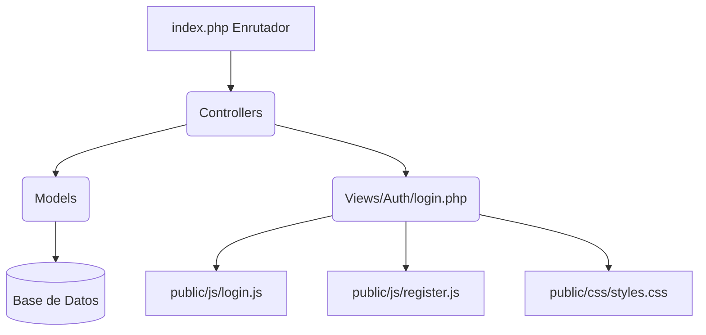

# Zooki - Sistema de Gestión Veterinaria Inteligente

Zooki es un sistema web moderno, robusto y eficiente diseñado para la gestión integral de clínicas veterinarias. Facilita la administración de pacientes (mascotas), historias clínicas, citas, y ofrece autenticación nativa segura e inicio de sesión integrado mediante Google Identity Services.

## Historial de versiones

El historial completo de versiones (v1.0.0 → v2.1.0), la guía de la primera versión estable y el esquema de versionamiento (Zooki SemVer) se documentan aparte en **[documentacion/HistorialVersiones.md](documentacion/HistorialVersiones.md)** (pestaña «Historial de versiones» del portal), para no inflar esta sinopsis.
La versión preparada para publicar es **2.1.0**: añade el Inicio del administrador (HU-6.2) y cierra la suscripción con Wompi (HU-0.5). Requiere revisión, integración y despliegue del dueño; D8/D10 y las pruebas manuales de sandbox siguen pendientes antes de cobrar dinero real. Las otras HU de v2.1 no se incluyen.
El conocimiento está pendiente de validación veterinaria y es apoyo a la decisión, no diagnóstico automático.

Salvedad acordada para el cierre: el QR del portal en el correo de alta (RE-5.8.4) se entregará aparte; el correo conserva el enlace de acceso. El carnet QR de emergencia de la mascota sí está incluido en 2.0.0.

## Arquitectura del Sistema

El proyecto está construido bajo una arquitectura **MVC (Modelo-Vista-Controlador)** con PHP puro:



### Estructura de Directorios
*   `/config/`: Configuración global del sistema, conexión a base de datos y utilidades.
*   `/controllers/`: Controladores encargados del procesamiento de peticiones y lógica del sistema.
*   `/models/`: Modelos de base de datos que representan las tablas principales (usuarios, mascotas).
*   `/views/`: Vistas PHP estructuradas. Las vistas de autenticación están en `/views/auth/`.
*   `/helpers/`: Clases de apoyo enfocadas en la seguridad (`Security.php`, `Csrf.php`).
*   `/public/`: Único punto de acceso del cliente. Contiene:
    *   `css/styles.css`: Estilos unificados del sistema.
    *   `js/login.js`: Lógica de animación de flip, alertas, modales e integración de Google.
    *   `js/register.js`: Validación en tiempo real y flujo de registro.
    *   `img/`: Recursos gráficos e imágenes del collage del Bento Grid.

---
## Guía de Instalación y Configuración

### Requisitos del Sistema
*   Servidor web Apache o Nginx.
*   PHP 8.2 o superior (con extensiones `pdo_mysql`, `openssl` y `json` habilitadas).
*   Servidor MySQL/MariaDB.
*   Composer (para gestión de dependencias en caso de requerirse).

### Configuración Paso a Paso

1.  **Clonar el Proyecto:**
    ```bash
    git clone <url_de_tu_repositorio>
    ```

2.  **Configurar Variables de Entorno (.env):**
    Duplica el archivo `.env.example` en la raíz, renombralo como `.env` e ingresa tus credenciales de base de datos y tu ID de cliente de Google:
    ```env
    DB_HOST=localhost
    DB_NAME=zooki_db
    DB_USER=root
    DB_PASS=tu_contraseña

    # Google Identity Services API Client ID
    GOOGLE_CLIENT_ID=tu_client_id_de_google.apps.googleusercontent.com
    ```

3.  **Configuración de Servidor Local (Virtual Host):**
    Se recomienda configurar un Host Virtual que apunte al directorio `public/` del proyecto para el correcto funcionamiento de las rutas relativas.

4.  **Crear la Base de Datos (v2):**
    En una base **vacía** (por ejemplo, `zooki_db` recién creada con `utf8mb4`), importa en este orden `database/01_schema.sql` (el esquema) y `database/02_semilla.sql` (roles, planes y catálogos). Luego corre `php scripts/migrar.php`: aplica las migraciones que falten y vuelve a aplicar la semilla sin duplicar nada. La v2 no migra datos de la v1: sobre una base v1 el esquema falla y el migrador se niega a correr.

5.  **Crear el super-administrador:**
    `php scripts/crear_superadmin.php` pide por consola el correo, el nombre y la contraseña (sin mostrarla) y crea la cuenta de la plataforma. Se niega si el correo ya existe. Ninguna credencial queda en el código ni en el SQL. En producción: `docker exec -it zooki_web php scripts/crear_superadmin.php`.
## Migraciones de la base de datos

La base nace de dos archivos que no son migraciones: `database/01_schema.sql` (las 65 tablas del esquema actual) y `database/02_semilla.sql` (datos semilla). Las migraciones son los archivos `database/NN_nombre.sql` con número **03 o mayor**. **En el servidor se aplican solas:** al arrancar, el contenedor `web` ejecuta `docker/iniciar.sh`, que corre `scripts/migrar.php`, carga el conocimiento si la migración terminó bien y después inicia Apache. Como Dokploy reconstruye el contenedor en cada despliegue, basta con subir el archivo `.sql` nuevo junto con el código.

El carnet público requiere `CARNET_IP_SECRETO` como variable del entorno de PHP (XAMPP o Dokploy), con al menos 32 caracteres aleatorios. Se usa para el HMAC de IP y el comprobante de ubicación; no se publica ni se escribe su valor en el repositorio. La migración 11 crea el contador de accesos sin mascota ni token. Sin el secreto el acceso público falla de forma segura con 503; las demás funciones conservan su acceso habitual.

### Actualizar una instalación v2 existente a 2.1.0

La actualización desde 2.0.0 conserva la base y los archivos: **no se vuelve a importar 01/02 ni se reinician los volúmenes**.
El arranque aplica las migraciones 12 y 13 pendientes y la semilla idempotente; si se parte de una alfa anterior, también aplica sus migraciones pendientes.
Antes de integrar a `main`, el dueño comprueba ambos trabajos del CI (general y MySQL 8), realiza un respaldo legible de la base y de los archivos subidos y revisa el PR de la rama de release.
Si Dokploy sigue `main`, el merge puede iniciar el despliegue automáticamente.

Después del despliegue se revisan los logs completos de migración y conocimiento, `php scripts/migrar.php --revisar` dentro del contenedor y la versión **2.1.0** en el contenedor y en pantalla.
Apache también puede arrancar aunque falle una migración: que abra el sitio no acredita una actualización correcta.
Se conserva el Schedule existente de `scripts/vigilar_atenciones.php` cada cinco minutos, además de la tarea financiera descrita a continuación; no se duplican.
El carnet usa el correo configurado y exige `CARNET_IP_SECRETO` en el entorno de PHP antes de probar su acceso público.

### Suscripciones y Wompi en Docker/Dokploy y XAMPP

Las siete variables de `.env.example` se configuran por el dueño en el entorno de PHP/Dokploy, sin publicar sus valores:

| Variable | Uso |
|---|---|
| `WOMPI_ENTORNO` | `sandbox` o `produccion`, con base y despliegue separados. |
| `WOMPI_LLAVE_PUBLICA` | Llave del comercio para Widget; debe corresponder al entorno. |
| `WOMPI_LLAVE_PRIVADA` | Consultas y operaciones del servidor; nunca llega al navegador. |
| `WOMPI_SECRETO_EVENTOS` | Verificación del checksum del receptor. |
| `WOMPI_SECRETO_INTEGRIDAD` | Firma del servidor para cada transacción. |
| `WOMPI_COBROS_HABILITADOS` | Apagado salvo valor `1`; instalar y verificar inicialmente con `0`. |
| `WOMPI_AUTOMATICOS_HABILITADOS` | Apagado salvo valor `1`; habilitar después del botón y de aprobar el mandato mensual. |

Crear **un** Schedule de Dokploy cada cinco minutos, zona America/Bogota, comando `php /var/www/html/Zooki/scripts/gestionar_suscripciones.php`.
`scripts/zooki.cron` contiene la definición; el contenedor web no instala cron ni cobra al arrancar.
En Windows, Programador de tareas: programa `C:\xampp\php\php.exe`, argumento con ruta absoluta a `scripts\gestionar_suscripciones.php`, directorio inicial del proyecto, repetir cada cinco minutos y no iniciar otra instancia.
`--revisar` es de solo lectura; `--solo=vencimientos|avisos|conciliacion|cobros` restringe el trabajo.

Registrar en Wompi las URLs absolutas basadas en `APP_URL` de cada despliegue:

Sandbox aparte:

```text
https://TU-DESPLIEGUE-DE-PRUEBAS/index.php?action=wompi_eventos_test
```

Producción:

```text
https://TU-DESPLIEGUE-PRODUCTIVO/index.php?action=wompi_eventos_prod
```

Conservar la subcarpeta pública si la base la incluye, sin repetir `index.php` si ya estaba en `APP_URL`.
Los dominios anteriores son marcadores; el dueño configura sus URLs reales, llaves y comercio.
Las pruebas automáticas nunca contactan Wompi, ni siquiera sandbox.
Antes de dinero real deben resolverse D8 (comercio, métodos, aceptación/COF/3RI y revocación) y D10 (conservación financiera), y comprobar en sandbox los campos `contract_id`/`file_hash` de los JWT de aceptación.
Regularizar desde plataforma las clínicas profesionales legadas con motivo y fecha, sin inventar pagos ni congelarlas por una fecha supuesta.
La guía ordenada de activación está en `specs/M0-S-suscripcion-pagos.md`, §10.

Ante una incidencia, poner ambos interruptores de cobro en `0` y reiniciar el servicio con ese entorno.
Conservar llaves/secretos, receptor y Schedule: los eventos de pagos ya iniciados siguen verificándose y conciliándose.
Si el evento no llegó, el retorno con `id` recupera el pago por GET privado del servidor, solo para la clínica propia.
En plataforma, Pagos e incidencias → ID de transacción Wompi y motivo → Conciliar; no se elige clínica y no se crea un cargo.
El Schedule envía «Recibimos tu pago» por la outbox una vez por pago/administrador verificado, con medio mínimo y último día incluido.
La migración 14 amplía esa outbox sin modificar las migraciones publicadas.
No repetir un POST incierto, borrar el inbox ni restaurar una instantánea antigua sin conciliar cargos ocurridos después.

El Grafo I vive versionado en `database/conocimiento/`, con fuentes por elemento y validación veterinaria pendiente.
En XAMPP, después de `php scripts/migrar.php`, ejecutar `php scripts/cargar_conocimiento.php`; con `--revisar` se valida y se muestran cambios sin escribir.
La carga conserva IDs, retira lógicamente y no duplica al repetir el mismo conjunto.

*   **Volumen nuevo:** cuando el volumen `db_data` está vacío, MySQL ejecuta en orden alfabético los `.sql` del primer nivel de `database/` (`01`, `02` y las migraciones). Las subcarpetas no se recorren: por eso el modelo de drawDB vive en `database/modelo/`.
*   **Registro:** cada migración aplicada queda en la tabla `schema_migraciones`, así que ninguna se repite.
*   **Semilla:** el migrador aplica `02_semilla.sql` en cada arranque, después de las migraciones. Solo inserta lo que falta (`INSERT IGNORE` con claves explícitas e índices únicos) y nunca sobrescribe: un precio o un nombre cambiados desde la plataforma se conservan.
*   **Base v1:** si la base no tiene la tabla `clinicas` o la columna `usuarios.id_usuario`, el migrador se niega con un mensaje claro. Hay que respaldarla y crear la base de nuevo.
*   **Si una falla:** se detiene ahí, no la anota (se reintenta en el siguiente arranque) y Apache arranca igual para no tumbar el sitio. El error aparece en los logs del contenedor en Dokploy con el prefijo `[migraciones] ERROR`.
*   **En local:** `php scripts/migrar.php` aplica las que falten y la semilla; con `--revisar` solo muestra qué aplicaría.
*   **Al escribir una migración nueva:** usa el número siguiente y hazla repetible (consulta `information_schema` antes de crear una columna o un índice, y revisa si la fila existe antes de insertarla), porque en una instalación nueva la corre MySQL al crear la base y luego el migrador. Si agrega filas a un catálogo global, van en `02_semilla.sql` con su id explícito.
*   **CI:** GitHub Actions carga `01_schema.sql` y `02_semilla.sql` en un MySQL 8 vacío, corre el migrador dos veces, comprueba los conteos de la semilla y crea la base desde un volumen vacío como lo hace `docker-compose.yml`.
## Modelo de Base de Datos

Zooki v2 es una plataforma **multi-inquilino**: cada clínica es un inquilino (`id_clinica`) y toda consulta de negocio se filtra por la clínica del contexto activo. El modelo completo está en [documentacion/MER.md](documentacion/MER.md); el ejecutable, en `database/01_schema.sql`. Las tablas se agrupan así:

*   **Plataforma:** `planes`, `clinicas`, `suscripciones` y `plantillas_comunicacion`.
*   **Identidad y acceso:** `usuarios` (una identidad por persona, con clave `id_usuario`; el documento y el correo son únicos pero corregibles), `roles` (`administrador`, `veterinario`, `propietario` y `super-administrador`), `usuario_clinica` (rol de personal en cada clínica), `propietario_clinica`, `consentimientos_datos`, `password_resets`, `verificaciones_email`, `intentos_login` y `casos_soporte`.
*   **Pacientes:** `mascotas` (ficha global con carnet QR), `mascota_clinica` (vínculo y número de historia por clínica), `mascota_colores`, `alertas_medicas`, `carnet_escaneos` e `ingresos_emergencia`; catálogos globales `especies`, `razas` y `colores_base`.
*   **Agenda:** `tipos_cita`, `horarios_clinica`, `horarios_veterinario`, `propuestas_horario`, `ausencias_veterinario`, `citas` (con triage de 4 niveles y protección contra doble reserva), `cita_sintomas` y `reasignaciones`.
*   **Historia clínica:** `consultas`, `consulta_sintomas`, `tratamientos` y `archivos_clinicos`.
*   **Prevención:** `vacunas` y `desparasitaciones`; catálogos por clínica `vacunas_base`, `especie_vacunas`, `laboratorios_base` y `productos_desparasitacion_base`.
*   **Grafo clínico (global):** `grafo_nodos` y `grafo_aristas`.
*   **Reputación:** `especialidades`, `veterinario_perfil`, `veterinario_especialidades` y `resenas_veterinario`.
*   **Comunicaciones y auditoría:** `notificaciones`, `notificaciones_internas`, `auditoria_mascotas` y `auditoria_sistema`.

---
## Principios de Diseño (SOLID)

El diseño arquitectónico de Zooki cubre de forma parcial los principios **SOLID** para asegurar un código mantenible a medida que el sistema escala, adaptándolos pragmáticamente a un entorno PHP nativo rápido:

*   **Responsabilidad Única (SRP):** Aplicado parcialmente mediante helpers de seguridad (`Csrf.php`, `Security.php`) y enrutadores dedicados que aíslan la lógica de autenticación de la presentación visual.
*   **Abierto/Cerrado (OCP):** Modularidad en el enrutamiento centralizado que permite agregar nuevas rutas de controladores sin modificar la estructura del despachador inicial.
*   *Nota:* Para mantener la ligereza y rapidez en las operaciones CRUD, ciertos flujos de bases de datos y controladores acoplan directamente lógica para evitar sobrecarga de abstracciones innecesarias.


## Pruebas automáticas y registro público (D3)

`tests/bootstrap.php` impide que PHPUnit abra implícitamente la base de la aplicación, antes de leer `.env`, y deja el almacén de intentos sin conexión por defecto. Las pruebas inyectan SQLite en memoria; `BaseV2MysqlTest` usa exclusivamente `zooki_test_base_v2` y borra esa base en cada prueba. No se debe apuntar a una base de trabajo. Los subprocesos PHP heredan la guarda mediante `ZOOKI_ENTORNO_PRUEBAS`.

```powershell
vendor/bin/phpunit
node --test "tests/Frontend/**/*.test.cjs"
```

Para habilitar la suite contra una instancia de MySQL/MariaDB propia de pruebas, define `ZOOKI_TEST_MYSQL_HOST` y, si corresponde, `ZOOKI_TEST_MYSQL_PORT`, `ZOOKI_TEST_MYSQL_USER` y `ZOOKI_TEST_MYSQL_PASS`. Deja `ZOOKI_TEST_MYSQL_DB` sin definir: la base predeterminada es `zooki_test_base_v2`. La guarda rechaza otra base y `Database` solo admite la configuración de pruebas explícita; no reutiliza las credenciales de la aplicación.

El registro de clínicas y el autorregistro de propietarios verifican Turnstile en el servidor. Las claves de prueba de `.env.example` siempre aprueban; se sustituyen por las de Cloudflare en producción. La lista mantenida de correos desechables está en `config/dominios_desechables.txt`, un dominio por línea. La tarea horaria existente `scripts/limpiar_cuentas_pendientes.php` limpia altas vencidas de personal y clínicas; no elimina identidades preexistentes al registrar una clínica.
