# Modelos y diagramas — Zooki v2.1

> **Cierre M0-S — 2026-10-25:** versión 2.1.0 preparada para revisión e integración; HU-0.5 implementada, 96 HU, 464 RE, 126 RN y 65 tablas. Migraciones 12/13, Inicio del administrador (HU-6.2) y panel financiero de plataforma. D8/D10 pendientes antes de dinero real.


> **Actualización de cierre M2 — 16/10/2026:** 2.0.0-alpha.4; conocimiento global con fuentes y validación veterinaria pendiente. Esquema de 52 tablas; integración del triage con agenda y urgencias pendiente de M4.

> **Preparación M4/B2 — 2026-10-18:** diagramas de destino B1/B1.1 sin cambios de flujo; la rama prepara 58 tablas mediante 01/08, sin implementar C ni desplegar. Producción alpha.4 conserva 52; no se sube revisión ni versión.

Este documento reúne los modelos de la Fase 2: el modelo conceptual de los dos grafos (soporte a la decisión clínica y agendamiento inteligente), los diagramas de proceso de negocio (BPMN) y los flujos del sistema. Complementa al [ERS](ERS.md) y al [MER](MER.md), y se renderiza en el portal mediante Mermaid.

> **Cómo verlos:** cada diagrama tiene arriba un visor con zoom, desplazamiento y pantalla completa (ajusta al ancho y al alto de la pantalla). El botón **draw.io** descarga o abre la versión con estilo (archivo con todas las hojas). Estos diagramas son la versión **detallada**: incluyen las validaciones, las ramas de error, el triage de 4 niveles, la cobertura de ausencias y el propietario multi-clínica. El detalle normativo (reglas de negocio, requisitos, diccionario de datos) vive en el ERS, el MER y las [Reglas de Negocio](ReglasNegocio.md).

**Convención de formas:** rombo `{ }` = pregunta/decisión · rectángulo `[ ]` = acción · `[/ /]` = mensaje al usuario · `[[ ]]` = subproceso · `{{ }}` = evento · `([ ])` = inicio/fin.

---

## Arquitectura — Diagrama de componentes

Vista de componentes de la plataforma v2.0 (SaaS multi-inquilino, tres capas). El cliente entra siempre por el **front controller**, que resuelve el inquilino y pasa por **Security** (rol + CSRF + `id_clinica`) antes de llegar a los controladores. La lógica de dominio incluye los dos motores de grafos, que se recorren **en memoria**: el Grafo I se guarda en tablas y se carga para recorrerlo; el Grafo II se arma en cada cálculo con los datos de la agenda. Los datos viven en MySQL con las filas **aisladas por `id_clinica`**, y las tareas programadas (cron) alimentan recordatorios, vencimiento de suscripciones, el vigilante de atenciones, el vencimiento de las reasignaciones sin confirmar y los respaldos.

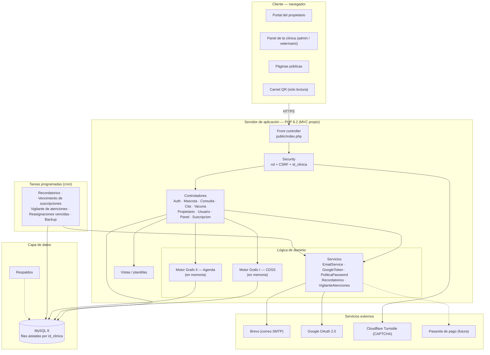

---

## 1. Grafo I — Conocimiento clínico (grafo con signo)

El conocimiento clínico es un grafo dirigido, ponderado y con signo, global para la plataforma.
Nodos y aristas tienen código estable, fuentes, estado de validación, activo y versión SHA-256 del conjunto.
Los tipos incluyen síntomas, diagnósticos, fármacos, especies, razas, condiciones y sustancias.
El signo no basta para vetar: una toxicidad documentada o alergia bloquea; una interacción advierte y exige decisión del veterinario.
Los pesos son afinidad de apoyo, no probabilidades ni prescripciones automáticas.

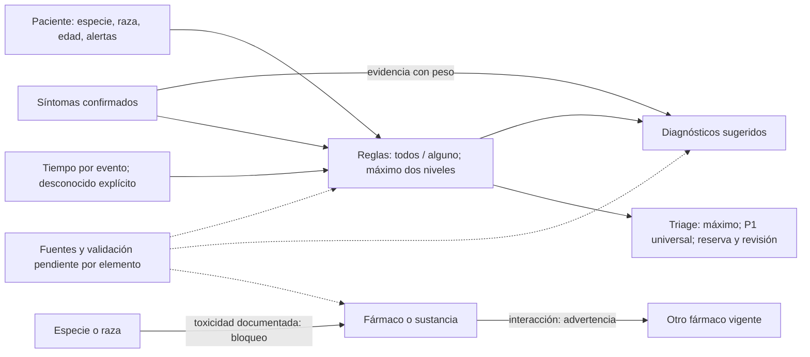

`grafo_nodos` y `grafo_aristas` conservan conceptos y relaciones; `grafo_reglas` expresa combinaciones, atributos y ventanas temporales que una arista binaria no representa.
`grafo_sinonimos` ayuda a buscar; no interpreta notas ni marca opciones automáticamente.
Los nodos taxonómicos enlazan por FK a especie o raza; los atributos de tamaño y cobertura pertenecen al conocimiento, no a nuevas columnas de taxonomía.
Se carga desde archivos completos con candado/transacción y retiro lógico, conservando IDs y referencias clínicas.
B1 entrega el esquema y el cargador con archivos vacíos; B2 aporta el conocimiento y C2–C4 implementan los motores.
No se declara validación clínica por superar pruebas de software.

---

## 2. Grafo II — Agendamiento inteligente

La agenda se modela como un grafo cuyos nodos son las citas del día por veterinario, con tres tipos de arista: **secuencia** (una cita depende del fin real de la anterior), **conflicto** (dos citas que chocan en horario y veterinario) y **emparejamiento** (asignación cita–veterinario, que permite reasignar). El grafo no se guarda: se construye en tiempo real desde `citas`, `tipos_cita`, los veterinarios (`usuarios`), `horarios_clinica`, `horarios_veterinario` y `ausencias_veterinario`. Se conservan solo hechos/estados recuperables: solicitudes y revisiones previas, bloques/cupos, espera presencial, pausas, operaciones y eventos de aviso, además de reasignaciones/propuestas; el destino de datos aún no está instalado. Las aristas se reconstruyen en memoria; ver el [MER](MER.md#6-operación-clínica).

**Implementación C5:** `GrafoAgenda` arma en memoria secuencia por veterinario/fecha, conflictos de intervalos y emparejamientos compatibles. `CascadaAgenda` relee bajo clínica → usuarios → mascotas; `DisponibilidadAgenda` conserva la única resta de apertura, jornada, cierres, ausencias aprobadas y ocupación global mínima. Las propuestas no apartan capacidad y no son cobertura de ausencia.

El ejemplo muestra el **efecto cascada**: la cirugía de las 09:30 se extiende y el retraso se propaga por la cola del veterinario A; el sistema detecta un espacio libre en el veterinario B y **propone reasignarle** la última cita para absorberlo.

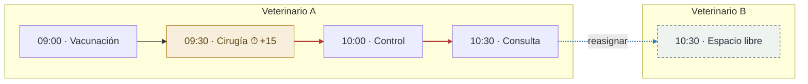

**Lectura:** las aristas rojas son la propagación del retraso; la azul punteada es la reasignación que propone el Grafo II y que el veterinario B debe confirmar (RN-428). Sobre este grafo actúa además la **prioridad (triage)** de 4 niveles que calcula el Grafo I: una cita urgente pesa más y puede tomar el próximo espacio (o un sobrecupo) antes que una ordinaria.

---

## 3. Proceso de negocio — Consulta clínica (con Grafo I)

**Precisión B1.1:** al regularizar identidad, solicitud y cita resuelven la misma mascota vigente; el contexto anterior conserva su identidad evaluada y no autoriza comandos sobre otra ficha/contexto.
Continuar/guardar relee paciente, titularidad, vínculos, datos clínicos permitidos y versiones bajo el contrato común; el veterinario revalida el comando actual sin recalcular actos pasados.
Un formulario o acuse idempotente anterior no sustituye esa validación; una atención completada no se reabre ni el propietario obtiene HU-4.17.

Actores: Veterinario. Entrada desde una cita del calendario o sin reserva vía Atención/Urgencias; toda nueva atención crea/enlaza antes su cita de llegada, conservando origen. Si la alerta roja se originó en el portal autenticado, ya están identificados el propietario de la sesión y la mascota que seleccionó; la verificación rápida y la ficha provisional corresponden solo a una llegada presencial sin identidad comprobada. El sistema apoya en cada paso; la decisión final es siempre del veterinario.

```mermaid
flowchart TD
  A([Veterinario va a atender]) --> B{Como atiende?}

  B -- Desde una cita (calendario) --> C{"Puede iniciar? Es el vet asignado, es el dia de la cita, faltan 15 min o menos e identidad/version son vigentes (RN-407)"}
  C -- No --> C1[/"Mensaje: no puede iniciar esta atencion"/]
  C1 --> ZF([Fin])
  C -- Si --> D[Iniciar atencion y sellar hora_inicio_real]
  D --> CTX

  B -- "Sin reserva / urgencia" --> PR{"Presencia fisica acreditada?"}
  PR -- "No: rojo remoto" --> DER[/"Avisar y derivar; no iniciar, pausar ni crear reserva ordinaria"/]
  DER --> ZF
  PR -- Si --> F{"Ficha y titularidad verificadas con mecanismos vigentes?"}
  F -- Si --> F1["Reutilizar ficha/cuenta y vinculo legitimo"]
  F -- No --> RO{Rojo presencial?}
  RO -- No --> ID[/"Completar identificacion ordinaria antes de atender"/]
  ID --> ZF
  RO -- Si --> G["Ficha provisional e ingreso de clinica; contacto opcional, sin documento por defecto"]
  G --> G1["Sin atribuir propiedad, crear cuenta ni activar carnet"]
  F1 --> LG
  G1 --> LG[["Llegada y capacidad: agenda o urgencias (§4/§6)"]]
  LG --> CA{"Cita de llegada asignada e iniciada por veterinario?"}
  CA -- No --> ESP[/"Espera o alternativas; sin consulta huerfana"/]
  ESP --> ZF
  CA -- Si --> CTX

  CTX["Contexto disponible del paciente: especie, raza, edad, alergias y alertas a la vista, historia<br/>(consultas de otras clinicas solo si el propietario lo autorizo, RN-113);<br/>los datos desconocidos de una ficha provisional no se inventan"] --> H["Form Consulta: motivo, anamnesis,<br/>examen fisico (peso o No se pudo pesar: NULL, nunca 0)<br/>y sintomas confirmados del catalogo; nota libre fuera del calculo"]
  H --> I{Captura inicial y rangos validos?}
  I -- No --> I1[/"Mensaje: corrige los campos marcados"/]
  I1 --> H
  I -- Si --> J["Grafo I: ranking por peso y cobertura al cambiar los sintomas;<br/>maximo 5 candidatos positivos, sin porcentajes ni elegir por el vet;<br/>datos que ayudarian con nombre legible y campos opcionales"]
  J --> K{El grafo encontro coincidencias?}
  K -- No --> L[El veterinario escribe el diagnostico]
  K -- Si --> M[Mostrar diagnosticos probables rankeados]
  M -- Escribe el suyo --> L
  M -- Usar este diagnostico --> MU["Copiar el texto al campo para que el vet lo edite;<br/>nunca se rellena solo"]
  MU --> L
  L --> N{"Diagnostico registrado? (RN-202)"}
  N -- No --> N1[/"Mensaje: el diagnostico es obligatorio"/]
  N1 --> L
  N -- Si --> P["El veterinario define el tratamiento: farmaco del catalogo<br/>o nombre libre (evaluacion incompleta, nunca sin interacciones);<br/>dosis, via, duracion, inicio, fin (calculado si es inequivoco) y observaciones"]
  P --> Q{"Alergia registrada del paciente o toxicidad de especie/raza<br/>con efecto bloqueo? (RN-211)"}
  Q -- Si --> Q1[/"Mensaje de bloqueo: elige otro farmaco"/]
  Q1 --> P
  Q -- No --> R{"Advertencia por toxicidad, regla o interaccion<br/>con medicacion vigente u otra fila nueva?"}
  R -- Si --> RP{Aviso de medicacion protegida segun RN-113?}
  RP -- No --> R1[Advertencia visible y decision auditada]
  RP -- Si --> RG["Aviso generico sin farmaco, dosis ni contenido protegido"]
  RG --> RC["Conciliar con el propietario o verificar autorizacion antes de confirmar"]
  RC --> R1
  R -- No --> U{Agregar otro tratamiento?}
  R1 --> RD{Confirmar o cambiar?}
  RD -- Cambiar --> P
  RD -- Confirmar con huella vigente y requisitos cumplidos --> U
  U -- Si --> P
  U -- No --> AL{"Detecto una alergia o alerta nueva?"}
  AL -- Si --> AL1["Registrarla en las alertas de la mascota, con nodo del Grafo I si existe<br/>(visible para toda clinica vinculada y en el carnet;<br/>solo la clinica que la registro la desactiva y queda en el historial)"]
  AL1 --> V
  AL -- No --> V{Adjuntar archivos?}
  V -- Si --> W{"Tipo y tamaño validos? (JPG/PNG/PDF, max 10MB, RN-204)"}
  W -- No --> W1[/"Mensaje: archivo no permitido o demasiado grande"/]
  W1 --> V
  W -- Si --> X[Confirmar y guardar]
  V -- No --> X
  X --> IV["Coordinador: clinica, usuarios y mascotas; resolver identidad actual y HC sin GET_LOCK"]
  IV --> IA{"Acceso actual al paciente/recurso en este contexto?"}
  IA -- No --> IAN[/"403 sin datos ni redireccion a la ficha final"/]
  IAN --> ZF
  IA -- Si --> IG{"Identidad/contexto/version vigentes para esta orden?"}
  IG -- No --> OBS[/"Contexto desactualizado; recargar con permiso actual, sin escribir"/]
  OBS --> CTX
  IG -- Si --> RV["Releer permisos, alergias, medicacion, version y sintomas activos;<br/>revalidar prescripcion en servidor y huella por fila"]
  RV --> RS{"Sintoma retirado o invalido? (RN-210)"}
  RS -- "Si: 422 junto al campo, nada escrito" --> I1
  RS -- No --> RB{Bloqueo o advertencia no resuelta?}
  RB -- Si --> P
  RB -- No --> Y[["Guardado atomico: consulta + sintomas + tratamientos + archivos<br/>y decisiones de prescripcion auditadas;<br/>N de historia si es la 1a (RN-102);<br/>completar su cita asociada y marcar version para cascada tras commit (RN-406); sin crear consultas nuevas huerfanas"]]
  Y --> Y1{Guardado correcto?}
  Y1 -- No --> Y2[/"Mensaje: error al guardar, reintentar"/]
  Y2 --> X
  Y1 -- Si --> Z1[Registrar en auditoria]
  Z1 --> Z2{Fue registro rapido de emergencia?}
  Z2 -- Si --> Z3[Dejar tarea pendiente: completar la ficha del paciente]
  Z2 -- No --> ZF
  Z3 --> ZF
```

---

## 4. Proceso de negocio — Agendamiento y llegada sin reserva

Solo propietario y veterinario crean citas; el administrador conserva gestión administrativa autorizada, sin crear ni atender.
La misma disponibilidad de servidor valida sugerencias, reserva y cambios: clínica ∩ veterinario, menos cierres, ausencias efectivas y ocupación, por duración+margen, en intervalos [inicio,fin).
No se promete atención ni se pausa por un cálculo rojo remoto.
Las solicitudes no urgentes en espera se ordenan amarillo antes de verde y, dentro de cada color, llegada física/id_solicitud ascendentes; al asignar se revalida capacidad completa, sin sobrecupo.

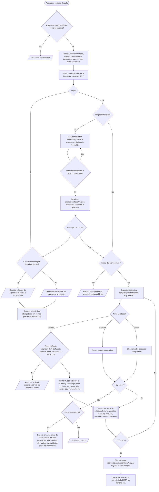

---

## 5. Proceso de negocio — Cascada con política temporal M

s es inicio pactado; r/f son primer inicio real y fin real; D es servicio activo decidido, no recortado por el algoritmo; P suma pausas cerradas.
Antes de iniciar: e=máximo(s, extremo del predecesor, ahora), N=e+D.
En atención/reanudada: N=r+D+P; A(t)=tiempo transcurrido menos pausas; R=máximo(0,D−A); F=máximo(N,t+R).
Completada: F=f y el reloj posterior no cambia el resultado.
Extremo de ocupación L=máximo(N+margen único,F); si F supera N+margen se propaga el exceso, sin descontar ni sumar margen otra vez.
Pausa abierta: u es reanudación prevista condicional, N_u=r+D+P+(u−inicio de pausa); F_u=máximo(N_u,u+R_al_pausar). Sin u sustentada solo se informa una cota, nunca libera al veterinario.
Inicio 09:00/D=30, pausa 09:10–09:30/margen10: N=09:50/L=10:00; dos pausas 10+15: N=09:55/L=10:05.
Se preservan pactadas, segmentos y sellos; repetición de hechos/reloj no acumula delta.

El vigilante programado procesa atención abierta, propuestas vencidas y marcas `pendiente_calculo` sin depender del calendario.
El inicio y cierre sellan hechos y disparan el mismo procesador; la consulta confirma su acto y marca de cálculo juntos, y procesa después del commit.
La proyección idéntica no incrementa versión ni vuelve a auditar; un cambio de hechos invalida propuestas anteriores.
Una pausa sin reanudación sustentada o un legado no demostrable queda en revisión, sin estimar una liberación.
Aceptar conserva pactadas, sellos y snapshots; solo cambia veterinario, bloque naranja cuando corresponda y estimaciones aceptadas.
La última hora comunicada y la ventana RN-429 se actualizan al confirmar entrega; un pendiente se coalesce, y un reclamado/incierto no se reenvía automáticamente.

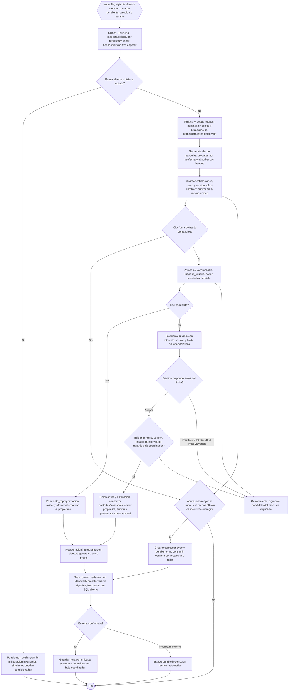

---

## 6. Proceso de negocio — Derivación roja, llegada y conciliación

El aviso rojo remoto es inmediato y sin cuota/mora, pero no acredita presencia física ni permite pausar pacientes presentes.
Solo administrador y veterinario autorizado de la clínica completan/consolidan identidad tras verificar titularidad con sesión, cuenta y vínculos legítimos vigentes; conocer un ID o ser acompañante no acredita propiedad.
No se inventa documento, reto o plazo adicional; sin prueba suficiente la ficha sigue provisional.
La acción administrativa no registra/modifica consultas ni crea citas; la creación clínica de llegada corresponde al veterinario.
Se conservan las cuatro ramas de identidad de RE-4.15.3 y el rollback de todas las referencias.
Completar P→P o consolidar P→F actualiza todas las solicitudes activas/terminales y citas afectadas al paciente vigente, con sus IDs estables; ingreso y evaluación conservan procedencia original.
Activas incrementan versión y requieren revisión vigente para órdenes nuevas; finalizadas/retiradas conservan episodio y revisión históricos sin reabrirlos.
La regularización no recalcula colores/actos pasados ni concede al admin facultades clínicas.
Eventos y respuestas idempotentes se reconstruyen solo con acceso, contexto e identidad actuales; envío reclamado/incierto sin resolver impide confirmar la conciliación, sin bloquear atención roja ni mantener SQL durante SMTP.
Este flujo también aplica si se regulariza mientras una solicitud sigue activa; no exige que la urgencia haya finalizado.

```mermaid
flowchart TD
  REG([Regularizar identidad de un ingreso existente, incluso con solicitud activa]) --> VER
  A([Rojo remoto o ingreso presencial]) --> B["Caso y aviso idempotentes con prioridad maxima, sin cuota ni mora"]
  B --> F{Presencia fisica acreditada?}
  F -- No --> REM[/"Derivar; si cerrada, telefono y servicio 24h; no pausar/iniciar"/]
  F -- Si --> ID{Identidad y titularidad verificadas?}
  ID -- Si --> EX["Reutilizar ficha y cuenta; portal conserva identidad sin nueva verificacion"]
  ID -- No --> PRO["Ficha provisional + ingreso; propietario NULL/carnet inactivo; sin cuenta nueva"]
  PRO --> CT["Nombre/telefono opcionales; sin documento por defecto ni atribucion de propiedad"]
  EX --> ORD
  CT --> ORD["Cola de rojos presentes por llegada fisica/ID; cambio vet con motivo/auditoria"]
  ORD --> NRO{"Otro rojo y atencion ya pausada?"}
  NRO -- Si --> DEC{Decision del veterinario?}
  NRO -- No --> CAP
  DEC -- "Atender nuevo rojo" --> CAP{Vet libre?}
  DEC -- "Seguir atencion anterior" --> ESP2["Nuevo rojo espera; continuar/reanudar segun decision"]
  ESP2 --> REE{{Liberacion o reevaluacion clinica}}
  REE --> CAP
  CAP -- Si --> CITA
  CAP -- No --> PA{Tipo pausable y sin otra pausa abierta del vet?}
  PA -- Si --> SEG["Pausar con segmento real; conservar inicio y activo restante"]
  PA -- No --> ESP["Espera durable sin vet asignado; primero compatible que se libere"]
  ESP --> CAP
  SEG --> CITA["Veterinario crea/enlaza cita de llegada e inicia cuando atiende realmente"]
  CITA --> CON[["Consulta atomica (§3); releer revision/ficha vigente; cerrar rojo y reanudar pausa en la misma unidad"]]
  CON --> CAS[["Cascada M (§5), no regenerar margen"]]
  CAS --> PEND{Ficha provisional?}
  PEND -- Si --> VER["Admin o vet verifica titularidad por mecanismos vigentes"]
  VER --> OK{Acreditada?}
  OK -- No --> TAR["Mantener tarea/estado provisional; sin fusion ni carnet"]
  OK -- Si --> BLO["Transaccion y candados comunes; releer S activas/terminales, C, I, actos, HC y eventos"]
  BLO --> ENV{"Envio afectado reclamado o incierto sin resolver?"}
  ENV -- Si --> CE[/"Conflicto sin traslado; resolver envio antes de reintentar conciliacion"/]
  CE --> TAR
  ENV -- No --> UN["Completar P o consolidar en F; S y C al mismo paciente vigente; IDs estables"]
  UN --> VERS["Incrementar versiones; activas pendientes sin huella vigente; terminales conservan revision historica"]
  VERS --> EVE["Conservar contexto/identidad evaluada; revalidar eventos pendientes y respuestas por referencias"]
  EVE --> UNI{"Referencias coherentes y unidad completa?"}
  UNI -- No --> ROL["Rollback de citas/actos/S/I/HC/versiones/revision/eventos/operacion"]
  ROL --> TAR
  UNI -- Si --> AUD["Commit con mapa y auditoria; sin copiar contacto ni recalcular decisiones pasadas"]
  PEND -- No --> NEC
  AUD --> NEC{Termino necesidad de contacto de atencion/identidad?}
  NEC -- No --> MOT["Conservar solo necesario con motivo; sin plazo inventado"]
  NEC -- Si --> EXT{Conservacion excepcional justificada?}
  EXT -- Si --> MOT
  EXT -- No --> LIM["Contacto a NULL, fecha/autor; conservar ingreso y actos; limpiar copias operativas"]
```

---

## 7. Proceso de negocio — Configurar horario del veterinario

Actores: Administrador de la clínica. Define el horario **recurrente** por día de la semana en su clínica (el veterinario solo propone cambios, §13.4); esto reemplaza el supuesto de que todos los veterinarios atienden 24/7. Si al cambiar el horario quedan citas por fuera, se marcan para reajuste (§5).

La coordinación C2 de este guardado, las propuestas y los cierres puntuales se detalla en §16. Las marcas conservan las horas hasta el procesamiento C5.

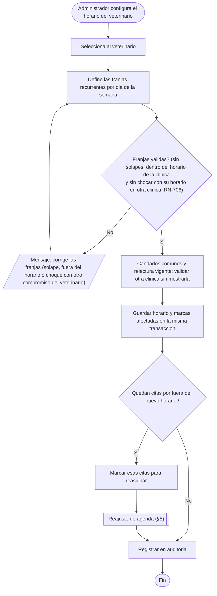

---

## 8. Proceso de negocio — Ausencia y cobertura del veterinario

Actores: Veterinario titular (solicita), Administrador (aprueba o registra directamente) y Veterinario de cobertura (destino). Una ausencia es la excepción por fecha que tapa la disponibilidad recurrente. El "intercambio de turnos" no es una entidad nueva: es **ausencia del titular + cobertura del reemplazo** (reasignación de sus citas). La trazabilidad de quién atendió de verdad la da la historia clínica (RN-208), no la agenda.

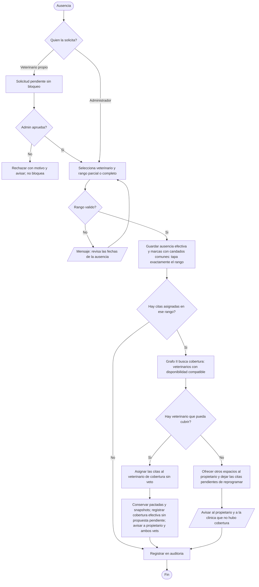

---

## 9. Flujo del sistema — Acceso y aislamiento por clínica (multi-inquilino)

Cómo el sistema resuelve el contexto (una persona puede tener varios roles: propietario y personal en una o varias clínicas) y confina cada sesión a la clínica de ese contexto. El aislamiento por `id_clinica` es transversal: no depende de la buena voluntad de cada consulta, sino que se centraliza en `helpers/Security.php` y en la capa de modelos, y se cubre con pruebas (RNF-11).

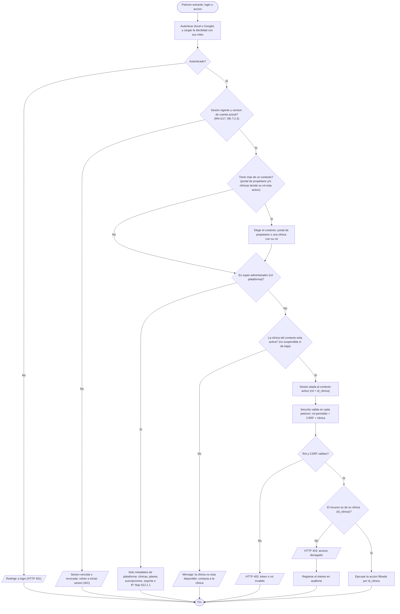

---

## 10. Flujo del sistema — Login del propietario (multi-clínica)

El propietario entra con su documento o correo y su contraseña, o con Google. Antes de llegar a su portal, el sistema revisa tres cosas: que la cuenta esté verificada, que el perfil esté completo (las cuentas de Google lo completan una vez, §13.1) y que haya aceptado la versión vigente de la política de datos. Una vez adentro ve **todas** sus mascotas y su historia; al agendar, cancelar o calificar elige **solo entre las clínicas a las que está vinculado** ([HU-5.9](HistoriasUsuario.md#hu-59--iniciar-sesión-en-el-portal-multi-clínica), [HU-T.18](HistoriasUsuario.md#hu-t18--registrarme-e-iniciar-sesión-con-google-propietario)). Si la persona tiene además roles de personal, elige el contexto como en el §9.

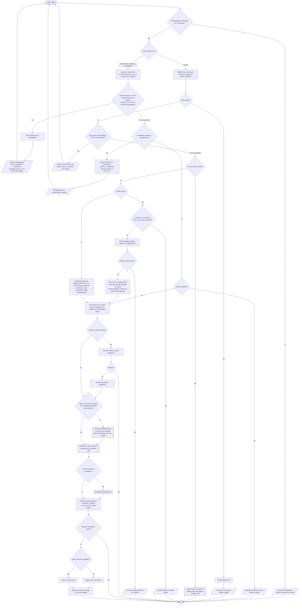


### 10.1 Alta de personal: activación o invitación a una clínica

HU-T.7, RE-T.7.4/5, RE-T.19.1, RN-705 y RN-G06. El administrador solo conoce los datos que escribe y los que su clínica ya puede ver. Si correo y documento identifican cuentas distintas, prevalece el correo; si solo el documento existe, se usa el correo registrado de su titular. No se muestran los datos de una cuenta existente hasta que acepte. La persona conserva los otros roles y elige contexto al entrar (§9).

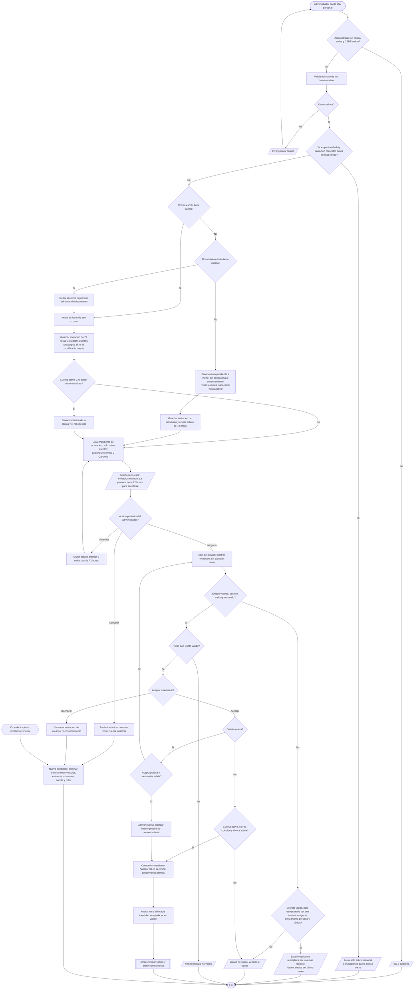

Un enlace auténtico de una invitación que el administrador reenvió (la anterior quedó anulada y la nueva sigue vigente) dice que hay una más reciente; con un secreto que no coincide, vencido o ya aceptado, el mensaje es el genérico y no se revela nada (F0). Si falla el transporte de correo se informa que la invitación quedó registrada y se ofrece reenviarla, igual para ambos caminos. La auditoría de la clínica registra la invitación con el mismo texto en ambos casos; la creación o supresión de una identidad pendiente es un hecho global. Reenviar y cancelar se filtran por la clínica activa; una petición ajena da 403 y auditoría.


---

## 11. Flujo del sistema — Registro del propietario (multi-clínica)

Tres caminos de registro, siempre en el contexto de una clínica: **alta por el personal**, **enlace o QR de la clínica** y **autoregistro directo** eligiendo la clínica de la lista. En los dos últimos el propietario puede usar el formulario o **Google**; el alta por el personal no usa Google. Todo registro exige aceptar la política de tratamiento de datos ([RN-G19](ReglasNegocio.md#módulo-t--acceso-seguridad-y-administración-reglas-transversales)). En el alta por el personal no hay aceptación presencial (decisión del usuario, M5 C3): la cuenta queda pendiente y el titular acepta la política y crea su contraseña desde un enlace de 72 horas, como la activación del personal (§10.1). Si el correo ya existe, no se duplica la identidad: se **liga** la cuenta existente a la nueva clínica, previa verificación de que es el dueño del correo ([RN-109](ReglasNegocio.md#módulo-1--mascotas-y-propietarios), [RN-G20](ReglasNegocio.md#módulo-t--acceso-seguridad-y-administración-reglas-transversales)).

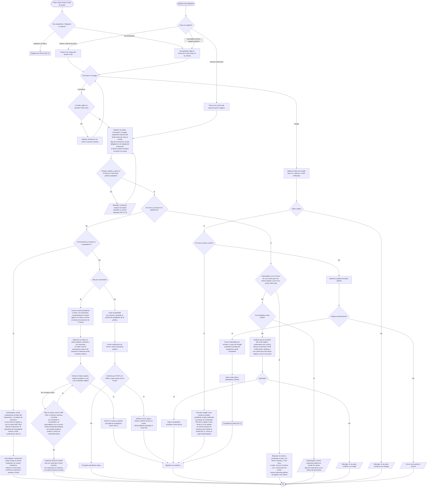

### 11.1 Vínculos del propietario: vincularse, desvincularse y autorizar la historia

Desde «Mis clínicas» del portal, el propietario decide a qué clínicas está vinculado y cuáles ven la historia que registraron las demás ([HU-5.13](HistoriasUsuario.md#hu-513--vincularme-o-desvincularme-de-una-clínica), [HU-5.12](HistoriasUsuario.md#hu-512--autorizar-a-una-clínica-a-ver-la-historia-de-otras-clínicas)). Las tres acciones son reversibles, así que se aplican sin confirmación y con un aviso breve. La autorización se lee de la base en cada petición de la clínica, nunca de su sesión: por eso revocar aplica de inmediato ([RN-113](ReglasNegocio.md#módulo-1--mascotas-y-propietarios), [RN-115](ReglasNegocio.md#módulo-1--mascotas-y-propietarios)).

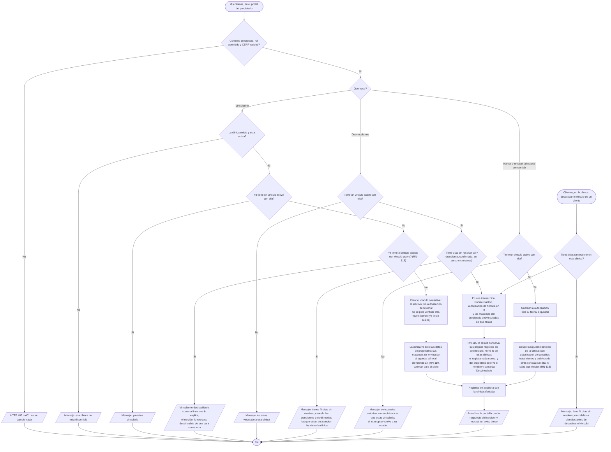

La clínica también puede desactivar el vínculo desde Clientes (entrada «Clientes» del diagrama): se rechaza con citas sin resolver en ella y, si procede, se aplica lo mismo que cuando se desvincula el propietario (decisiones del usuario en M5, C1.1). Sus mascotas quedan inactivas allí: la clínica solo lee lo suyo, no registra nada nuevo y no salen sus recordatorios. Deja de ver el documento, el correo y el teléfono del propietario (en su lista, en la ficha de la mascota y en las citas) y ya no edita sus datos. Para reactivarlo, le pide la confirmación por correo y el propietario la acepta (§12.3); sus mascotas vuelven a esa clínica cuando se agendan o se atienden allí (RN-110). Nunca se pide el vínculo de una cuenta de super-administrador (RN-G13): la clínica recibe la respuesta de siempre, pero no se crea la solicitud ni se envía el correo, y un enlace anterior tampoco la liga.

El tope de 3 clínicas ([RN-116](ReglasNegocio.md#módulo-1--mascotas-y-propietarios), decisión del usuario en M5 C3) cuenta las clínicas activas con vínculo activo, las mismas que muestra «Clínicas»; se cuenta bajo el bloqueo de la fila del propietario, para que dos clics a la vez no lo pasen. Solo aplica cuando el propietario se vincula él mismo desde el portal: el alta por una clínica, la confirmación de su solicitud de vínculo y el registro desde el enlace o QR de una clínica no se bloquean. Desvincularse libera el cupo.


---

## 12. Flujos de proceso por módulo

Detalle del funcionamiento de cada proceso de módulo. Cada flujo se corresponde con una o varias historias de usuario (Fase 3), donde se detalla el comportamiento con sus criterios de aceptación.

### 12.1 Registro de clínica (self-service) — Módulo 0

```mermaid
flowchart TD
  A([Registro publico de clinica]) --> P1["Paso 1, datos de la clinica:<br/>NIT o cedula: sin guion calcula DV;<br/>con guion comprueba el DV escrito"]
  P1 --> P1V{"Campos del paso validos?"}
  P1V -- No --> P1
  P1V -- Si --> P2["Paso 2, administrador: nombre, tipo y documento,<br/>telefono, correo y contraseña"]
  P2 -. Atras sin perder lo escrito .-> P1
  P2 --> P2V{"Campos del paso validos?"}
  P2V -- No --> P2
  P2V -- Si --> B["Paso 3: aceptar politica y Registrar clinica; sin Google<br/>(sin JavaScript se ven los tres pasos y se envia todo junto)"]
  B -. Atras sin perder lo escrito .-> P2
  B --> C{"CAPTCHA valido en servidor?"}
  P1 -. NIT valido al escribir .-> UNI["Consultar unicidad por IP limitada<br/>Avisar junto al campo y habilitar Reportar a soporte<br/>Sin revelar cuentas ni contactos; repetir control al enviar"]
  C -- No --> ERR[Corregir verificacion]
  ERR --> B
  C -- Si --> V{"Formato, NIT DIAN y correos permanentes validos?"}
  V -- No --> E[Corregir campos]
  E --> B
  V -- Si --> N{"NIT duplicado?"}
  N -- Si --> SOP["Avisar duplicidad; ofrecer reporte a soporte<br/>Misma entrada: calcula DV sin guion o valida el escrito; POST con CSRF y CAPTCHA<br/>maximo 5 reportes diarios por IP real; crear caso"]
  N -- No --> R{"Menos de 3 altas hoy por IP real?"}
  R -- No --> LIM[Intentalo mañana]
  R -- Si --> T[Iniciar transaccion y reservar contador diario por IP]
  T --> CL[Crear clinica pendiente]
  CL --> ID{"Existe correo o, si es nuevo, documento?"}
  ID -- No --> NUE[Crear administrador inactivo con hash y consentimiento]
  ID -- Si --> EX["Conservar cuenta y roles; ignorar contraseña del formulario<br/>Prevalece correo; si es nuevo, titular del documento"]
  NUE --> TK["Guardar token con hash, 24 horas; auditar; confirmar transaccion"]
  EX --> TK
  TK --> MAIL[Enviar enlace al titular]
  MAIL --> MSG["Ventana de carga y luego la misma respuesta:<br/>Revisa tu correo para activar la clinica"]
  MSG --> GET[GET muestra boton sin modificar datos]
  GET --> SA{"La cuenta del enlace es de super-administrador?"}
  SA -- Si --> SAM[/"Mensaje claro sin boton: administra la plataforma y no puede<br/>administrar una clinica; registrala con otro correo (RN-G13)"/]
  SA -- No --> POST{"POST con CSRF, consentimiento y token vigente no usado?"}
  POST -- No --> INV[Enlace no disponible o corregir formulario]
  POST -- Si --> ACT["Una transaccion: consumir token, activar clinica y cuenta nueva,<br/>plan gratuito, rol administrador, copiar catalogos y auditar"]
  ACT --> OK{"Todo correcto?"}
  OK -- No --> RB[Rollback completo; enlace conserva su uso]
  OK -- Si --> LOGIN["Iniciar sesion: elegir contexto si hay varios, §9"]
  TK -. Vence sin confirmar .-> LIMPIEZA["Limpieza del sistema: borrar clinica pendiente<br/>Cuenta nueva solo sin otros vinculos; preservar preexistente"]
```

### 12.1.1 Panel del super-administrador — Módulo 0

M0-S/S1–S4: el plan contratado y el efectivo, la vigencia y la gracia se leen del servicio único.
Regularizar el profesional legado exige motivo y último día incluido; la concesión administrativa se distingue de un pago y no levanta una suspensión de clínica.
«Pagos e incidencias» dentro de Gestionar consulta metadatos financieros de esa clínica; «Sin clínica identificada» muestra las referencias desconocidas sin asignarlas por suposición.
La revisión con nota, actor y fecha es atómica con su auditoría y no modifica el pago ni el periodo; flujo detallado en §12.7.E.

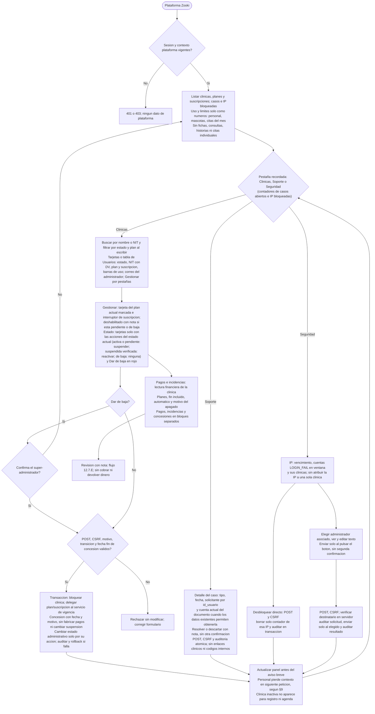

### 12.2 Control de límites del plan (freemium) — Módulo 0

La mascota creada en el portal sin clínica sigue global y no consume cupo hasta vincularla. El punto de entrada de urgencia recibe una prioridad evaluada en servidor; una petición ordinaria no puede autodeclararse roja. El motor de triage pertenece a los módulos 2/4.

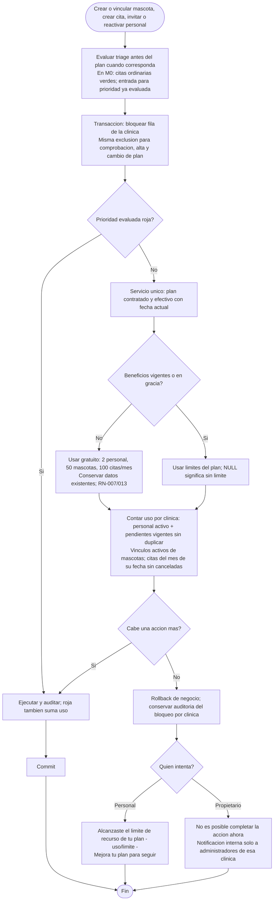

### 12.3 Registro de mascota y propietario — Módulo 1

La mascota es **global** del propietario: si él ya tiene la mascota en la plataforma (registrada en otra clínica), se **vincula** en lugar de crear una ficha duplicada ([RN-110, RN-111](ReglasNegocio.md#módulo-1--mascotas-y-propietarios)).

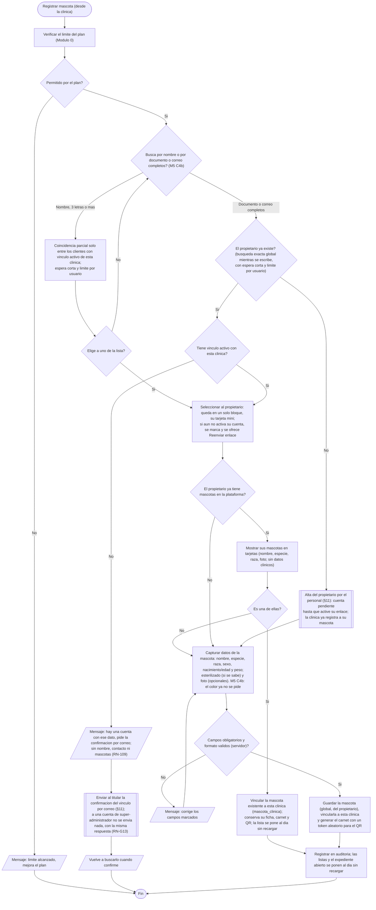

### 12.4 Vacunación y recordatorio automático — Módulo 3

Dos sub-flujos: **A)** el veterinario registra la vacuna; **B)** el sistema envía los recordatorios automáticos.

```mermaid
flowchart TD
  subgraph A["A) Registro de la vacuna (Veterinario)"]
    A1([Registrar vacuna aplicada]) --> A2[Capturar: vacuna, laboratorio, lote, fecha de aplicacion, veterinario]
    A2 --> A3{Campos validos?}
    A3 -- No --> A3a[/"Mensaje: corrige los campos marcados"/]
    A3a --> A2
    A3 -- Si --> A4[Calcular y guardar la proxima dosis segun el esquema]
    A4 --> A5[Programar el recordatorio en el calendario]
    A5 --> A6[Registrar en auditoria]
    A6 --> A7([Fin])
  end

  subgraph B["B) Recordatorio automatico (Sistema)"]
    B1{{Evento: cron diario}} --> B2["Buscar dosis que vencen en 7 y en 1 dia (por defecto, configurable por la clinica);<br/>sin mascotas inactivas ni dosis ya renovadas"]
    B2 --> B3{Hay dosis por vencer?}
    B3 -- No --> B9([Fin])
    B3 -- Si --> B4["Enviar recordatorio por correo al propietario,<br/>a nombre de la clinica que aplico la dosis"]
    B4 --> B5[Registrar el envio en notificaciones]
    B5 --> B6{El envio fue exitoso?}
    B6 -- Si --> B9
    B6 -- No --> B7["Reintentar el envio (hasta 3 veces)"]
    B7 --> B8{Se entrego en algun intento?}
    B8 -- Si --> B9
    B8 -- No --> B8a[Marcar como no entregado y avisar a la clinica]
    B8a --> B9
  end
```

### 12.5 Carnet de emergencia por QR — Módulo 5

El QR lleva un **token aleatorio**, nunca el id de la mascota; el propietario puede regenerarlo ([RN-502 a RN-505](ReglasNegocio.md#módulo-5--portal-del-propietario-multi-clínica)).

**Subetapa A — portal del propietario (HU-5.10):** lectura de emergencia compartida con el flujo público siguiente, que corresponde a la subetapa B. Impresión en tarjeta A6 (148 × 105 mm), ampliable verticalmente para conservar todos los registros. El SVG es privado y se genera en el servidor; el enlace absoluto usa la misma base de los correos.

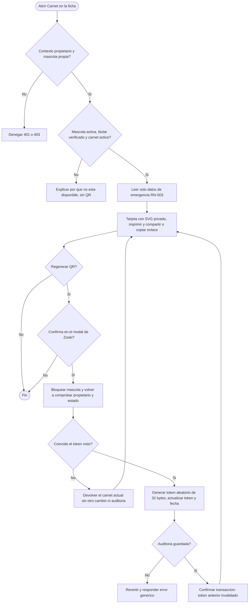

**Subetapa B — acceso público y escaneos (HU-5.11, 2.0.0).** Las respuestas válidas, genéricas y 429 llevan `noindex, nofollow`, `no-store` y `no-referrer`. No se abre sesión en las rutas públicas. La IP común con auditoría respeta `TRUSTED_PROXIES` y se guarda solo como HMAC-SHA256 con `CARNET_IP_SECRETO`; si falta, se responde 503 sin datos. Los tokens no disponibles hacen la misma consulta de índice antes del mismo 404. La foto se sirve por token y el SVG se entrega sin identificadores internos.

```mermaid
flowchart TD
  A([Escanear el QR]) --> I[Resolver IP confiable y calcular HMAC]
  I --> L[Serializar contador por IP, insertar acceso y limpiar los de mas de 24 horas]
  L --> C{Mas de 30 accesos en la ultima hora?}
  C -- Si --> R[429 generico, sin escaneo ni aviso]
  C -- No --> B[Normalizar formato y buscar token bajo bloqueo de mascota]
  B --> V{Token vigente, mascota y carnet activos, con titular?}
  V -- No --> N[404 con cuerpo y cabeceras identicos para todos los casos]
  V -- Si --> D[Leer proyeccion RN-503, registrar escaneo con notificado igual a 1]
  D --> U{Hay aviso de esa mascota en los ultimos 30 minutos?}
  U -- Si --> T[Confirmar sin otro aviso]
  U -- No --> S[Reservar notificacion de correo sin token, con id_clinica nulo]
  S --> K[Confirmar transaccion y enviar correo]
  K --> E{Correo enviado?}
  E -- Si --> F[Notificacion enviada]
  E -- No --> G[Notificacion con error]
  F --> P[Mostrar tarjeta publica y comprobante opaco del escaneo]
  G --> P
  T --> P
  P --> O[Ofrecer ubicacion optativa y acceso del dueno]
```

La ventana de agrupación se mide desde el aviso reservado, incluso si el correo falla; los escaneos intermedios no prolongan la ventana. No se bloquea la información de emergencia por un fallo de SMTP. El propietario consulta sus diez últimos escaneos después de comprobar propiedad en el servidor.

```mermaid
flowchart TD
  A([Tocar Compartir mi ubicacion]) --> P{El navegador tiene geolocalizacion y el visitante acepta?}
  P -- No --> N[Mensaje junto al boton, sin transmitir ubicacion]
  P -- Si --> E[POST con token, coordenadas a seis decimales y comprobante firmado]
  E --> L[Contar acceso por IP antes de validar]
  L --> T{Supera 30 por hora?}
  T -- Si --> R[429 generico]
  T -- No --> V[Validar coordenadas y bloquear mascota del token vigente]
  V --> C{Ultimo escaneo de esa IP, comprobante de ese token, hasta 30 minutos y sin ubicacion?}
  C -- No --> G[Respuesta generica, sin guardar]
  C -- Si --> U[Guardar ubicacion y reservar correo aparte, sin agrupar]
  U --> K[Confirmar, enviar mapa y registrar enviado o error]
  K --> G
  D([Soy el dueno]) --> S[Guardar token en sesion del acceso y pedir login]
  S --> H[Autenticar y aplicar politica, permisos y contexto propietario]
  H --> O{El token vigente pertenece a esa persona?}
  O -- Si --> F[Abrir ficha en el portal, con id resuelto en servidor y sin id en la URL de retorno]
  O -- No --> Q[Abrir su portal normal sin datos ajenos]
```

### 12.6 Calificación del veterinario — Módulo 8

```mermaid
flowchart TD
  A([Cita marcada como atendida]) --> B[Habilitar la encuesta y notificar al propietario]
  B --> C{El propietario ya califico esta cita?}
  C -- Si --> C1[/"Mensaje: ya calificaste esta cita"/]
  C1 --> ZF([Fin])
  C -- No --> SF{"Quien califica es el veterinario que atendio? (RN-G18)"}
  SF -- Si --> SF1[/"Mensaje: no puedes calificar tu propia atencion"/]
  SF1 --> ZF
  SF -- No --> D["Registrar estrellas (1 a 5) y comentario opcional"]
  D --> E{"Datos validos (calificacion obligatoria)?"}
  E -- No --> E1[/"Mensaje: selecciona una calificacion"/]
  E1 --> D
  E -- Si --> F[Guardar la reseña]
  F --> V{"Correo del propietario verificado y la cita tiene consulta registrada?"}
  V -- No --> V1["Guardar sin contar para la reputacion"]
  V1 --> J
  V -- Si --> R[Recalcular el promedio del veterinario]
  R --> G{Alcanza el minimo de reseñas?}
  G -- Si --> H[Mostrar el promedio en su perfil publico]
  G -- No --> I[Mantener el promedio oculto hasta alcanzar el minimo]
  H --> J["Registrar en auditoria (la clinica no puede editar ni borrar la reseña;<br/>solo el super-administrador puede ocultarla, con motivo)"]
  I --> J
  J --> ZF
```

---

## 13. Flujos del sistema — Cuenta y perfil

Lo que una persona puede hacer con su propia cuenta: completar el perfil cuando se registró con Google, cambiar sus datos y su contraseña, y, si es veterinario, mantener su perfil público. Las reglas están en el Módulo T de las [Reglas de Negocio](ReglasNegocio.md#módulo-t--acceso-seguridad-y-administración-reglas-transversales) (RN-G19 a RN-G24) y las historias en [HU-T.2](HistoriasUsuario.md#hu-t2--cambiar-mi-contraseña), [HU-T.5](HistoriasUsuario.md#hu-t5--ver-y-actualizar-mi-perfil-y-datos-de-contacto) y [HU-T.18](HistoriasUsuario.md#hu-t18--registrarme-e-iniciar-sesión-con-google-propietario).

### 13.1 Completar el perfil (cuenta creada con Google)

No es una pantalla aparte que la persona busque: aparece sola apenas termina el registro con Google y vuelve a aparecer en cada inicio de sesión hasta que el perfil esté completo.

```mermaid
flowchart TD
  A(["Se dispara al terminar el registro con Google (§11)<br/>y en cada inicio de sesion mientras el perfil siga incompleto (§10)"]) --> B["Pantalla obligatoria: tipo y numero de documento y telefono"]
  B --> C{Campos completos y formato valido?}
  C -- No --> C1[/"Mensaje: corrige los campos marcados"/]
  C1 --> B
  C -- Si --> D{El documento ya pertenece a otra cuenta?}
  D -- Si --> D2["Crear y confirmar el caso para el super-administrador<br/>(uno abierto por titular y documento; no se repite)"]
  D2 --> D1[/"Responder: no se pudo completar el perfil; revisa datos o contacta soporte"/]
  D1 --> ZF([Fin: el perfil sigue incompleto])
  D1 --> N["Despues de responder y del commit: correo individual a cada super-administrador activo/verificado<br/>solo tipo, fecha y enlace al panel con sesion; sin identidad del titular"]
  N --> NF["Si falla, registrar en log; el caso sigue abierto y la respuesta no cambia"]
  D -- No --> E[Guardar documento y telefono]
  E --> F[Marcar el perfil como completo]
  F --> G[Registrar en auditoria]
  G --> H([Portal habilitado: registrar mascotas y agendar])
```

### 13.2 Cambiar mis datos: teléfono, correo y documento

```mermaid
flowchart TD
  A([Editar mi perfil]) --> Q{Que cambia?}

  Q -- Telefono --> T1{Formato valido?}
  T1 -- No --> T2[/"Mensaje: revisa el telefono"/]
  T2 --> A
  T1 -- Si --> T3[Guardar]
  T3 --> AUD

  Q -- Correo --> CP{"La cuenta tiene contraseña?"}
  CP -- No --> CP1[/"Primero crea una contraseña (§13.3): al cambiar el correo se retira Google"/]
  CP1 --> ZF
  CP -- Si --> CI["Confirmar identidad (contraseña o Google)"]
  CI --> C1{"Identidad confirmada, formato valido, correo no temporal (RE-0.1.5)<br/>y distinto del actual? (M5 C4b)"}
  C1 -- No --> C2[/"El aviso dice que falta, que es temporal, que ya es su correo<br/>o que confirme la identidad"/]
  C2 --> A
  C1 -- Si --> CU{"Correo ocupado?"}
  CU -- Si --> CM[/"Misma respuesta: si puede completarse, recibiras un enlace"/]
  CU -- No --> C3["Enviar verificacion al correo nuevo;<br/>misma respuesta generica y correo anterior vigente"]
  C3 --> C4{Verifica dentro del plazo?}
  C4 -- No --> C5[El cambio expira; se conserva el correo anterior]
  C5 --> ZF([Fin])
  C4 -- Si --> C6[Aplicar el correo nuevo]
  C6 --> C7[Avisar del cambio al correo anterior]
  C7 --> C8{La cuenta estaba vinculada a Google con el correo anterior?}
  C8 -- Si --> C9[Retirar la vinculacion con Google]
  C8 -- No --> AUD
  C9 --> AUD

  Q -- Documento --> D1["Confirmar identidad (contraseña o Google)"]
  D1 --> D2{Confirmada?}
  D2 -- No --> D3[/"Mensaje: no se pudo confirmar tu identidad"/]
  D3 --> ZF
  D2 -- Si --> D4{"Formato valido para el tipo de documento?"}
  D4 -- No --> D5[/"Mensaje: revisa el tipo y el numero de documento"/]
  D5 --> A
  D4 -- Si --> D6{El documento ya pertenece a otra cuenta?}
  D6 -- Si --> D7["No se aplica; crear el caso para el super-administrador<br/>(posible cuenta duplicada)"]
  D7 --> DG[/"Mensaje generico: no se pudo aplicar el cambio; revisa datos o contacta soporte"/]
  DG --> ZF
  DG --> NS["Despues de responder y del commit: aviso privado de soporte como en 13.1<br/>si falla, log sin cambiar el caso ni la respuesta"]
  D6 -- No --> D8[Aplicar el documento nuevo]
  D8 --> D9[Avisar por correo al titular]
  D9 --> AUD

  AUD["Registrar en auditoria (con el valor anterior)"] --> ZF
```

### 13.3 Crear o cambiar mi contraseña

```mermaid
flowchart TD
  A([Contraseña en mi perfil o cambio obligatorio]) --> B{La cuenta ya tiene contraseña?}
  B -- Si --> C[Pedir la contraseña actual]
  C --> C1{Contraseña actual correcta?}
  C1 -- No --> C2[/"Error: contraseña actual incorrecta"/]
  C2 --> C
  C1 -- Si --> N
  B -- No --> G["Pedir otra confirmacion de Google: token validado en servidor,<br/>audiencia de Zooki, vigencia y correo del titular"]
  G --> G1{Identidad confirmada y Google vinculado?}
  G1 -- No --> G2[/"No crear contraseña; confirmar Google o usar recuperacion por enlace"/]
  G2 --> ZF([Fin])
  G1 -- Si --> N["Ingresar contraseña nueva; requisitos y errores debajo del campo mientras escribe"]
  N --> P{Cumple la politica?}
  P -- No --> P1[/"Error junto al campo"/]
  P1 --> N
  P -- Si --> S[Guardar hash y retirar cambio obligatorio]
  S --> SS["Incrementar version_sesion; conservar la sesion del titular que cambia.<br/>Las demas reciben 401 en su siguiente peticion"]
  SS --> AUD[Auditar sin guardar la contraseña]
  AUD --> COR[Enviar aviso por correo]
  COR --> AV[Toast breve; recarga o redireccion inmediata conserva el aviso]
  AV --> F([Fin: puede entrar con contraseña y, si tenia, con Google])
  R([Enlace de restablecimiento]) --> RV{Token vigente, no usado, cuenta activa y correo coincide?}
  RV -- No --> G2
  RV -- Si --> RP{Contraseña y confirmacion cumplen la politica?}
  RP -- No --> RERR[/"Error en el formulario de restablecimiento"/]
  RERR --> R
  RP -- Si --> TX["Consumir enlace y guardar hash en transaccion;<br/>despues subir version_sesion"]
  TX --> RA[Auditar y avisar por correo; otras sesiones cerradas]
  RA --> F
```

RE-T.2.4/5, RN-G22 y RN-G10. La sesión abierta con Google no basta para crear la primera contraseña: se solicita otra confirmación, verificada en el servidor. El cierre de sesiones se aplica también al restablecimiento del administrador y al cambio de correo (§13.2); la sesión que realiza el cambio se conserva si pertenece al titular. Si falla el correo, el cambio ya aplicado no se revierte; queda el fallo del envío en el log.


### 13.4 Perfil del veterinario

```mermaid
flowchart TD
  A([El veterinario abre su perfil]) --> Q{Que hace?}

  Q -- Editar bio o foto publicas --> B1{"Foto con tipo y tamaño validos?"}
  B1 -- No --> B2[/"Mensaje: revisa el archivo de la foto"/]
  B2 --> A
  B1 -- Si --> B3[Guardar; el perfil publico se actualiza]
  B3 --> AUD

  Q -- Ver sus especialidades --> E1[Solo lectura: las asigna el administrador de la clinica]
  E1 --> ZF([Fin])

  Q -- Proponer un cambio de horario --> H1[Proponer franjas por dia para la clinica del contexto activo]
  H1 --> H2{"Sin solapamientos, dentro del horario de la clinica<br/>y sin chocar con su horario en otra clinica?"}
  H2 -- No --> H3[/"Mensaje: la franja se solapa, queda fuera del horario o choca con otro compromiso"/]
  H3 --> H1
  H2 -- Si --> H4[Enviar la propuesta al administrador]
  H4 --> H5{El administrador la aprueba?}
  H5 -- No --> H6[Avisar al veterinario el rechazo y el motivo]
  H6 --> AUD
  H5 -- Si --> H7[Revalidar y aplicar con candados; horario y marcas atomicos]
  H7 --> H8{Quedan citas fuera del nuevo horario?}
  H8 -- Si --> H9[["Marcar esas citas para reajuste (§5)"]]
  H9 --> AUD
  H8 -- No --> AUD

  Q -- Solicitar ausencia --> AUS[["Solicitud propia pendiente; admin aprueba antes de bloquear (§8)"]]
  AUS --> ZF

  Q -- Ver sus calificaciones --> R1{Tiene 5 o mas reseñas validas?}
  R1 -- Si --> R2[Ver su promedio y sus reseñas]
  R1 -- No --> R3[Ver sus reseñas; el promedio publico aun no se muestra]
  R2 --> ZF
  R3 --> ZF

  AUD[Registrar en auditoria] --> ZF
```

## 14. Exploración del conocimiento global — M2 C6 (HU-2.12)

```mermaid
flowchart TD
  A["Abrir mapa del conocimiento"] --> B{Contexto de superadministrador?}
  B -- No --> X["403 sin datos"]
  B -- Si --> C["Leer solo conocimiento global, fuentes, cobertura y version"]
  C --> D{Conjunto disponible?}
  D -- No --> E["Estado vacio o error legible; sin cobertura falsa"]
  D -- Si --> L{Cargo la libreria del mapa desde el CDN?}
  L -- No --> M["Aviso y lista con los mismos datos, filtros y detalle"]
  L -- Si --> F["Mapa dirigido con tipo, signo y peso; validacion pendiente visible"]
  F --> G["Buscar y filtrar conservando relaciones universales"]
  M --> G
  G --> H["Detalle de nodo, arista o regla; fuentes y condiciones"]
  H --> G
```

No hay rama de edición ni lecturas de mascotas, historia, tratamientos o citas.
La pantalla también ofrece la lista como vista alternativa al mapa; una regla aparece en el detalle de los nodos que nombra, no como arista (C6).
La escritura del conocimiento ocurre solo desde el cargador por consola, después de una migración exitosa; la pantalla y su endpoint se implementan en C6.

## 15. Configuración de marca y tipos de cita — M4 C1 (HU-7.4)

RE-7.4.1–6 y configuración de RE-4.6.1; RN-701 y RNF-11. Conserva los horarios de HU-7.1. El margen operativo, la urgencia con clínica cerrada y la pausa real se completan en C3/C4a/C7a, respectivamente.

```mermaid
flowchart TD
  A["Abrir Configuración o solicitar acción"] --> B{"Security: sesión y contexto administrador de clínica activa?"}
  B -- No --> X["Denegar según §9; sin datos ni cambios"]
  B -- Sí --> C{"Lectura o escritura?"}
  C -- Lectura --> L["Revalidar clínica, usuario y vínculo administrador; leer marca y tipos propios, incluidos inactivos"]
  L --> UI["Formulario de marca/tipos y horarios existentes; validación por campo y restricciones de entrada"]
  UI --> D["Guardar marca, crear/editar tipo o cambiar estado lógico; bloquear doble envío"]
  C -- Escritura --> E
  D --> E{"POST y CSRF válidos?"}
  E -- No --> F["405 o 403; conservar formulario"]
  E -- Sí --> G{"Campos y duración/margen/pausable explícito válidos?"}
  G -- No --> H["422 con campo y mensaje; no escribir"]
  H --> UI
  G -- Sí --> I{"Clínica del formulario coincide con contexto autorizado?"}
  I -- No --> J["403 e intento auditado; sin cambios"]
  I -- Sí --> T["Iniciar transacción exterior; bloquear clínica, usuario y vínculo en ese orden B1"]
  T --> V{"Clínica/usuario/vínculo administrador siguen activos?"}
  V -- No --> R["Rollback; 403 e intento auditado fuera de la transacción"]
  V -- Sí --> K{"Marca propia, tipo nuevo o tipo existente propio bloqueado?"}
  K -- No --> R
  K -- Sí --> W["Guardar marca o tipo; desactivar/reactivar sin borrar ni alterar snapshots de citas"]
  W --> AU["Registrar antes/después y actor/clínica en auditoría de la misma transacción"]
  AU --> OK{"Escritura y auditoría correctas?"}
  OK -- No --> ERR["Rollback completo; error sin éxito aparente; permitir reintento"]
  OK -- Sí --> COM["Commit; devolver registro canónico; actualizar nombre de contexto si cambió"]
  COM --> U["Actualizar formulario/lista/preview inmediatamente y luego aviso breve; rehabilitar controles"]
  ERR --> UI
  U --> UI
  L --> OUT["Consumidores autorizados: marca de la clínica del contexto o del acto; global conserva Zooki"]
```

La validación remota por campo usa POST/CSRF y revalida el administrador sin escribir. El guardado repite la validación en servidor. Los tipos inactivos siguen legibles en históricos; el catálogo de reservas los excluye y el servidor rechaza usarlos en una nueva reserva. Las salidas clínicas usan la procedencia ya autorizada, sin elegir una clínica para mensajes globales ni personalizar las descargas públicas.

## 16. Coordinación de horarios y cierres puntuales — M4 C2

RE-4.11.1/2/4/5 y componente administrativo RE-4.8.2; RN-706/703/415 y contexto de §9. Las propuestas conservan sus franjas en JSON y los cierres sus intervalos exactos [inicio, fin). No se convierten en ausencias ni modifican la recurrencia al cerrar una fecha concreta.

```mermaid
flowchart TD
  A["Configuracion admin o perfil del veterinario"] --> P{"Sesion y contexto autorizados segun §9?"}
  P -- No --> DEN["Denegar sin datos ajenos; auditar intento"]
  P -- Si --> L["Leer horario propio de clinica, propuestas y marcas; vet solo su jornada"]
  L --> F["Editar con validacion en vivo y restricciones; clave del comando y doble envio protegido"]
  F --> T{"POST, CSRF, contexto y sintaxis validos?"}
  T -- No --> ERR["Error junto al campo; no escribir; permitir correccion"]
  T -- Si --> EXT{"Transaccion exterior compatible?"}
  EXT -- No --> REI["Rechazar entrada; reiniciar con el conjunto completo de recursos"]
  EXT -- Si --> CL["Iniciar unidad corta; bloquear clinica antes de descubrir recursos actuales"]
  CL --> RP["Usuarios globales ordenados, mascotas ordenadas, vinculos y configuracion; lecturas actuales tras esperar"]
  RP --> V{"Actor, clinica y membresias siguen vigentes?"}
  V -- No --> RB["Rollback completo; reauditar denegacion fuera de la unidad"]
  V -- Si --> OP{"Clave y huella del comando?"}
  OP -- "Misma clave y carga" --> ACT["Reconstruir respuesta con acceso y vista actuales; no repetir cambios"]
  OP -- "Misma clave y carga distinta" --> CON["Conflicto; rollback sin cambios"]
  OP -- Nueva --> ACC{"Accion autorizada?"}
  ACC -- "Vet propone lo propio" --> VAL["Validar dia, intervalos, apertura y compromisos globales minimos"]
  VAL --> PV{"Franjas compatibles?"}
  PV -- No --> GEN["Error de franja; conflicto ajeno generico sin clinica ni horas"]
  PV -- Si --> PRO["Guardar propuesta pendiente; horario y citas no cambian"]
  ACC -- "Admin rechaza" --> MOT{"Propuesta propia pendiente, vet vigente y motivo presente?"}
  MOT -- No --> CON
  MOT -- Si --> RECH["Guardar rechazo, revisor, fecha y motivo"]
  ACC -- "Admin aprueba o configura vet" --> VA["Revalidar propuesta pendiente si aplica, membresia y franjas actuales"]
  VA --> CO{"Sin solapes propios o interclinica y dentro de apertura?"}
  CO -- No --> GEN
  CO -- Si --> HOR["Guardar franjas; aprobar propuesta si corresponde"]
  ACC -- "Admin guarda o restaura apertura" --> AP["Guardar configuracion de apertura validada"]
  ACC -- "Admin crea o retira cierre" --> CE{"Rango exacto y motivo validos; cierre de su clinica?"}
  CE -- No --> CON
  CE -- Si --> CIE["Guardar cierre o baja logica; conservar recurrencia y bloques usados"]
  HOR --> MAR["Bloquear citas ordenadas y marcar afectadas; incrementar version; preservar horas y snapshots"]
  AP --> MAR
  CIE --> MAR
  PRO --> AUD
  RECH --> AUD
  MAR --> AUD["Auditoria y resultado idempotente en la misma transaccion"]
  AUD --> OK{"Unidad completa correcta?"}
  OK -- No --> ROL["Rollback de horario/cierre/propuesta, marcas, versiones, operacion y auditoria"]
  GEN --> ROL
  OK -- Si --> COM["Commit antes de devolver resultado canonico y vista autorizada"]
  ACT --> COM
  COM --> UI["Actualizar formulario/listas y pendientes de reajuste antes del aviso breve"]
  UI --> L
  ROL --> ERR
```

Las reservas y reprogramaciones que compiten entran por el mismo coordinador desde su transacción exterior: descartan lecturas previas, revalidan vínculos, apertura, jornada y cierres después de esperar, y guardan operación/auditoría con la cita. Si la reserva se confirma primero, el escritor de configuración descubre y marca esa cita; si cambia primero la configuración, la reserva valida contra el estado nuevo. La proyección global de conflictos recurrentes solo lee día e intervalos; no devuelve clínica, pacientes o contactos ajenos.

C2 entrega estas guardias de escritura y marcas visibles. C3 completa las sugerencias/disponibilidad y RE-4.11.3/RE-4.8.3; C5 procesa las marcas. No se mueve ninguna cita ni se reinicia el bloque o su tope al editar/restaurar. Los comandos de C2 no entran en numeración HC ni abren una transacción exterior que luego adquiera GET_LOCK; C7 integra también toda alta clínica y numeración HC con el mismo coordinador; no queda GET_LOCK de HC paralelo.


## 17. Disponibilidad única y reserva segura — M4 C3

HU-4.9; RE-4.9.1–3, RE-4.1.2/3, RE-4.6.2, RE-7.4.3, RE-4.8.3 y RE-4.11.3, con los componentes de RE-4.2.4/RE-5.3.3.
Conserva acceso de §9, flujo de destino de §4, fronteras de grafos de §2 y orden común de §16/B1.
La retirada de creación al administrador continúa en C4a; C3 no amplía sus permisos actuales.

```mermaid
flowchart TD
  A["Horas o sugerencias internas/portal; reservar o reprogramar"] --> V{"Contexto vigente, mascota propia/vinculada, vet miembro y parámetros válidos?"}
  V -- No --> DEN["Denegación genérica auditada; sin proyección global"]
  V -- Sí --> Q{"Consulta o escritura?"}
  Q -- Consulta --> DAT["Tipo activo del servidor; reprogramar usa snapshot y exclusión legítima"]
  Q -- Escritura --> TX["Coordinador común: clínica; usuarios y mascotas globales ordenados; vínculos"]
  TX --> ACT["Lecturas actuales tras esperar; revalidar acceso y recursos"]
  ACT --> OP{"Clave del mismo actor, clínica y acción?"}
  OP -- "Misma huella" --> REP["Devolver referencia guardada sin repetir negocio ni auditoría"]
  OP -- "Otra huella" --> RB["Rollback completo; conflicto"]
  OP -- Nueva --> NUE{"Estado y tiempo válidos para un comando nuevo?"}
  NUE -- No --> RB
  NUE -- Sí --> DAT
  DAT --> CAL["Un corte del reloj inyectable America/Bogota; apertura intersectada con jornada vet"]
  CAL --> MEN["Restar cierres activos y ausencias aprobadas; proyectar ocupación global mínima vet/mascota"]
  MEN --> INC{"Duración/fin demostrables y pausa sin incertidumbre?"}
  INC -- No --> REV["Fecha afectada sin reservas ordinarias; revisión genérica, sin modificar legado"]
  INC -- Sí --> LIB["Intervalos restantes semiabiertos con segundos; sin horarios no hay capacidad"]
  LIB --> MOD{"Consulta?"}
  MOD -- Sí --> HOR["Horas exactas HH:mm o HH:mm:ss; mismo paso, selección y envío sin truncar; no apartan capacidad"]
  MOD -- No --> CAB{"Duración más margen completos en una franja y sin cruzar medianoche?"}
  CAB -- No --> RB
  CAB -- Sí --> CUO["Cuota del mes destino; reprogramar excluye solo su propia cita legítima"]
  CUO --> GUAR["Guardar cita y vínculo si corresponde; hora_fin solo clínica; conservar snapshots y sellos"]
  GUAR --> AUD["Resultado idempotente y auditoría en la misma transacción"]
  AUD --> OK{"Unidad íntegra?"}
  OK -- No --> RB
  OK -- Sí --> COM["Commit antes de avisos existentes; respuesta canónica"]
  REV --> MOD2{"Había transacción?"}
  MOD2 -- Sí --> RB
  MOD2 -- No --> ERR["Mostrar error genérico de revisión; no confundir con una consulta válida sin huecos"]
  REP --> COM
```

Las sugerencias y las rutas de horas reciben mascota/tipo/veterinario/fecha, nunca tiempos o prioridad impuestos por JS.
Se conserva el paso de presentación por duración del tipo, anclado en la franja original, sin crear horizontes, límites o incrementos nuevos.
Las horas con segundos no nulos viajan y se muestran como HH:mm:ss; HH:mm abrevia únicamente segundos cero y conserva el mismo instante.
Los clientes internos, del portal y de reprogramación seleccionan y envían literalmente la sugerencia, sin redondear.
Una consulta válida sin huecos muestra su estado vacío; un error muestra el mensaje genérico escapado, descarta respuestas obsoletas y no habilita guardar sin selección.
El replay HTTP de reprogramación valida sintaxis y acceso vigente antes de recuperar la operación del mismo actor/clínica/acción/huella bajo el coordinador.
Solo un comando nuevo vuelve a validar estado, tiempo y disponibilidad; el replay confirmado no retrocede estados posteriores ni repite escritura, auditoría o notificaciones internas.
El servidor vuelve a calcular al guardar; un resultado de consulta no equivale a una reserva.
Una cita cancelada/no_asistio libera ocupación; un sobrecupo no se omite como si fuera un hueco libre.
Para una atención con evidencia suficiente se reconstruye la cota de A.3 sin escribir cascada; una cota agotada o una pausa sin reanudación no acredita liberación real.
La decisión del dueño de 2026-10-20 mantiene la fecha afectada para revisión cuando la ocupación no pueda demostrarse, sin rellenar snapshots con el tipo actual.
Una completada con evidencia conserva N y usa máximo(N+m, fin real), sin desplazar el margen con el reloj posterior.
Las marcas de C2 siguen pendientes de C5; no se mueven citas, reinician bloques/topes ni entregan triage, nuevos avisos, gestión de ausencias o continuidad clínica.
Los conteos de requisitos e historias no cambian por precisar estos criterios existentes.


### 12.7 Suscripción, vigencia y cobro — Módulo 0 (S1–S4)

El servidor calcula por clínica la vigencia y gracia con la fecha actual, aunque el trabajador se retrase. Los intervalos incluyen inicio y excluyen fin. La mora no suspende administrativamente la clínica. Un profesional legado sin fecha conserva su condición hasta regularización por plataforma con motivo y vencimiento; no crea un pago. Mes/año con ancla y sin prorrateos: pago en gracia desde el fin anterior; tras congelar desde acreditación local.

S1 implementa vencimiento, gracia, congelación y avisos. S2 implementa el botón con eventos verificados; S3 añade fuente hospedada y autorización mensual separada. Falta de configuración o cobros apagados deshabilitan el botón, sin afectar la atención.

**A — Pagar/Renovar.** Precio y centavos calculados en servidor; clínica, CSRF y ciclo verificados. Desde 2.2.0 el pago abre el checkout web de Wompi a pantalla completa con los mismos datos firmados (decisión del dueño, 2026-10-26); guardar la tarjeta o Nequi sigue con el widget hospedado. Una obligación se comparte entre pestañas aunque elijan distinto ciclo. Cerrar no cancela ni acredita; volver con un ID permite recuperar por GET privado y referencia de la clínica activa. La cotización vencida se cierra tras rechazo/error confirmado o ausencia confirmada por búsqueda privada completa de un checkout manual abandonado, según A.1; conserva la evidencia y vuelve a cotizar con tarifa vigente. Las concesiones legadas sin fin requieren regularización previa.

```mermaid
flowchart TD
  A["Administrador: Pagar o Renovar"] --> B{"Contexto, CSRF y ciclo validos?"}
  B -- No --> X["Rechazar sin crear cargo"]
  B -- Si --> R["Comprobar checkout vencido sin emitir cargos: flujo A.1"]
  R --> C["Calcular tarifa; bloquear clinica\nReutilizar o reservar orden e intento unicos; commit"]
  C --> D["Firmar configuracion; el navegador abre el checkout web de Wompi a pantalla completa"]
  D --> E["Tarjeta, PSE o Nequi en Wompi"]
  E --> F["Retorno con id: GET privado y referencia de clinica propia; cierre: estado local"]
  E -. "Evento independiente" .-> G["Flujo B: verificar y conciliar"]
  G --> F
```

**A.1 — Recuperación automática de checkout abandonado (RE-0.5.15, decisión del dueño, 2026-10-26).** Se ejecuta antes de reservar al pulsar Pagar y desde el Schedule existente de cinco minutos, también sin webhook. `--revisar` solo enumera candidatos, sin HTTP ni escrituras. Solo considera órdenes pendientes vencidas de la clínica/entorno: todos sus intentos manuales, anteriores terminales negativos y último creado/incierto sin ID; si tiene ID se consulta mediante el conciliador. GET privado `/transactions?reference=...` sin filtros de estado ni fechas; solo 200 con lista válida completa vacía prueba ausencia. Errores, 404, objetos en lugar de listas o paginación desconocida conservan la reserva. Sin credenciales reales en las pruebas.

```mermaid
flowchart TD
  A["Pagar con rol y CSRF / Schedule"] --> C{"Orden manual pendiente y vencida del entorno?"}
  C -- No --> FIN["Conservar estado; no emitir cargos"]
  C -- Si --> ID{"Ultimo intento tiene ID?"}
  ID -- Si --> REC["GET por ID; conciliador comun fuera del candado"]
  ID -- No --> EL{"Ultimo creado o incierto y anteriores terminales negativos?"}
  EL -- No --> FIN
  EL -- Si --> GET["GET privado por referencia fuera del candado"]
  GET --> R{"Respuesta valida completa?"}
  R -- No --> FIN
  R -- "Con transacciones" --> REC
  R -- "Lista vacia" --> LOCK["Bloquear clinica; comparar orden y todos los intentos con instantanea"]
  LOCK --> CAM{"Todo sigue igual y cotizacion vencida?"}
  CAM -- No --> FIN
  CAM -- Si --> TX["Cerrar orden y liberar claves logicas; conservar intentos; auditar en misma transaccion"]
  TX --> OK["Commit; permite nueva cotizacion sin conceder vigencia"]
  TX -- "Auditoria falla" --> RB["Rollback; reserva sigue protegida"]
```

**B — Evento y acreditación.** Inbox durable antes del HTTP 200; duplicados 200, firma inválida 401 y base caída 503. Tras el 200 durable, el receptor intenta conciliar ese evento; Schedule queda de respaldo. No se cierran ni vacían búferes ajenos o de pruebas. Huella canónica D9, whitelist sin cuerpo íntegro ni PII. La consulta privada usa host del entorno; si informa comercio se coteja con `/merchants/info`. HTTP queda fuera de transacción. La concesión y su auditoría son atómicas, con periodo único por orden. Un GET pendiente/404/caído se reanuda por `--solo=conciliacion`; el retorno con ID válido también puede recuperarlo por GET privado, solo si su referencia pertenece a la clínica activa. Anulación, discrepancia, segundo cargo real o aprobado tardío de una orden cerrada generan incidencia conservada para S4, sin borrar vigencia ni devolver automáticamente; el aprobado tardío de la orden cerrada conserva su evidencia sin conceder periodo automáticamente.

```mermaid
flowchart TD
  A["POST evento sin sesion ni CSRF"] --> B{"Tamano, esquema, entorno y checksum validos?"}
  B -- No --> N["400, 401 o 413; sin efecto financiero"]
  B -- Si --> C["Persistir inbox y auditoria; commit"]
  C --> D{"Duplicado o fallo?"}
  D -- Duplicado --> OK["200; no reaplicar"]
  D -- Fallo --> ERR["503; no confirmar recepcion"]
  D -- Nuevo --> ACK["200; intentar conciliar en linea\nSchedule recupera pendientes con lease"]
  ACK --> API["GET privado fuera de transaccion\nTransaccion y comercio si se informa"]
  API --> V{"Concordancia con orden y APPROVED?"}
  V -- "API caida o PENDING" --> RET["Conservar pendiente; conciliar despues"]
  V -- "Fallo terminal" --> EST["Registrar y auditar sin conceder"]
  V -- "Discrepancia o VOIDED" --> REV["Incidencia financiera para S4"]
  V -- Si --> LOCK["Bloquear clinica; revalidar orden, version y lease"]
  LOCK --> P{"Ya hay periodo o cargo aprobado?"}
  LOCK -- "Orden cerrada: aprobado tardio" --> REV
  P -- "Mismo pago" --> DUP["No-op; evento procesado"]
  P -- "Otro cargo" --> REV
  P -- No --> TX["Insertar periodo unico; actualizar vigencia y plan\nReservar recibo por pago y destinatario; auditar; commit"]
  TX --> FIN["Suspension administrativa intacta"]
```

**D — Vigencia y recuperación.**

```mermaid
flowchart TD
  A["Periodo vigente de pago"] --> AV["Avisos previstos a 7 y 1 dias"]
  AV --> V{"Llego fin exclusivo sin renovar?"}
  V -- No --> A
  V -- Si --> G["Gracia configurada, por defecto tres dias\nMantener beneficios; sin marcar clinica suspendida"]
  G --> F{"Termino gracia sin pago acreditado?"}
  F -- No --> PAG{"Se acredito renovacion?"}
  PAG -- Si --> R["Conceder periodo segun D2; auditar"]
  PAG -- No --> G
  F -- Si --> CONG["Congelar beneficios y avisar\nPlan efectivo gratuito, datos conservados"]
  CONG --> OP{"Nueva operacion clinica?"}
  OP -- "Roja evaluada en servidor" --> ROJO["Atender y registrar; no bloquear por mora/cupo"]
  OP -- Ordinaria --> CUPO["Conservar atencion e historia existentes\nComprobar cupos gratuitos para nuevas altas"]
  CONG --> PAGO["Boton o cargo ya autorizado; flujo B"]
  PAGO --> R
  R --> ACT{"Clinica administrativamente activa?"}
  ACT -- Si --> A
  ACT -- No --> SUS["Pago registrado; suspension o baja se conserva"]
```

**Avisos:** una tarea cada cinco minutos bloquea clínica y suscripción, materializa transición y reserva outbox por destinatario/fin/tipo. Los previos salen desde las 07:00 a 7/1 días; congelación al siguiente despacho. SMTP ocurre después del commit, bajo reclamación durable. Una entrega incierta no se reenvía a ciegas. Una renovación vuelve obsoletos los avisos pendientes del fin anterior.


**12.7.C — fuente y cobro automático mensual (S3, RN-016/018).**
El widget hospedado entrega un token efímero; Nequi PENDING se comprueba sin persistirlo y no crea fuente hasta APPROVED.
El servidor consulta `/merchants/info`, exige ambas aceptaciones y conserva solo prueba de contratos y metadatos mínimos de la fuente.
Guardar no autoriza cargos: el administrador acepta aparte importe mensual, condiciones y periodicidad; el anual no tiene automático.
Retirar o quitar detiene cargos futuros, sin acortar lo pagado; una reserva de envío confirmada sigue conciliándose como cargo en curso.
Los tokens de aceptación actuales se usan en la petición y no se guardan; cambios de condiciones o importe requieren nueva autorización.

```mermaid
flowchart TD
  A["Trabajador cada cinco minutos"] --> B{"Habilitado y hay mandato declarado?"}
  B -- No --> FIN["No cobrar"]
  B -- Si --> API["Consultar contratos actuales fuera de transaccion"]
  API --> C["Bloquear clinica; revalidar mensual vencida en gracia\nFuente propia, retiro, tarifa y condiciones"]
  C --> D{"Obligacion compartida con boton en curso o incierta?"}
  D -- Si --> REC["No emitir otro POST; conciliar por eventos"]
  D -- No --> E{"Sin intento previo o fallo terminal?\nTurno inicial, +24 o +48 h; menos de tres"}
  E -- No --> FIN
  E -- Si --> RES["Reservar referencia unica; marcar enviando; auditar y commit"]
  RES --> POST["POST firmado con payment_source_id; fuera de transaccion"]
  POST --> R{"Respuesta conocida?"}
  R -- No --> INC["Incierto; nunca repetir envio"]
  R -- Si --> ID["Guardar id sin degradar evento adelantado; no acreditar"]
  ID --> EV["Evento firmado y GET privado: flujo B"]
  EV --> FALL{"Rechazo terminal confirmado?"}
  FALL -- No --> REC
  FALL -- Si --> AV["Outbox unico de fallo por intento y administrador verificado"]
  AV --> TRES{"Tres intentos o fuera de gracia o mandato retirado?"}
  TRES -- Si --> FIN
  TRES -- No --> A
```

**12.7.E — consulta financiera y revisión de incidencias (S4, RE-0.3.7/RE-0.5.24/25/26).**
No consulta fichas ni historia; no muestra identificadores de fuentes.
El motivo del apagado automático distingue precio, condiciones o ambos; nuevas aceptaciones y retiradas explícitas limpian la proyección, sin borrar su auditoría.

```mermaid
flowchart TD
  A["Plataforma: Gestionar clinica / Pagos e incidencias"] --> B{"Sesion y cuenta super-administradora activas?"}
  B -- No --> X["403; ningun metadato financiero"]
  B -- Si --> L["Servicio unico: contratado, efectivo, vigencia y automatico\nHistorial paginado por clinica; concesiones separadas"]
  L --> I["Incidencias vinculadas por intento y orden locales\nDesconocidas: seccion global sin clinica identificada"]
  I --> R{"Marcar revisada con nota?"}
  R -- No --> FIN["Solo lectura; nunca cobrar ni devolver"]
  R -- Si --> V{"POST, CSRF, nota y pertenencia de seccion validos?"}
  V -- No --> ERR["403/422; conservar formulario"]
  V -- Si --> TX["Bloquear evento en transaccion; revalidar plataforma"]
  TX --> YA{"Ya revisado?"}
  YA -- Si --> KEEP["Conservar primera nota; sin escritura ni auditoria duplicada"]
  KEEP --> FIN
  YA -- No --> AU["Guardar revisor, fecha y nota; auditar en la misma transaccion"]
  AU --> OK{"Escritura y auditoria correctas?"}
  OK -- No --> RB["Rollback; incidencia sigue sin revisar"]
  OK -- Si --> C["Commit; actualizar historial y aviso breve\nConservar estado, codigo, pago y periodo"]
```


**12.7.F — recuperación de evento perdido (S4, RE-0.5.13/14/24 y RE-0.3.7).**
El navegador solo proporciona el ID validado; referencia, estado, importe y beneficiario proceden del GET privado.
La evidencia interna `transaction.consultada` se distingue de un evento firmado y comparte su conciliador y recuperación por Schedule.
Plataforma exige motivo auditado y no elige una clínica de destino.

```mermaid
flowchart TD
  R[Retorno del administrador con id] --> V{Formato valido?}
  M[Plataforma: ID y motivo] --> S{Rol, POST, CSRF y motivo validos?}
  S -- Si --> V
  S -- No --> X[Rechazar sin efecto financiero]
  V -- No --> X
  V -- Si --> GET[GET privado fuera de transaccion]
  GET --> C{Referencia local del entorno?}
  GET -- API caida o 404 --> P[Informar pendiente; sin acreditar]
  C -- No --> P
  C -- Si --> A{Retorno de la misma clinica o plataforma?}
  A -- No --> P
  A -- Si --> I[Auditar consulta manual; inbox interno durable]
  I --> B[Conciliador comun: cotejos y bloqueo de clinica]
  B --> U{APPROVED concordante y periodo aun no concedido?}
  U -- Si --> FIN[Periodo unico, recibo y auditoria atomica; commit]
  U -- No --> E[Pendiente, no-op o incidencia; Schedule de respaldo]
```

El correo «Recibimos tu pago» usa la outbox de S1: se reserva al acreditar bajo bloqueo de clínica y clave única por pago/administrador D7, y se despacha tras commit. Incluye valor, ciclo, referencia, medio mínimo saneado del GET y fin incluido de ese pago, aunque haya otra renovación posterior. SMTP incierto no se repite a ciegas ni invalida el periodo.
