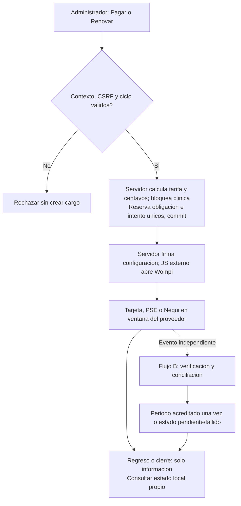
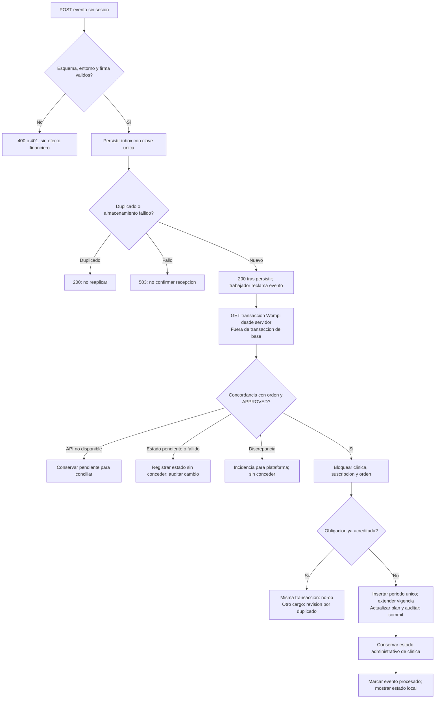
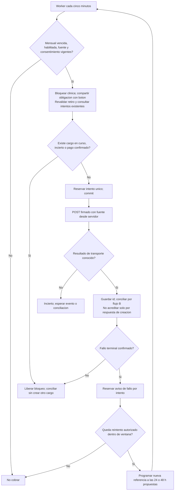
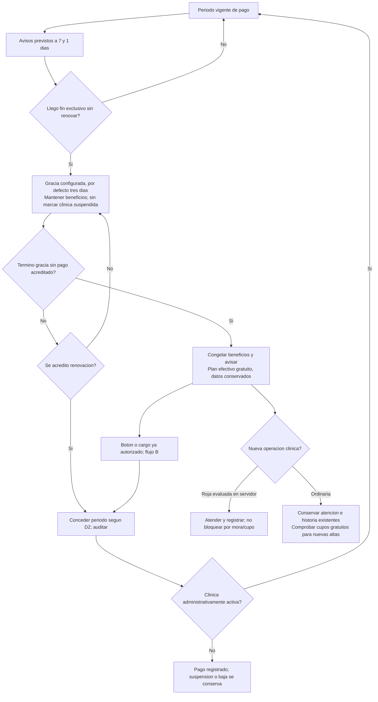

# M0-S — Suscripción y cobro con Wompi

> Estado: **S2 entregada, pendiente de revisión** · S1 aprobada e integrada · Aprobación y ajustes vinculantes en §9/§9.1
> Entrega: v2.1 · Fecha: 2026-10-24 · Rama comprobada: `release/v2.1.0`
> Escribe: **Codex** · Revisa: **Claude (arquitecto)** · Aprueba, integra y despliega: dueño del producto

## 1. Resultado y límites

**Resultado:** el administrador de una clínica podrá contratar o renovar el profesional con Wompi, ver vigencia e historial y, después de esa primera entrega, autorizar el cobro automático mensual mediante una fuente guardada. La plataforma aplicará vencimiento, gracia, congelación de beneficios y recuperación del plan sin borrar información ni impedir urgencias rojas. El super-administrador verá estados y pagos, sin entrar en datos clínicos.

**Registro histórico de la entrega inicial de planificación:** se escribió este archivo y la anotación pedida en `agentes/estado.md`, sin código, SQL ni cambios en `documentacion/`. Claude Code trabajaba simultáneamente en el Inicio del administrador. Las propuestas se aprobaron después en §9/§9.1 y S1 trasladó la especificación; los anexos de S1/S2 describen la implementación y su verificación actuales. No se incrementa versión en estas subetapas.

### 1.1 Decisiones confirmadas del dueño — 2026-10-24

1. Pasarela **Wompi Colombia**, primero **A: botón Pagar/Renovar**, con ventana Wompi y tarjeta/PSE/Nequi, confirmado por evento; después **B: cobro automático mensual** con fuente de tarjeta o Nequi.
2. El cobro real deja de ser futuro: RF-F.1 entra en **v2.1**. Se propone absorberlo en RF-0.7 y ampliar HU-0.5, sin crear otra HU.
3. Profesional: **$89.990 COP/mes** o **$899.900 COP/año**, «paga 10, usa 12». Un cambio de precio no modifica un periodo ya pagado.
4. **Tres días de gracia** después del vencimiento, como parámetro con ese valor por defecto. Al terminar se congelan beneficios conforme a RN-007/RN-013. **RN-420 se conserva: una urgencia roja nunca se bloquea por cupo ni mora.**
5. Correos al administrador: **7 días antes**, **1 día antes**, **el día de congelación** y, con automático, **cobro fallido**.
6. Reutilizar la tarjeta **Uso del plan** del nuevo Inicio del administrador **sin rediseñarla**; solo añadir su conexión al módulo una vez entregado ese Inicio.

Los demás valores/políticas de este plan se identifican como propuestas; se aprueban expresamente con las decisiones de §6, sin atribuirlos al dueño como ya confirmados.

### 1.2 Inventario comprobado y contradicciones

| Fuente actual | Hallazgo e implicación |
|---|---|
| `database/01_schema.sql`: `planes` | Precios enteros en **pesos**, límites anulables; no convertir esas columnas a centavos sin migrar todos sus lectores. El servidor de pagos convertirá pesos a centavos enteros. |
| `suscripciones` | `id_clinica`, `id_plan`, `estado` activa/suspendida/cancelada, `ciclo`, `al_dia`, `fecha_inicio` y `fecha_fin` de tipo DATE; sin precio contratado, pago, fuente ni registro de renovaciones. |
| `clinicas` | `id_plan` y estado administrativa pendiente_verificacion/activa/suspendida/baja. **Suspensión administrativa y mora son independientes.** |
| `helpers/LimitePlan.php::plan()` | Lee la última suscripción por id y sus banderas, pero **no la fecha de vencimiento**. `transaccion()` bloquea la fila de clínica; `consumir()` deja pasar rojo evaluado por servidor. Centralizar aquí el plan efectivo, compartido con el nuevo Inicio, sin duplicar cálculos en vistas. |
| `models/Plataforma.php::cambiarSuscripcion()` | Cambia plan/estado de la última fila o la crea sin vencimiento; actualiza `clinicas.id_plan` y audita. Debe delegar en el nuevo servicio para no saltarse la vigencia ni producir pagos ficticios. |
| `database/02_semilla.sql` | Profesional inicial a 100.000/960.000; INSERT IGNORE no sobrescribe precios existentes. Hace falta migración explícita, conservando tarifas personalizadas para revisión. |
| HU-0.5 / RE-0.5.4 / RF-F.1 / RN-008 | Excluyen pasarela o conservan precio anterior. **Se sustituyen expresamente** por las propuestas de §2, tras aprobación. No se altera silenciosamente la exclusión vigente. |
| RE-0.5.5 | Su ejemplo impide otra mascota a partir de 40, aunque RN-003 y RE-0.4.7 permiten 50. Propuesta: permitir hasta 50 y bloquear la 51; mantener todos los datos existentes. |
| `scripts/zooki.cron`, Dockerfile y `docker/iniciar.sh` | El contenedor web **no ejecuta cron**. Dokploy usa Schedules externos; el inicio aplica migraciones/conocimiento y arranca Apache. No agregar un bucle de cobros al arranque ni duplicar el vigilante clínico. |
| `scripts/vigilar_atenciones.php`, `models/EventoAgenda.php`, `helpers/CorreoAgenda.php` | Hay patrones de reloj/zona, reclamación de trabajo, SMTP posterior al commit y envío incierto. Reutilizar el patrón y helpers transversales; no usar entidades de agenda para cobrar. |

El esquema actual tiene 59 tablas de negocio y migraciones hasta la 11. El comentario antiguo de cabecera de `01_schema.sql` aún dice 58: se corregirá cuando se toque el esquema en S1. El inventario es lectura del checkout del 24/10, no comprobación de producción.

**Destino:** [MER](../documentacion/MER.md), [Modelos](../documentacion/Modelos.md) §12.1.1/§12.2 y nueva §12.7 propuesta en §5.4; [HU](../documentacion/HistoriasUsuario.md), [RE](../documentacion/RequisitosEspecificos.md), [RN](../documentacion/ReglasNegocio.md) y [ERS](../documentacion/ERS.md).

**Fuera de alcance:** facturación electrónica DIAN, integración contable, dispersión de fondos, marketplace por clínica, cupones, prorrateos no aprobados, cobro automático anual, PSE recurrente, reembolsos automáticos, bandeja nueva de avisos y rediseño del Inicio. Contracargos/anulaciones y pagos dobles se detectan y pasan a revisión; no se improvisa una devolución ni se borra un periodo histórico. No se cierra ninguna otra HU de v2.1 por este módulo.

## 2. Trazabilidad y textos normativos propuestos

### 2.1 Historias y requisitos funcionales

**Sustitución completa propuesta de HU-0.5 — Suscripción, pagos y congelación por mora.** Prioridad Alta; estado Planificada (v2.1); estimación **por reestimar**, sustituyendo los 5 puntos que solo cubrían congelación. Actor principal: administrador de clínica; actor secundario: super-administrador.

> Como administrador de una clínica, quiero contratar o renovar el plan profesional, consultar mis pagos y autorizar o retirar su cobro automático mensual para conservar sus beneficios y conocer cuándo vence, sin perder datos si no renuevo.

**Criterios de aceptación propuestos:**

- Muestra plan contratado, plan efectivo, ciclo, precio total, próxima vigencia y situación al día/en gracia/congelada; el gratuito no tiene vencimiento de pago ni cobro.
- Pagar/Renovar abre Wompi por un importe calculado en servidor, con referencia única. Solo un pago verificado concede periodo; cerrar la ventana o regresar al sitio no lo concede.
- Conserva precio y duración del periodo comprado; muestra historial con fecha, referencia, ciclo, importe, estado y periodo concedido, sin medios completos ni datos clínicos.
- Mantiene beneficios durante la gracia parametrizada de 3 días; después solo limita nuevas altas al cupo gratuito, sin ocultar datos, y mantiene la excepción roja.
- Envía los cuatro tipos de correo acordados, sin duplicarlos por repetir la tarea.
- En la segunda entrega permite guardar una fuente y autorizar cobro automático **mensual** por separado; guardar no implica autorizar. Quitar la fuente o retirar autorización detiene futuros cargos, sin acortar lo pagado.
- Cada cambio persistido de estado, autorización, intento y periodo se audita. El super-administrador consulta los pagos por clínica; sus ajustes manuales no se presentan como pagos Wompi.

**Reglas:** RN-003/007/008/013–019, RN-420, RN-G01/G05/G13 y RNF-11/12/16. **RF:** RF-0.5 y RF-0.7. **Dependencias:** HU-0.3/HU-0.4 y entrega del Inicio del administrador para su enlace visual; S1 no depende de rediseñar ese Inicio.

**Adiciones a HU-0.3:** «Consulta por clínica el estado contractual y efectivo de la suscripción, sus vigencias y el historial de pagos e incidencias de conciliación, sin acceder a datos clínicos ni iniciar cobros con la fuente de la clínica. Un ajuste administrativo exige motivo y se distingue de un pago confirmado». Conserva todos sus criterios existentes; moderación RE-0.3.6 sigue en su módulo.

**Precisión de HU-0.4:** sustituir la lectura de “suscripción al día” por «plan efectivo obtenido del servicio de suscripción con fecha actual; conserva el profesional durante su gracia». Los límites de RN-003 y la prioridad roja calculada en servidor permanecen.

**Texto de RF-0.5 propuesto:** «Asignar y controlar por clínica el plan contratado y el efectivo, su vigencia y gracia parametrizada; congelar los beneficios de pago al terminar la gracia y recuperarlos al acreditar un periodo. La mora o la bajada al gratuito no ocultan ni borran datos: solo limitan nuevas altas a los cupos gratuitos, con excepción de urgencias rojas». Aceptación: prueba en ambos bordes de vencimiento/gracia y recuperación; clínica suspendida administrativamente no se reactiva por pagar.

**Nuevo RF-0.7, prioridad Alta, entrega v2.1:** «Cobrar la suscripción mediante Wompi: primero pago voluntario con botón y, posteriormente, renovación automática mensual autorizada con fuente guardada; verificar y conciliar transacciones en servidor, aplicar cada periodo una sola vez y mostrar el historial al administrador y al super-administrador». Aceptación: evento firmado más consulta API concordante; duplicados no duplican periodo ni cargo; pruebas con cliente falso.

**RF-F.1:** retirar su fila del catálogo de futuros y registrar su equivalencia histórica **RF-F.1 → RF-0.7 (v2.1)**, sin renumerar RF-F.2…RF-F.8. La automatización es responsabilidad de Zooki, no se presupone una API de “suscripciones Wompi”.

### 2.2 RE — texto exacto y aceptación propuesta

Se reemplazan RE-0.5.1–5; se añaden consecutivamente RE-0.5.6–26 y RE-0.3.7. No quedan saltos ni un RE que siga prohibiendo la pasarela.

| ID | Requisito propuesto | Criterio verificable | Etapa |
|---|---|---|---|
| RE-0.5.1 | Registrar ciclo mensual o anual, vigencia y precio contratado sin modificar periodos pagados. | 89.990 COP genera 8.999.000 centavos; 899.900 genera 89.990.000. Un cambio posterior de catálogo conserva importe y fechas anteriores. | S1/S2 |
| RE-0.5.2 | Mantener beneficios de pago durante la gracia configurada y aplicar luego el gratuito a nuevas altas. | Con fin exclusivo 25/10/2026 00:00 y gracia 3, profesional hasta antes del 28/10 00:00; desde ese instante gratuito efectivo aunque el cron se retrase. | S1 |
| RE-0.5.3 | Ejecutar vencimiento, congelación y reserva de avisos mediante tarea programada, sin depender de visitas. | Dos ejecuciones y dos trabajadores simultáneos materializan una transición y un aviso por destinatario; reloj inyectado cubre días omitidos por caída del trabajador. | S1 |
| RE-0.5.4 | Permitir en v2.1 pagar o renovar con botón Wompi mediante tarjeta, PSE o Nequi habilitados para el comercio. | Abre la ventana con configuración del servidor; pago pendiente/declinado o cierre no amplían vigencia. El anterior veto RF-F.1 queda sustituido. | S2 |
| RE-0.5.5 | Conservar datos y atención de mascotas existentes al caer al gratuito, limitando solo nuevas altas sobre su cupo. | Con 40 mascotas permite 41…50; rechaza 51. Con 60 existentes permite consultarlas y atenderlas sin borrar/desvincular diez; rojo se registra aun al límite. | S1 |
| RE-0.5.6 | Emitir los avisos de vencimiento con anticipaciones configuradas, por defecto 7 y 1 días, y al congelar. | Fecha, clínica, destinatario y vencimiento correctos; gratuito/pagada renovación no reciben aviso obsoleto; ejecutar dos veces no repite. | S1 |
| RE-0.5.7 | Auditar atómicamente los cambios de suscripción, pago, fuente y autorización, sin secretos ni datos de tarjeta. | Auditoría fallida revierte periodo/estado local; trabajador identifica origen automático y clínica; ningún registro contiene llaves, tokens de medio, PAN o CVC. | Todas |
| RE-0.5.8 | Autorizar pagos y gestión de fuentes solo al administrador del contexto clínico activo. | Vet, propietario, plataforma como pagador y administrador de otra clínica reciben 403; POST sin CSRF se rechaza. No se toma id_clinica del formulario como autoridad. | S1/S2/S3 |
| RE-0.5.9 | Mostrar estado contractual y efectivo, próxima fecha y opciones pertinentes sin rediseñar Uso del plan. | Escritorio y móvil: al día, gracia y congelada coherentes con los límites; Pagar/Renovar lleva al módulo. Concesión antigua sin fecha se identifica sin inventarla. | S1/S4 |
| RE-0.5.10 | Crear orden e intento con referencia única y clave de operación, calculando moneda, precio y centavos en servidor. | Dos clics/dos pestañas con la misma versión devuelven la misma orden; manipular monto, clínica, plan, ciclo o firma no permite otra tarifa ni otro beneficiario. | S2 |
| RE-0.5.11 | Generar firma de integridad en servidor para cada transacción y mantener secretos fuera del navegador. | Vector SHA256 conocido y variaciones de monto/referencia/expiración; HTML/JS/respuestas/logs no incluyen llave privada ni secretos. Configuración incompleta deshabilita cobros, no la atención. | S2 |
| RE-0.5.12 | Validar la firma y el entorno de cada evento antes de aceptarlo como evidencia. | Firma inválida, propiedad ausente/no escalar o id no cubierto por firma no consulta API ni altera negocio. Propiedades adicionales válidas respetan su orden; sandbox nunca acredita producción. | S2 |
| RE-0.5.13 | Consultar la transacción en la API de Wompi y cotejarla con el intento local antes de acreditar. | Solo APPROVED concordante en id, comercio cuando se informe, referencia, importe, moneda, entorno y beneficiario local concede periodo. API caída conserva evento pendiente; ninguna redirección acredita. | S2 |
| RE-0.5.14 | Deduplicar eventos e intentos y aplicar cada pago lógico una sola vez, incluso con concurrencia. | Evento repetido, dos eventos distintos del mismo pago y dos procesos simultáneos dejan un periodo. Otro pago real para la misma obligación queda como cobro duplicado a revisar, sin desaparecer del historial. | S2 |
| RE-0.5.15 | Conservar estados pendientes/inciertos y conciliar sin repetir un cargo de resultado desconocido. | Corte después de POST remoto, antes de guardar su id, no dispara otro POST. Un evento tardío recupera el intento por su referencia; un evento viejo no revierte un aprobado. | S2/S3 |
| RE-0.5.16 | Calcular periodos con calendario y ancla contractual, conservando saldo temporal al renovar. | 31/01 → último día de febrero → 31/03; anual desde 29/02 conserva regla de año bisiesto. Renovación anticipada no pierde días. Caso de gracia y cambio de ciclo se fija con D2/D3. | S1/S2 |
| RE-0.5.17 | Mostrar historial financiero propio sin fuentes completas ni datos clínicos. | Solo clínica autorizada; paginación estable y salida escapada de fecha, referencia, ciclo, importe, estado y periodo; id de otra clínica denegado. | S2 |
| RE-0.5.18 | Registrar fuentes de tarjeta o Nequi mediante tokenización Wompi y aceptación explícita. | Sin las dos aceptaciones o sin fuente verificada del servidor no se guarda. Solo id externo, tipo y marca/últimos 4 disponibles, más metadatos de vínculo/consentimiento; PAN/CVC/teléfono Nequi no persisten en la fuente. | S3 |
| RE-0.5.19 | Exigir autorización separada del automático mensual y permitir retirarla o quitar la fuente. | Guardar no activa el automático. Retirar antes de reclamar trabajo evita el cargo; retirar tras envío informa cargo en curso y detiene los siguientes. Lo pagado conserva su vigencia. | S3 |
| RE-0.5.20 | Generar un único cobro automático por obligación mensual vencida y autorizada. | Dos workers y pago manual concurrente comparten la obligación; no emiten dos envíos automáticos ni otro mientras el manual está en curso. Plan gratuito, anual, fuente ajena/inactiva o clínica no elegible no generan cargos. Un duplicado externo sigue .14/.24 y D5. | S3 |
| RE-0.5.21 | Reintentar solo fallos terminales confirmados, con calendario y máximo configurados. | Propuesta inicial +24/+48 h, tres intentos totales: cada intento tiene nueva referencia; PENDING/resultado incierto no habilita otro. Se detiene al pagar, retirar consentimiento o agotar ventana. | S3 |
| RE-0.5.22 | Avisar por correo de cada intento automático fallido confirmado sin duplicarlo por repetir el evento. | Dos eventos del mismo intento producen un aviso; no se comunica “rechazo” ante mero timeout, y el cuerpo no revela medios completos ni secretos. | S3 |
| RE-0.5.23 | Descongelar beneficios al acreditar el periodo sin levantar una suspensión administrativa. | Pago aprobado restaura profesional en clínica activa; en suspendida/baja conserva el pago e incidencia, pero no cambia estado de clínica ni habilita contextos. | S2 |
| RE-0.5.24 | Separar entornos y conciliar anulaciones o discrepancias sin borrar evidencia financiera. | Id de transacción reutilizado en otro entorno no colisiona ni concede acceso real; VOIDED después de un aprobado e importe divergente generan incidencia auditada para revisión, sin repetir concesión. | S2/S4 |
| RE-0.5.25 | Conservar suscripciones legadas y distinguir concesiones administrativas de periodos pagados. | Filas sin fecha no se cobran ni congelan por adivinar un vencimiento; precio personalizado no se sobrescribe; super-admin regulariza con motivo y fecha, nunca con transacción Wompi inventada. | S1/S4 |
| RE-0.5.26 | Conservar prueba del consentimiento y exigir renovación si cambia el importe autorizado o los términos aplicables. | Cambiar catálogo no cobra automáticamente el nuevo importe sin aceptación; tokens de aceptación vencidos no se reutilizan. El historial conserva actor, fecha, condiciones e importe consentido. | S3 |
| RE-0.3.7 | Permitir al super-administrador consultar pagos, vigencias e incidencias de cada clínica como metadatos de plataforma. | Ve dos clínicas y sus pagos/filtros, sin enlaces clínicos ni credenciales/fuentes completas; otros roles reciben 403. Ajustes separados y auditados no marcan un pago como aprobado. | S4 |

**RE existentes a precisar, sin nuevos números:**

- **RE-0.4.1:** «Leer en servidor el plan efectivo a la fecha actual mediante el servicio único de suscripción, incluida la gracia; comprobar cupo y alta bajo bloqueo de clínica. Una invitación vigente reserva cupo». Aceptación adicional: el mismo instante da el mismo límite en operación e Inicio, aunque el cron no haya materializado el estado.
- **RE-0.3.1:** añadir «plan contratado/efectivo, vigencia, gracia y estado de cobro diferenciados»; probar dos clínicas y estados distintos.
- **RE-0.3.2:** «Cambiar plan o conceder/retirar un beneficio administrativo exige motivo, fecha de efecto y vencimiento cuando corresponda. Se conserva el periodo pagado, la auditoría y su origen; no fabrica pagos ni aprueba intentos Wompi. Las restricciones administrativas siguen separadas». Política de concesión: D6.
- **RE-0.4.6 / RN-420:** mantener texto de excepción roja y actualizar su evidencia al recorrido ya construido en M4; esta planificación no declara de nuevo probada aquella entrega.

Tipos de los nuevos RE: Seguridad para .7/.8/.11/.12/.18/.19/.26; Confiabilidad para .14/.15/.21/.24/.25; Cálculo para .1/.2/.16; Usabilidad para .9; Funcional/Integración para los demás. Prioridad Alta, salvo historial/avisos/panel de consulta, Media. Se trasladarán a las cinco columnas del catálogo vigente.

### 2.3 RN — texto exacto propuesto

| ID | Texto propuesto | Tipo / estado durante construcción |
|---|---|---|
| RN-007 (sustituir) | Una suscripción de pago conserva sus beneficios hasta el fin del periodo y durante su gracia configurada, por defecto 3 días. Terminada la gracia sin periodo acreditado, se congelan esos beneficios hasta regularizarla; se aplican RN-013 y la excepción roja RN-420. La mora no suspende administrativamente a la clínica. | Proceso / Planificada (v2.1) |
| RN-008 (sustituir) | El plan profesional tiene precio inicial de $89.990 COP al mes o $899.900 COP por año anticipado, «paga 10, usa 12». El super-administrador puede cambiar el catálogo con auditoría; cada compra conserva importe, moneda, ciclo y vigencia contratados. Ningún cambio modifica un periodo pagado ni autoriza un aumento automático sin nuevo consentimiento. El cobro real con Wompi pertenece a v2.1. | Cálculo / Planificada (v2.1); tratamiento tributario pendiente D1 |
| RN-013 (precisar) | Bajar al gratuito o congelar beneficios por mora no oculta ni borra datos: se sigue atendiendo a las mascotas existentes y consultando su historia. Solo se impiden nuevas altas de mascotas/vínculos, citas o personal que superen 50 mascotas, 100 citas/mes y 2 cuentas según RN-003, salvo urgencias rojas. No se desactiva personal ni se cancelan citas existentes para forzar el cupo. | Restricción / Planificada (v2.1) |
| RN-014 (nueva) | El acceso por suscripción se calcula por clínica con fecha actual y parámetros persistidos, sin depender del navegador ni del último cron. Los periodos usan intervalos de inicio incluido y fin excluido; la suspensión administrativa de la clínica prevalece sobre un pago. | Cálculo / Planificada (v2.1) |
| RN-015 (nueva) | Un pago solo acredita beneficios después de verificación del proveedor en servidor y coincidencia con la obligación local. Una obligación concede periodo una sola vez; duplicados, estados inciertos o discrepancias se concilian sin emitir otro cargo a ciegas ni borrar evidencia. | Restricción / Planificada (v2.1) |
| RN-016 (nueva) | El cobro automático es mensual, voluntario y requiere fuente disponible y autorización explícita del administrador. Guardar una fuente no autoriza cargos; quitarla o retirar autorización detiene los futuros. Los reintentos son limitados, configurados por clínica y solo siguen fallos terminales confirmados. | Proceso / Planificada (v2.1) |
| RN-017 (nueva) | La plataforma avisa por correo al administrador antes del vencimiento, por defecto a 7 y 1 días, al congelar y ante cobro automático fallido. Cada aviso se identifica por clínica, obligación o vencimiento, tipo y destinatario para no duplicarlo al repetir eventos o tareas; un fallo de correo no invalida un pago ni bloquea atención. | Proceso / Planificada (v2.1) |
| RN-018 (nueva) | Zooki conserva de la fuente externa únicamente su identificador, tipo y marca/últimos cuatro cuando existan, además del vínculo y prueba de consentimiento. Su servidor no recibe números completos, CVC ni credenciales del medio; recibe el token efímero para crear la fuente, pero no lo persiste ni registra. Los secretos de integración permanecen en el servidor. | Restricción / Planificada (v2.1) |
| RN-019 (nueva) | Solo el administrador de la clínica en su contexto activo contrata, paga y administra su autorización automática. El super-administrador consulta metadatos financieros y realiza ajustes administrativos identificados, con motivo y auditoría; no usa fuentes de una clínica para iniciar cobros ni accede a datos clínicos. | Restricción / Planificada (v2.1) |

**Se conservan sin alterar:** RN-003 (50/100/2 y profesional sin límites), RN-420 y RN-G05. RN-004 se precisará con «metadatos de suscripción y pagos» en su lista de datos de plataforma, manteniendo su prohibición clínica; no se amplía a fuentes completas.

### 2.4 Matriz de entrega y coherencia documental posterior

| HU | RE incluidos | RN/RNF | Etapa | Evidencia prevista |
|---|---|---|---|---|
| HU-0.5, HU-0.4 | RE-0.5.1/2/3/5/6/7/9/16/25; RE-0.4.1/6/7 | RN-003/007/008/013/014/017, RN-420/G05; RNF-11/16 | S1 | Reloj de bordes, 50/51, legado, trabajador doble, rojo, avisos/outbox y migración doble. |
| HU-0.5 | RE-0.5.4/8/10–17/23/24 | RN-015/019/G05/G13; RNF-11/12 | S2 | Cliente falso, firmas, evento/API, concurrencia y recuperación de corte. |
| HU-0.5 | RE-0.5.18–22/26; regresión .7/8/14/15 | RN-016/018/019/G05; RNF-11/12 | S3 | Fuentes/consentimiento, 3 intentos propuestos, retiro concurrente, importes cambiados e inciertos. |
| HU-0.3, HU-0.5 | RE-0.3.1/2/7 y RE-0.5.9/17/24/25 | RN-004/019/G05/G13; RNF-11/16 | S4 | Dos clínicas, estados/historial, sin datos clínicos; suites finales y prueba del dueño. |

Al implementar se añadirán HU-0.5 y HU-0.3 a RN-G05 en ambas matrices; HU-0.5 a RN-003/RN-420; RN-007/008/013–018 → HU-0.5; RN-014/015 → también HU-0.4; RN-019 → HU-0.3/HU-0.5. La matriz RN → HU → RE deberá enumerar los RE de las filas anteriores, no solo enlazar el plan. RF-0.7 se añadirá a trazabilidad/casos de uso de ERS y RF-F.1 quedará solo en equivalencias/historia.

Base leída: **96 HU, 435 RE, 120 RN y 59 tablas**. Propuesta completa: **96 HU, 457 RE (+22), 126 RN (+6), 65 tablas (+6)**; los cinco RE existentes se reemplazan, no se suman. Se suma RF-0.7 y se retira RF-F.1 del listado futuro, sin renumerar otros. Los conteos se recalcularán al integrar porque hay otro agente modificando documentos. HU-0.5 ya estaba entre las 16 HU de v2.1; no se añade una HU ni se conservan sin reestimación sus 5 puntos/62 puntos totales. Una revisión nueva por documento al cerrar, con Ficha, ERS, historial y descargas coherentes, **no en esta planificación**.

## 3. Etapas y dependencias

Todas las etapas empiezan después de aprobar este plan y las decisiones que las bloquean. Escribe **Codex**, revisa **Claude (arquitecto)** y prueba/integra el dueño; no se programa en paralelo sobre los mismos archivos del Inicio.

| Etapa | Entregable y límite de cierre | Dependencias / decisiones | Archivos previstos y pruebas |
|---|---|---|---|
| **S1a — base y vigencia** | Migración 12, modelo único de vigencia/gracia/congelación, precio y conservación del legado. Sin pasarela. Cierra .2/.5/.25 y estructura de .1/.16; RE-0.4.1. | Plan y D1/D2/D3/D6; congelación no cambia `clinicas.estado`. | `database/12_suscripcion_pagos.sql`, `01_schema.sql`, `02_semilla.sql`, drawDB, MER; nuevos `models/Suscripcion.php`, `helpers/VigenciaSuscripcion.php`, `helpers/TarifaSuscripcion.php`; adaptar `LimitePlan` y el ajuste de `Plataforma` en turno coordinado. `VigenciaSuscripcionTest`, `SuscripcionTest`, `SuscripcionMysqlTest`: bordes, fechas ancla, legado, cupos y auditoría/rollback. |
| **S1b — avisos y estado visible** | CLI de mantenimiento y outbox; estado/fecha visible en módulo de suscripción y contrato de enlace con Uso del plan. Cierra .3/.6/.9 y auditoría asociada. No obliga a tener llaves Wompi. | S1a, D7; enlace al Inicio solo tras entrega de Claude Code. | `scripts/gestionar_suscripciones.php`, `scripts/zooki.cron`, `models/AvisoSuscripcion.php`, `helpers/CorreoSuscripcion.php`, `controllers/SuscripcionController.php`, `views/admin/suscripcion.php`, JS/CSS propios, Security/rutas; `AvisosSuscripcionTest`, `TrabajadorSuscripcionTest`, concurrencia MySQL y `Suscripcion.test.cjs`. S1 cierra juntas S1a/S1b, sin declarar pagada la HU. |
| **S2a — cotización y botón** | Orden e intento únicos, firma/configuración segura, Widget y retorno informativo; historial propio. Aún no concede derechos hasta S2b. | S1, D1/D2/D3/D8, comercio configurado; solo entorno falso en pruebas. | `models/PagoSuscripcion.php`, `helpers/ClienteWompi.php` (interfaz), `helpers/ClienteWompiHttp.php`, `helpers/FirmaWompi.php`, `helpers/ConfiguracionWompi.php`; controlador/vista/JS/CSS de suscripción, `.env.example`, Dockerfile solo si requiere extensión HTTP. `PagoSuscripcionTest`, `FirmaWompiTest`, `SuscripcionPermisosTest`, JS de checkout. |
| **S2b — eventos y acreditación** | Inbox firmado, consulta API, conciliación, periodo atómico, recuperación de pendientes/inciertos y descongelación. Cierra pago con botón, .4/.8/.10–17/.23/.24. | S2a, D5/D9; contrato de Wompi de §8. | `controllers/WompiEventosController.php`, `models/EventoWompi.php`, `models/ConciliadorPago.php`, `Suscripcion`, trabajador, Security/rutas; `EventosWompiTest`, `ConciliadorPagoTest`, `SuscripcionMysqlTest` con barreras entre procesos. Revisión S2 antes de S3. |
| **S3a — fuente y consentimiento** | Tokenización hospedada, prueba de aceptaciones, registrar/quitar fuente y autorización separada. Sin cobrar hasta S3b. | S2, D4/D8; habilitación y contrato de aceptación verificados. | `models/FuentePago.php`, `helpers/AutorizacionCobro.php`, cliente Wompi/controlador/vista/JS; `FuentePagoTest`, `ConsentimientoCobroTest`, JS de aceptación/Nequi pendiente/retiro. |
| **S3b — mensual y reintentos** | Un cargo mensual por obligación; reintentos terminales, aviso de fallo y conciliación de inciertos. Cierra .18–22/.26. | S3a, D4/D8/D9; activación operativa explícita. | `models/CobroAutomatico.php`, `gestionar_suscripciones.php`, cliente falso, outbox; `CobroAutomaticoTest`, concurrencia MySQL manual/auto/retirar fuente, reloj adelantado y caída tras POST. |
| **S4 — plataforma y cierre** | Panel financiero por clínica, incidencias y ajustes separados; integración visual final; HU-0.5 implementada y evidencia de cada RE. | S2/S3 revisadas; D5/D6; turno exclusivo de los archivos compartidos. | `PlataformaController`, `Plataforma`, vistas/JS/CSS de plataforma existentes o parcial `views/plataforma/pagos.php`; `PagosPlataformaTest`, pruebas JS/aislamiento; documentos y Modelos, versión/historial de v2.1 y descargas al cerrar según decisión de publicación del dueño. |

S1a crea también tablas preparatorias de S2/S3 vacías: no abre rutas de pasarela ni autoriza cargos. Si la ejecución descubre un cambio de esquema adicional tras publicar 12, se usará la migración siguiente; nunca se reescribe 12 publicada. Cada subentrega tendrá su anexo corto y revisión antes de continuar. Los nombres de archivos nuevos son propuestas; las responsabilidades y fronteras de permisos sí son contrato del plan aprobado.

## 4. Datos y migración 12 — texto para MER y drawDB

### 4.1 Convenciones y entidades propuestas

Texto para MER: «La suscripción expresa el contrato y el acceso efectivo de la clínica. Una orden representa una obligación de renovación, con varios intentos externos; una orden acreditada concede un solo periodo inmutable. Los eventos verificados se deduplican antes de conciliar. Las fuentes se vinculan a una clínica y autorización; los avisos salen de una cola persistente. Ninguna entidad financiera contiene datos clínicos ni datos completos de un medio de pago».

InnoDB/utf8mb4_general_ci; ids internos BIGINT autoincrementales para las seis tablas nuevas y FKs INT compatibles hacia clínica/usuario/suscripción. Importes **BIGINT en centavos**, positivos, COP CHAR(3); claves externas/referencias/huellas con comparación binaria ASCII, no `general_ci`. Fechas de negocio DATETIME en America/Bogota; `timestamp` del proveedor conserva entero UNIX y las fechas ISO externas se normalizan antes de comparar. No se usarán float para dinero ni sumas PHP `+1 month` sin ancla.

| Tabla nueva | Columnas principales propuestas | Unicidad, índices y relaciones |
|---|---|---|
| `pagos_suscripcion` | `id_pago`, `id_clinica`, `id_suscripcion`, `id_plan`, `clave_obligacion` CHAR(64), `version_periodo_base` INT, `ciclo` mensual/anual, `moneda`, `subtotal_centavos`, `impuesto_centavos`, `total_centavos`, `tarifa_version` VARCHAR(50), `clave_operacion` CHAR(64), `cotizacion_hasta`, `estado` pendiente/confirmado/cancelado/revision, `proximo_intento`, `id_usuario_solicitante` nullable, `creado_en`, `confirmado_en` nullable. | UNIQUE clave_obligacion y UNIQUE (id_clinica, clave_operacion). FKs clínica/suscripción/plan/usuario; comprobar que la suscripción pertenece a la misma clínica en modelo y, cuando sea posible, FK compuesta. Índices clínica/fecha y estado/proximo_intento. Campos tributarios definitivos dependen de D1. |
| `intentos_pago` | `id_intento`, `id_pago`, `numero`, `entorno` test/prod, `referencia` VARCHAR(128), `id_transaccion_wompi` VARCHAR(128) nullable, `id_fuente` nullable, `origen` boton/automatico, `estado` creado/enviando/pendiente/aprobado/declinado/error/anulado/incierto, `codigo_error` acotado nullable, `creado_en`, `enviado_en`, `consultado_en`, `lease_token` CHAR(64) nullable, `lease_hasta` nullable. | UNIQUE (id_pago, numero), UNIQUE (entorno, referencia), UNIQUE (entorno, id_transaccion_wompi). FK orden y fuente, sin aceptar una fuente ajena. Índices estado/lease_hasta e id_pago. El importe proviene de la orden inmutable; no de una respuesta del navegador. |
| `wompi_eventos` | `id_evento` local, `clave_evento` CHAR(64), `id_evento_proveedor` VARCHAR(128) nullable, `entorno`, `tipo` VARCHAR(80), `id_transaccion_wompi` VARCHAR(128), `timestamp_proveedor` BIGINT, `checksum` CHAR(64), `huella_datos_firmados` CHAR(64), `datos_minimos` JSON, `id_intento` nullable, `estado` pendiente/procesando/procesado/ignorado/error/revision, `recibido_en`, `procesado_en`, `lease_token`, `lease_hasta`, `intentos_proceso`, `proxima_revision`, `codigo_error` nullable. | UNIQUE (entorno, clave_evento); índices entorno/transacción y estado/proxima_revision. FK intento tras resolución; ninguna id_clinica recibida del webhook determina permisos. No se guarda el cuerpo íntegro ni correo/teléfono de Wompi; whitelist de datos mínimos ya verificados. |
| `fuentes_pago` | `id_fuente`, `id_clinica`, `entorno`, `id_fuente_wompi` VARCHAR(128), `tipo` CARD/NEQUI, `marca` VARCHAR(30) nullable, `ultimos_cuatro` CHAR(4) nullable, `estado` pendiente/disponible/retirada/error, `creada_por` usuario, `creada_en`, `retirada_en` nullable; `consentida_en`, `version_contratos` VARCHAR(128), enlaces/huellas de contratos, `version_autorizacion`, `importe_mensual_autorizado_centavos` nullable. | UNIQUE (entorno, id_fuente_wompi); FK clínica/usuario; índice clínica/estado. Ningún PAN, CVC, fecha de tarjeta, teléfono/cuenta Nequi, token de tokenización ni JWT de aceptación persistido. El identificador externo es interno de servidor, no un identificador para elegir libremente desde el navegador. |
| `suscripcion_periodos` | `id_periodo`, `id_clinica`, `id_suscripcion`, `id_plan`, `id_pago` nullable, `origen` wompi/administrativo/legado, `ciclo`, `inicio`, `fin`, `dia_ancla`, `mes_ancla`, `hora_ancla`, `total_centavos` nullable, `moneda`, `creado_en`, `id_usuario_actor` nullable, `motivo` nullable. | UNIQUE id_pago para una concesión por orden; índices suscripción/inicio/fin y clínica/fin. FKs clínica/suscripción/plan/pago/usuario; comprobar no solapamiento bajo bloqueo de clínica. Un ajuste no sobrescribe la prueba de pago ni el periodo histórico. |
| `avisos_suscripcion` | `id_aviso`, `id_clinica`, `id_suscripcion`, `id_pago`/`id_intento` nullable, `id_usuario_destinatario`, `tipo` vence_7/vence_1/congelada/cobro_fallido, `clave_aviso` CHAR(64), `vencimiento_objetivo`, `programado_en`, `estado` pendiente/reclamado/enviado/error/incierto/obsoleto, `id_notificacion` nullable, `lease_token`, `lease_hasta`, `intentos`, `enviado_en` nullable. | UNIQUE clave_aviso; índices estado/programado_en y clínica/fecha. FKs de metadatos y a `notificaciones`; esta última conserva id_clinica y el registro de correo. El número del tipo es nombre estable, la anticipación se lee del parámetro. |

**Unicidad clínica:** las consultas de clínica siempre parten de su id del contexto; órdenes/periodos/fuentes se autorizan por esa misma clínica aunque el llamante conozca un id interno. La consulta global de plataforma y el trabajador de eventos son excepciones expresas RN-G13, limitadas a metadatos y probadas con dos clínicas. Nuevas FKs de negocio usan RESTRICT, no cascada destructiva.

### 4.2 Cambios en tablas existentes y parámetros

- **`suscripciones`:** añadir `gestion_cobro` legado/gestionada (por defecto legado para filas antiguas), `periodo_inicio`/`periodo_fin` DATETIME nullable (fin excluido), `estado_cobro` sin_vigencia/al_dia/gracia/congelada, `version_periodo` INT NOT NULL DEFAULT 0, `cobro_automatico` TINYINT DEFAULT 0, `id_fuente_activa` nullable FK a fuentes, `autorizado_por` nullable FK usuario, `autorizado_en`/`retirado_en` nullable, `cambio_ciclo_siguiente` nullable. Las últimas columnas son estado contractual/consentimiento, no datos del medio.
- Se conserva `estado` administrativa de suscripción y `al_dia` como proyección para compatibilidad. En gracia `al_dia=0`, pero el plan efectivo sigue siendo profesional; **todos** los lectores de permisos/Inicio/Plataforma se migran al servicio único en S1. No se entrega una mezcla de lectores antiguos que congelen antes de tiempo. `fecha_inicio`/`fecha_fin` siguen como fechas de presentación compatibles; para gestionadas se derivan del intervalo preciso, nunca compiten como otra fuente de verdad.
- No se añade una FK circular: crear primero fuentes y órdenes compatibles, después los enlaces de intentos/periodos y al final `suscripciones.id_fuente_activa`; el DDL consolidado reflejará ese orden. La fila canónica sigue siendo la última suscripción de cada clínica; todas las escrituras se serializan por clínica y delegan al servicio, sin insertar otra fila para evadir la obligación existente.
- **`clinicas`:** `suscripcion_gracia_dias` INT DEFAULT 3; `aviso_vencimiento_1_dias` INT DEFAULT 7; `aviso_vencimiento_2_dias` INT DEFAULT 1; `hora_aviso_suscripcion` TIME DEFAULT '07:00:00'; `cobro_reintento_1_horas` INT DEFAULT 24 y `cobro_reintento_2_horas` INT DEFAULT 48; `vigencia_cotizacion_min` INT DEFAULT 15. Propuestos salvo 3/7/1 confirmados. Validar valores no negativos, anticipaciones ordenadas y reintentos crecientes; no lanzar reintentos después de la ventana de gracia. Cambiar configuración no altera el importe ya consentido. No se construye en este módulo toda HU-7.5: parámetros iniciales persistidos y ajuste administrativo auditado; UI general pertenece a su módulo.
- **`planes`:** conservar precios en COP; semilla nueva a 89.990/899.900. Migración compara el par antiguo 100.000/960.000 antes de cambiarlo: si coincide aplica el nuevo; si hay otra tarifa la conserva, la reporta para decisión del dueño y no habilita cobro real con una tarifa no regularizada. No hace UPDATE en cada arranque. D1 determina desglose tributario antes del DDL definitivo; no se agregan impuestos encima del precio confirmado sin autorización.

### 4.3 Migración, conservación y despliegue

**`database/12_suscripcion_pagos.sql` propuesta**, aún no escrita. Comienza con SET NAMES utf8mb4. Usa comprobación de information_schema para columnas/índices/FKs y creación condicional de tablas; después valida su forma esperada, sin considerar “ya existe” como prueba de compatibilidad. INSERT de configuración solo si falta; sin REPLACE, sin sobrescribir datos o consentimientos. DEFAULT JSON no portable: columnas JSON anulables y relleno explícito compatible MySQL 8/MariaDB 10.4. No se modifica ninguna migración publicada.

Para filas con `fecha_fin` existente, convertir su interpretación propuesta de **último día pagado incluido** a fin excluido del siguiente día 00:00; el dueño debe confirmar D2 antes de migrar. Sin fecha fiable no se inventa un vencimiento, precio, pago ni consentimiento: conservar como legado, sin automático y pendiente de regularización con motivo. No habilitar masivamente el profesional ni congelar de golpe concesiones antiguas. Revisión previa de filas contradictorias/duplicadas; elegir la fila más reciente conforme al comportamiento actual y conservar las restantes como historia, no borrarlas.

Pruebas: instalación nueva 01+02+12, base v2 existente con datos y dos ejecuciones de 12/migrador, fallo parcial recuperable, claves/índices sin duplicar, precio personalizado intacto, gracia configurada conservada, cero huérfanos, cero cargos/avisos por ejecutar DDL. Los seis nuevos objetos y cada columna anterior se llevarán a MER y `database/modelo/drawdb_schema_v2.sql` antes de escribir código; `01_schema.sql` se sincroniza junto con 12 y `02_semilla.sql` conserva INSERT IGNORE. El siguiente número 12 se reservará al empezar S1: si otra entrega lo ha usado, se avisa y se renumera antes de publicar, sin colisiones.

**Operación:** respaldo verificable y despliegue conservando volúmenes; arranque automático mediante `docker/iniciar.sh` → migrador. Como Apache arranca aunque falle migrar, los cobros quedan deshabilitados hasta comprobar esquema, llaves/entorno, endpoint y Schedules. No “arreglar” producción reimportando 01/02. Recuperación: desactivar nuevos cobros, conservar el webhook/inbox y conciliar los ya enviados; no restaurar una instantánea antigua del libro de pagos ignorando cargos reales ocurridos después. Rollback de imagen solo si entiende el esquema conservado.

## 5. Código futuro, seguridad, pantallas y flujos

### 5.1 Fronteras de responsabilidad y rutas propuestas

`VigenciaSuscripcion` calcula fechas/estado sin PDO; `Suscripcion` obtiene el contrato por clínica; `LimitePlan` pregunta a ese servicio. `TarifaSuscripcion` valida catálogo y aritmética entera. `PagoSuscripcion` reserva obligación e intento; `FirmaWompi` implementa algoritmos; `ClienteWompi` es interfaz inyectable y `ClienteWompiHttp` su adaptador con timeouts/hosts fijos. `EventoWompi` persiste inbox; `ConciliadorPago` aplica resultado; `CobroAutomatico` reclama trabajo. `AvisoSuscripcion` y `CorreoSuscripcion` reservan y transportan fuera del commit. Nada de lógica de cobro en vistas ni llamadas HTTP bajo el candado de clínica.

| Acción propuesta en `public/index.php` y Security | Permiso y validación |
|---|---|
| `admin_suscripcion`, `suscripcion_estado_ajax`, `suscripcion_historial_ajax` | GET, contexto **ADMIN clínico activo**, clínica tomada de sesión; solo metadatos propios. |
| `suscripcion_pagar_ajax` | POST + CSRF, ADMIN, operación/versión y ciclo válidos; importe e id de clínica no son autoridad del cliente. |
| `suscripcion_fuente_ajax`, `suscripcion_automatico_ajax`, `suscripcion_retirar_fuente_ajax` | POST + CSRF, ADMIN; tokenización/consentimiento y fuente ligada a la clínica; serialización contra worker. |
| `suscripcion_retorno` | ADMIN, vista informativa del intento propio con código opaco. No aplica pagos ni llama API con una id arbitraria del navegador. Si requiere login reutiliza retorno interno seguro, sin redirect externo. |
| `wompi_eventos_test`, `wompi_eventos_prod` | POST público **sin sesión ni CSRF de navegador**, únicamente receptor de eventos con firma/entorno, tamaño y esquema validados. No es una API de consulta ni acepta elección de clínica. Entorno no desplegado rechaza; solo producción concede derechos reales. |
| `plataforma_pagos_ajax`, `plataforma_suscripcion_ajuste_ajax` | Solo contexto plataforma; consulta de metadatos cross-clínica explícita y ajuste POST + CSRF + motivo/fechas. Ninguna ruta cobra una fuente desde plataforma. |

Cada acción nueva se registra en la matriz y se prueba por rol/contexto; no basta ocultar botones. Validación junto al campo y en servidor, selección de ciclos por lista permitida, importes del servidor y salida escapada. Scripts de interfaz propios, datos por `data-*`, nunca JS/CSS en línea; el SDK externo se incluye por `src`. Confirmación Zooki solo para acciones graves según política vigente; guardar/quitar una autorización reversible se comunica con aviso breve y actualiza la pantalla antes del toast.

### 5.2 Contrato de seguridad e idempotencia

**Variables que se propondrá añadir a `.env.example`, sin valores reales:**

```dotenv
WOMPI_ENTORNO=sandbox
WOMPI_LLAVE_PUBLICA=
WOMPI_LLAVE_PRIVADA=
WOMPI_SECRETO_EVENTOS=
WOMPI_SECRETO_INTEGRIDAD=
WOMPI_COBROS_HABILITADOS=0
WOMPI_AUTOMATICOS_HABILITADOS=0
```

La configuración nace del servidor. Solo la llave **pública** y la configuración de una orden propia pueden llegar al SDK; privada y secretos nunca. API base según allowlist de §8, sin URL aportada por usuario/webhook; TLS verificado, sin redirecciones a hosts arbitrarios y sin registrar cabeceras Authorization. Producción y pruebas no comparten llaves ni datos: sandbox se ejecuta en un despliegue/base aislados, nunca sobre suscripciones reales; el despliegue productivo rechaza eventos test. Fallar cerrado si faltan credenciales o no corresponden al entorno. Producción no se activa solo por detectar llaves. No tocar `.env` en las tareas de agentes.

**Reglas locales de procesamiento:**

1. Reservar bajo bloqueo **clínica → suscripción → orden → intento** y confirmar la reserva antes del HTTP remoto. Esta es la misma primera exclusión de `LimitePlan`; fuente/autorización se comprueban en ella. Reclamar eventos/avisos en transacción corta y liberarla antes de adquirir clínica para no invertir el orden. No mantener transacción PDO abierta mientras Wompi o SMTP responde.
2. `clave_operacion` vincula doble envío del formulario al mismo resultado; `clave_obligacion` vincula botones, pestañas y worker al mismo ciclo/versionado. Cada **nuevo intento terminalmente justificado** tiene nueva referencia; una repetición técnica no crea intento. No se inventa un header Idempotency-Key soportado por Wompi: la garantía local se combina con referencia/conciliación y estado incierto.
   La obligación se identifica por clínica, suscripción canónica, versión del periodo y vencimiento objetivo; no por origen, medio, pestaña ni ciclo elegido. Elegir anual mientras existe un intento mensual en curso no crea otra obligación ni cambia el precio de aquella: primero se resuelve el intento. Al acreditar se incrementa la versión; una siguiente renovación legítima tiene otra obligación.
   Un intento de botón reservado también excluye al automático; cerrar la ventana no libera esa reserva. Caducar la cotización impide nuevas aperturas, pero no demuestra que una transacción ya iniciada haya fallado: mientras no se descarte un cargo en curso, se concilia o pasa a incierto. La apertura inicial nunca concede el profesional; crear una suscripción gestionada pendiente tampoco cambia el plan efectivo. El proveedor podría confirmar dos transacciones distintas pese a las defensas locales: se registran ambas y se aplica D5, sin prometer idempotencia externa que Wompi no documenta.
3. Al recibir, limitar/validar JSON y firma según §8; exigir id de transacción cubierto por los campos firmados. Normalizar hexadecimal y comparar en tiempo constante; si llegan checksum de cabecera y cuerpo, deben coincidir. No aceptar todo por estar en una IP atribuida a Wompi. No rechazar un evento legítimo solo por ser antiguo: sus reenvíos pueden llegar más tarde.
4. **La muestra oficial no trae id independiente de evento.** `data.transaction.id` identifica la transacción, no cada cambio. Propuesta D9: `clave_evento = SHA256` de la serialización canónica sin ambigüedades de entorno, tipo, id de transacción, timestamp, lista ordenada de propiedades y checksum verificado. Es el id idempotente local del evento; `id_evento_proveedor` queda NULL salvo soporte oficial futuro verificable. No deduplicar solo por transacción y perder un APPROVED posterior a PENDING.
5. Guardar evento válido en inbox durable antes del 200. Duplicado conocido devuelve 200 sin reaplicar; firma inválida 401/400 sin efecto; base indisponible 503 sin confirmar recepción; tipo desconocido firmado se registra ignorado y devuelve 200. Tras persistir, un error API queda pendiente y el worker reanuda: no depender de que Wompi repita. No prometer entrega exactamente una vez entre redes; sí efecto local único.
6. Consultar API en servidor; encontrar orden por **referencia que ya reservó Zooki**, nunca por correo de pagador ni id_clinica del evento. Verificar concordancia completa con §8 y tomar estado remoto actual: evento fuera de orden no rebaja un aprobado. Si API no devuelve un dato indispensable, registrar discrepancia y no aprobar por suposición.
7. Para acreditar, bloquear clínica y obligación, revalidar importes/versionado/estado actual, insertar un periodo UNIQUE id_pago y actualizar proyecciones/plan/auditoría en una transacción. Si auditoría falla, no marcar evento procesado: queda reintentable. Restricción única resuelve incluso dos eventos con distinta huella que anuncian la misma aprobación. Pago confirmado nunca se acredita dos veces.
8. Aprobación entre reserva y respuesta del POST es posible: una respuesta PENDING atrasada no revierte el resultado ya conciliado. Timeout/corte tras envío deja **incierto**, no “declinado”. Sin id remoto, esperar evento que resuelva referencia o conciliación operativa; no suponer un endpoint de búsqueda por referencia ni emitir otro POST porque “no respondió”. Una consulta 404 aislada tampoco prueba que no hubo cargo.
9. Otro cargo aprobado para obligación ya satisfecha se registra como incidencia de cobro duplicado y se notifica a plataforma, sin segundo periodo ni devolución automática. VOIDED/contracargo posterior no borra el historial; D5 define su tratamiento contractual. Quitar fuente inhabilita selección local inmediatamente; un cargo ya enviado sigue conciliándose.
10. Auditoría de RN-G05: actor usuario o NULL con origen trabajador/proveedor, clínica, entidad, transición, motivo/correlación y fecha; no credenciales, tokens o payload sin filtrar. Mutaciones locales revierten ante fallo de auditoría; recepción ya persistida se conserva para recuperación. Accesos de lectura financiera se limitan/autorizan, sin inventar identidad de usuario para el worker.

### 5.3 Pantallas y contrato con el Inicio concurrente

**Admin — Suscripción:** plan contratado/efectivo, al día/gracia/congelada, fecha/hora de fin y congelación, ciclo/precio total COP y botón Pagar/Renovar. Durante pendiente/incierto: aviso junto al botón, estado consultable al servidor y sin permitir un cargo alternativo ambiguo. Historial de órdenes con sus intentos/periodos, sin mostrar ids de fuentes externas completos. En S3, guardar fuente hospedada en Wompi, marca/últimos cuatro disponibles o «Nequi», aceptaciones no premarcadas, importe/periodicidad de la autorización y quitar/retirar automático. No pedir campos de tarjeta en formularios de Zooki.

**Plataforma:** filtro por clínica/estado/ciclo/fecha, vigencia y plan efectivo, historial de cargos, periodos y discrepancias; navegación paginada. No botón “cobrar a la clínica” ni acceso clínico. Un ajuste administrativo se presenta aparte de los pagos y exige motivo/fecha; no modifica la fila de transacción aprobada.

**Uso del plan:** conservar estructura, colores, proporciones y datos de uso del Inicio de Claude Code. El módulo propone un DTO del servicio con `plan_contratado`, `plan_efectivo`, `situacion`, `periodo_fin`, `gracia_hasta`, `cobro_automatico` y `puede_pagar`, además del resumen 50/100/2 existente. La conexión concreta a `PanelController`/parcial que resulte de aquella entrega se hará **después de su revisión**, en turno exclusivo. No crear otra tarjeta ni otra fórmula de cuotas. Comprobar móvil <768, tableta 768–1023 y escritorio ≥1024; el dueño prueba pantalla, no se rediseña el panel por integrar pagos.

### 5.4 Texto y diagramas propuestos para Modelos

Nueva sección **12.7 Suscripción y cobro — Módulo 0** (12.6 ya existe para reputación). Texto propuesto: «El servidor de Zooki reserva la obligación y calcula precio/periodo. Wompi procesa el medio; la redirección solo informa. Los eventos se verifican y se consultan por API antes de acreditar, bajo exclusión común de clínica y con efecto idempotente. Los trabajadores concilian pagos y ejecutan avisos/vencimientos independientemente del navegador. La gracia mantiene temporalmente beneficios; congelación aplica cupos gratuitos sin suspender la clínica ni impedir una urgencia roja».

Se ajustarán además §12.1.1 para consulta financiera/ajuste administrativo y §12.2 para sustituir el diamante “activa y al día” por “beneficios vigentes o en gracia según fecha actual”; la salida roja sigue antes de comprobar cupo. Los cuatro diagramas siguientes son el texto exacto propuesto de los nuevos recorridos, pendiente de aprobar políticas D2–D9.

**A — renovar con botón**



**B — evento verificado y extensión del periodo**



**C — cobro automático mensual y reintentos**



**D — vencimiento, gracia, congelación y recuperación**



### 5.5 Tareas programadas, Docker/Dokploy y XAMPP

Propuesta de un único entrypoint CLI **`scripts/gestionar_suscripciones.php`**, con `--solo=vencimientos|avisos|cobros|conciliacion` y `--revisar` sin escrituras, correo ni POST remoto. Rechaza HTTP (PHP_SAPI), inyecta PDO/reloj/cliente/transporte en pruebas y toma zona de `ReglaAtencion`. Sin sesión/usuario ficticio; identifica trabajador en auditoría. Vencimientos y avisos funcionan en S1 sin cliente de pasarela; cobros se habilitan solo después de S3.

| Trabajo | Frecuencia propuesta | Invariante |
|---|---|---|
| Vencimientos y congelación | Cada 5 minutos | Cálculo por fecha también protege operaciones entre pasadas; refresca estado/auditoría una vez por transición. |
| Avisos previos | Cada 5 minutos; reserva al alcanzar la hora 07:00 local configurada | 7/1 días de calendario; si se perdió una pasada, recuperar el aviso todavía útil más cercano, sin mandar juntos avisos antiguos. Congelación/fallo se reservan al evento, sin esperar a las 07:00. |
| Cobro automático | Cada 5 minutos | Solo al vencer el periodo y ser elegible; no se carga a las 7 de la mañana por confundirlo con aviso. Parámetros inicial/+24/+48 h propuestos; ninguna llamada de cobro en S1/S2. |
| Conciliación y outbox | Cada 5 minutos | Reclamación con lease y límite por lote; un enviando expirado pasa a incierto, no vuelve a POST. Evento con id permite GET; sin id espera resolución segura. SMTP después de commit; envío de resultado incierto no se repite a ciegas. |

Las cuatro funciones pueden correr secuencialmente en un Schedule del mismo CLI. Reclamar lotes pequeños, evitar un candado global durante HTTP y aislar errores por clínica. Persistir trabajo/marcas en MySQL: reconstruir el contenedor no pierde obligaciones. Un bloqueo por otra instancia omite esa unidad; no lanza un segundo cargo. Registrar resumen de ejecuciones y errores sin secretos, salida no cero ante fallo operativo y revisión del último éxito en plataforma/operación.

**Dokploy:** un Schedule sobre el servicio web cada cinco minutos, TZ America/Bogota, comando futuro `php /var/www/html/Zooki/scripts/gestionar_suscripciones.php`. Documentarlo también en `scripts/zooki.cron` como fuente versionada; este archivo no instala cron dentro de Docker. Conservar Schedules de respaldo, recordatorios, vigilancia de agenda y limpieza, sin duplicarlos. Llaves como entorno de PHP/Dokploy, endpoint HTTPS por ambiente y SDK/hosts permitidos. Verificar extensiones PHP HTTP/TLS/JSON necesarias y agregarlas al Dockerfile solo si faltan; no suponer que XAMPP y la imagen tienen el mismo cURL. El arranque migra, **no cobra**. Pausar la creación de cargos en una incidencia no debe apagar la recepción/conciliación de los ya emitidos.

**XAMPP:** Apache/MySQL encendidos para interfaz y base; Programador de tareas de Windows con `C:\xampp\php\php.exe`, argumento con ruta absoluta a `scripts\gestionar_suscripciones.php`, inicio en el repo, repetición de 5 minutos, “no iniciar otra instancia” y usuario con entorno adecuado. No depende de dejar una pestaña abierta. Probar antes `--revisar` y cliente falso con base aislada; redirigir logs a carpeta fuera de git sin claves. La API falsa/eventos locales cubren desarrollo; una prueba manual futura en sandbox necesita URL HTTPS accesible a Wompi, nunca exponer XAMPP o producción sin preparación. Esta planificación no instala tareas ni abre túneles.

## 6. Riesgos y decisiones pendientes para el dueño

Esta tabla conserva las propuestas originales; **§9/§9.1 registra las decisiones aprobadas y prevalece sobre ella**. D8/D10 siguen pendientes para dinero real. Ninguna etapa dependiente empieza por silencio y aprobar el plan no habilita producción.

| Decisión | Riesgo / alcance | Recomendación concreta | Antes de |
|---|---|---|---|
| **D1 — IVA, total y soporte tributario** | Cobrar una suma distinta a la anunciada; confundir comprobante con factura DIAN. | Mantener **89.990/899.900 como total final visible**, con IVA incluido cuando corresponda; confirmar con responsable contable condición tributaria y desglose exacto. Comprobante de pago no se anuncia como factura electrónica. No sumar IVA por defecto ni inventar tasa/condición legal. | S1/precios y S2 |
| **D2 — calendario y pago en gracia** | Cobrar días no prestados o regalar gracia al renovar; migrar DATE ambiguo. | Mes/año calendario con ancla, no 30/365 días. `fecha_fin` legado es último día incluido. Renovación anticipada extiende desde fin actual; **si paga en gracia, continuar desde el vencimiento anterior**; una vez congelada, empezar desde el instante local de acreditación tras verificar la API, sin cobrar tiempo congelado. No suponer un campo remoto de fecha de aprobación no comprobado. Mostrar fechas antes de pagar. Si el dueño prefiere gracia gratuita adicional se cambia texto, modelo de prueba y diagrama antes de S1. | S1 |
| **D3 — mensual a anual, anual a mensual y baja voluntaria** | Prorrateo ambiguo y pérdida del saldo temporal. | Sin prorrateos ni devolución automática en este módulo: cambio al siguiente vencimiento. Pago anual anticipado agrega 12 meses desde el fin ya comprado; anual→mensual al terminar el anual; retirar automático no reduce el periodo. No cambiar una orden con intento en curso. | S1/S2 |
| **D4 — reintentos y nueva tarifa automática** | Repetir cargos rechazados/ambiguos o cobrar más sin consentimiento. | Intento inicial al vencer, reintentos a +24 y +48 horas, **tres totales**, solo fallos terminales; configurados en clínica y dentro de gracia. Un cambio de importe exige nueva aceptación; sin ella avisar y usar botón, no cobrar silenciosamente el aumento. | S3 |
| **D5 — pago doble, VOIDED, contracargo y devolución** | Dinero cobrado sin segundo servicio, o retiro de beneficios legítimos. | Registrar incidencia financiera visible en plataforma, conservar lo acreditado/evidencia hasta revisión; resolver devolución externamente con el comercio y registrar resultado administrativo. No conceder otro periodo ni revertir automático sin política aprobada. Acordar responsable y plazo de atención antes de dinero real. | S2/activación real |
| **D6 — legado y concesiones manuales** | Congelar clínicas por fechas inexistentes o mantener beneficios indefinidos por accidente. | Conservar legado actual sin cobros automáticos; listado de regularización. Una concesión nueva exige motivo y fecha fin; ajustes no inventan pago ni levantan suspensión administrativa. El dueño confirma calendario de regularización y qué suscripciones reales ya estaban pagadas; no se infiere de al_dia=1. | S1 |
| **D7 — destinatarios y hora de correo** | Varias personas ADMIN, correos sin verificar o buzón abandonado. | Enviar a **todos los administradores activos con correo verificado** de la clínica; un aviso único por usuario/tipo/vencimiento o intento. Avisos previos a las 07:00 locales; congelación/fallo al siguiente despacho. Sin destinatario, registrar incidencia y mostrarla en plataforma; no enviarla a propietarios/vets ni a email_contacto por suposición. | S1b |
| **D8 — comercio Wompi, modalidad y consentimiento** | Disponibilidad de tarjeta/PSE/Nequi, recurrencia/COF/3DS y comisiones no acreditadas por leer la guía. | Confirmar titular/NIT de comercio, métodos y fuentes habilitados, costes de operación y texto de mandato; no repercutir comisiones sin decisión. Una cuota por cargo de tarjeta. Validar con Wompi el consentimiento vigente para cargos sucesivos, COF/3RI exigible y revocación remota específica CARD/NEQUI. Quitar fuente local detiene uso inmediato aunque la revocación remota no esté confirmada; no prometer borrado del proveedor. Manual sandbox solo en actividad separada autorizada; habilitar producción con checklist y permiso del dueño. | S2, S3 y producción |
| **D9 — identidad de evento e incertidumbre** | La guía no publica un id propio del evento ni se ha comprobado una búsqueda segura de transacción por referencia sin id. | Aprobar la **huella canónica del evento verificado como id local** y deduplicación adicional por transacción/orden; no confundir esos ids. Un POST incierto bloquea otro cargo hasta evento o conciliación operativa, sin inventar una API. Validar nuevamente el contrato oficial antes de implementar. | S2b |
| **D10 — conservación de datos financieros** | Guardar payloads/PII excesivos o borrar pruebas necesarias para controversias. | Libro financiero/auditoría sin borrado funcional; solo metadatos mínimos y contratos/consentimientos. Definir con responsable jurídico/contable plazos de conservación y supresión antes de datos reales, sin inventar un plazo legal. | Producción |

**Respuesta concreta sobre anual y precio nuevo:** la decisión ya confirmada protege los 12 meses pagados al precio de compra. Recomendación pendiente: la siguiente renovación anual usa la tarifa vigente aceptada en su nueva orden; una cotización dura 15 minutos propuestos y no habilita nuevos intentos al vencer, pero un cargo ya emitido y luego aprobado se concilia por su importe pactado, no se pierde por llegar tarde el evento. Si se pretende congelar el precio anual para siempre, hace falta otra decisión explícita.

**Riesgos técnicos con mitigación:** estado efectivo centralizado para no congelar temprano; bloqueo común por clínica y claves únicas para no conceder/cobrar dos veces; HTTP fuera de transacción y estado incierto para cortes; suspensión administrativa separada; inbox/outbox durables para caídas; inicialización de precios sin pisar catálogo personalizado; cambios de contrato/API verificados antes de S2/S3. Seguridad incluye protección por permisos, no solo firma. El widget es tercero: usar su interfaz hospedada, no copiar ejemplos con scripts en línea ni construir formulario propio de PAN/CVC.

## 7. Tareas y verificación

- [ ] Dueño aprueba este plan y responde D1–D10 en los puntos que bloquean cada etapa; se incorporan las respuestas al mismo archivo.
- [ ] Claude revisa coherencia de RE/RN/datos/diagramas, idempotencia y convivencia con Inicio; acordar turno exclusivo para archivos compartidos antes de S1.
- [ ] S1 traslada a HU/RE/RN/ERS/MER/drawDB los textos aprobados y ajusta Modelos en la misma entrega, sin subir revisión documental hasta cierre; ninguna nueva columna nace solo en código.
- [ ] S1a/S1b verificadas y revisadas antes de integrar cobros; S2a/S2b verificadas y revisadas antes de S3; S3a/S3b y S4 con sus anexos/evidencia.
- [ ] Cada RE tiene prueba significativa o verificación visual indicada, incluido el ajuste de RE-0.5.5 y el comportamiento rojo; no cambiar esperados para ocultar contradicciones.
- [ ] Migración 12 repetida en instalación nueva/existente y fallo parcial; probar MySQL 8 del CI y MariaDB local, siempre en `zooki_test_base_v2`, nunca en la base de trabajo.
- [ ] Suites de implementación: `vendor/bin/phpunit` completo sin host y `node --test --test-concurrency=1 tests/Frontend/*.test.cjs`; motor local dirigido a esquema/concurrencia nuevos, CI completo con MySQL 8 conforme al método vigente. No repetir suites ahora por un plan documental.
- [ ] Cierre con conteos/matrices, revisiones una vez, Ficha/historial y PDF/Word del portal; versión de v2.1 según publicación aprobada, no una subida por plan.
- [ ] Validación operativa futura de variables/HTTPS/Schedules con cobros aún apagados; el dueño aprueba pasar a sandbox manual y después a producción como pasos distintos. No confundir sandbox con dinero real.
- [ ] Entregar comandos Git explícitos solo de los archivos propios; el dueño hace commit/push/tags.

### 7.1 Batería prevista con cliente Wompi falso

`tests/Support/ClienteWompiFalso.php` implementará la interfaz, registrará llamadas y simulará payloads/estados/errores/relojes. El adaptador HTTP se probará con transporte falso; la configuración de pruebas rechazará cualquier salida de red a Wompi, **también sandbox**, y no usará llaves reales. Firmas usan secretos sintéticos y vectores locales; SMTP simulado o archivo en base local aislada. No se harán pruebas de contrato contra la pasarela dentro de PHPUnit/JS.

- **Fechas y límites:** un segundo antes/en/después de vencer y de acabar gracia, cambio de mes/año/bisiesto/ancla, cero gracia configurable, cron retrasado, 50/51 y 100/101, invitaciones que reservan cupo, consulta/atención existente y rojo en mora; misma respuesta de límites en Inicio y operaciones.
- **Migración/legado:** sin suscripción, gratuito sin fin, pago con fin histórico, profesional sin fecha, estados contradictorios, precio personalizado, repetición y recuperación del DDL; ninguna factura/cargo/consentimiento inventado.
- **Permisos:** dos clínicas, ADMIN clínico vs vet/propietario/plataforma; CSRF/método/ids/ciclo/manipulación de monto; respuesta y auditoría escapadas/sin secretos, sin campos clínicos en panel de plataforma.
- **Firmas/eventos/API:** suma exacta en centavos, firma de integridad con y sin expiración, propiedades firmadas variables/orden/tipos, checksums discordantes, entorno cruzado, referencia desconocida, API caída/404/monto/moneda no coincidentes, redirect falso, evento antes de respuesta, duplicados y eventos desordenados.
- **Concurrencia real:** dos procesos aprueban misma orden; manual contra automático; dos workers reservan mismo ciclo; retiro de fuente contra reclamación; caída antes/después de POST y antes/después de acreditar, auditoría falla y evento se reanuda. Barreras verifican bloqueo/resultado, no solo dos llamadas secuenciales.
- **Fuentes y reintentos:** Nequi pendiente no activa fuente; fuente de otra clínica o entorno rechazada; aceptación no premarcada, guardado sin mandato, revocación local, cambio de términos/importe, anual sin automático, tres intentos propuestos sin cuarto, PENDING/incierto sin reintentar; un correo por intento fallido.
- **UI/avisos:** abrir/cerrar widget, redirección informativa, actualización de estado antes de toast, no CSS/JS en línea, botón deshabilitado durante envío, filtros/paginación y tarjeta Uso del plan conservada. Outbox con dos workers, correo fallido/resultado incierto y aviso obsoleto tras renovación.

### 7.2 Cinco pruebas manuales del dueño al cerrar, no ejecutadas en este plan

1. Admin de clínica: Uso del plan conserva su diseño en móvil/escritorio y lleva a Suscripción con precio/fecha/estado coherentes; otra clínica no ve su historial.
2. En sandbox autorizado: botón tarjeta/PSE/Nequi habilitados, cancelar y aprobar; el retorno por sí solo nunca activa. Dos clics/eventos dejan un periodo.
3. Reloj de prueba aislado: vencimiento, tres días de gracia y congelación, correos 7/1/congelación; rojo y datos existentes accesibles, nuevas altas limitadas correctamente.
4. Fuente y autorización mensual: guardar, autorizar, fallo/reintentos y aviso; retirar/quitar detiene futuros cargos y no reduce el periodo comprado.
5. Plataforma: pagos/periodos/incidencias por clínica, concesión con motivo y fecha separada de pago real, y una clínica suspendida sigue suspendida después de pagar.

**Resultado de esta entrega de planificación — 2026-10-24:** inventario de solo lectura y documentación oficial consultada; numeración RE-0.5.1–26 y enlaces locales comprobados, cuatro diagramas renderizados como SVG mediante Mermaid 11 en Chrome sin interfaz, sin archivos de prueba añadidos al repo. Diff propio sin errores de espacios. Ningún RE se marca implementado: las suites, migración y pantallas anteriores son evidencia **prevista**, no ejecuciones ni aprobación del revisor. Solo se crearon este plan y la nota solicitada en estado, conservando el trabajo ajeno. No se generaron descargas del portal porque no se modificó `documentacion/`.

## 8. Documentación oficial de Wompi consultada — 2026-10-24

Fuentes primarias Colombia; se volverán a comprobar al implementar. Los enlaces apuntan a la sección correspondiente. No se contactó la API, no se creó comercio/transacción/fuente y no se verificó habilitación comercial. Las recomendaciones de arquitectura y negocio de este plan son propuestas de Zooki, no promesas de Wompi.

| Referencia | Sección consultada y contrato verificado |
|---|---|
| [Ambientes y llaves](https://docs.wompi.co/docs/colombia/ambientes-y-llaves/#ambientes-de-ejecución) | APIs separadas: `https://sandbox.wompi.co/v1` y `https://production.wompi.co/v1`. Llaves y secretos por entorno; el entorno del evento se expresa como test/prod. No mezclar pruebas con producción. |
| [Widget & Checkout Web — firma](https://docs.wompi.co/docs/colombia/widget-checkout-web/#paso-3-genera-una-firma-de-integridad) y [botón personalizado](https://docs.wompi.co/docs/colombia/widget-checkout-web/#botón-personalizado-opcional) | Integridad: SHA256 de referencia + importe entero en centavos + moneda + secreto; si se envía expiración, va antes del secreto. El SDK externo permite botón personalizado. La guía exige eventos para finalizar, no la redirección. La configuración la prepara el servidor. |
| [Eventos — Seguridad](https://docs.wompi.co/docs/colombia/eventos/#seguridad) y [Manejar un evento](https://docs.wompi.co/docs/colombia/eventos/#manejar-un-evento) | Checksum SHA256: concatenar valores en el orden de `signature.properties` bajo data, timestamp y secreto de eventos. La lista no es fija; checksum en cuerpo o X-Event-Checksum. Se responde 200 al recibir correctamente. La estructura publicada no muestra id propio de evento: D9 es diseño local. No implementar HMAC/RSA en sustitución del algoritmo documentado, pese a la terminología de la guía. |
| [Transacciones — Verificar estado](https://docs.wompi.co/docs/colombia/transacciones/#verificar-el-estado-de-una-transacción) | `GET /v1/transactions/{transaction_id}` actualmente requiere llave **privada** en backend; pública/sin autenticación ya no están soportadas. POST crea transacción; PENDING no es cobro aprobado. Estados documentados: PENDING/APPROVED/DECLINED/VOIDED/ERROR. La creación usa referencia, firma e importe en centavos. |
| [Fuentes — pasos 1, 2 y 3](https://docs.wompi.co/docs/colombia/fuentes-de-pago/#paso-a-paso) y [widget de tokenización](https://docs.wompi.co/docs/colombia/fuentes-de-pago/#widget-en-modo-de-tokenización) | Tarjeta/Nequi permiten fuentes; la fuente se crea en servidor mediante POST /payment_sources con llave privada y token del medio. Nequi exige autorización inicial hasta APPROVED. El cargo usa POST /transactions y payment_source_id. El widget ofrece modo tokenización; `recurrent`/COF tiene condiciones de franquicia/procesador. Habilitación, 3RI y revocación remota CARD/NEQUI quedan por verificar para este comercio (D8); no son garantía de la lectura. |
| [Tokens de aceptación — paso 1](https://docs.wompi.co/docs/colombia/tokens-de-aceptacion/#paso-1-obtener-los-tokens-de-aceptación-prefirmados) y [paso 4](https://docs.wompi.co/docs/colombia/tokens-de-aceptacion/#paso-4-enviar-los-tokens) | Se exigen `acceptance_token` y `accept_personal_auth`, con enlaces y aceptación explícita. Usar `GET /merchants/info` con header `x-merchant-public-key`. La guía anuncia retirada de `GET /merchants/:llave_publica_de_comercio` el **31/10/2026**: no iniciar integración con el endpoint antiguo que aún muestran otros ejemplos. Aceptaciones de Wompi y mandato mensual Zooki son pruebas distintas. |

No se presupone que Wompi programe los cargos por guardar una fuente, que la referencia convierta cualquier POST repetido en seguro, ni que quitar una fuente local la elimine del proveedor. Esas diferencias se reflejan en el cliente inyectable, estados inciertos y decisiones pendientes.

### 8.1 Reconsulta previa a S2 — 2026-10-24 (Codex)

Se volvieron a consultar las secciones oficiales enlazadas en §8: Widget (firma, expiración, botón personalizado y eventos), Eventos (checksum y reenvíos), Transacciones (GET autenticado), Ambientes y Tokens de aceptación (`/merchants/info`). No se detectó un cambio del contrato descrito en §8. No se llamó a las APIs ni se usaron llaves reales.

- **Precisión de implementación, sin cambio de contrato:** el ejemplo actual del GET de transacciones no incluye `environment` ni comercio. La procedencia se verifica mediante el host fijo y llave privada del entorno, más el entorno del evento firmado; si la respuesta incorpora entorno/comercio, también se cotejan. No se inventan campos obligatorios que el proveedor no publica.
- **Aceptaciones:** S2 abre el Widget hospedado, que recoge las aceptaciones y el medio. El adaptador usa `/merchants/info` con `x-merchant-public-key`; no incorpora el endpoint anterior. S3 implementará fuentes/mandato propio, sin anticiparlo en S2.
- **Cierre:** el SDK documenta `open(callback)` al finalizar, sin contrato de evento de cierre independiente. Cerrar no cancela la orden; consultar estado o volver a abrir reutiliza la misma referencia. Una cotización vencida sin resultado remoto queda incierta, sin crear otro intento a ciegas.
- **CSP:** revisar cabeceras existentes antes de añadir orígenes; el único script externo añadido es `https://checkout.wompi.co/widget.js`. Pruebas de navegador interceptan ese recurso con un SDK falso y bloquean toda red externa.
- **Diferencia detectada al comprobar el vector oficial:** [Eventos, pasos 3/4](https://docs.wompi.co/docs/colombia/eventos/#paso-3-concatena-tu-secreto) publica una cadena cuyo SHA256 real es `5a18ec5e8fdb7df463e9f94774cba8f583ba21bd04a09ceff2ea68a4bc0aefbe`, distinto al resultado `3476dda5…` impreso en esa misma guía. Se comprobó con PHP y una implementación independiente de .NET. No se copia ese resultado erróneo como firma válida; se sigue el algoritmo de concatenación descrito. **El dueño confirmó este criterio durante S2** (ver §9.3).

## 9. Revisión del arquitecto — 2026-10-24

**Revisó:** Claude (arquitecto). **Resultado: plan aprobable con cuatro ajustes**; falta la confirmación del dueño en D2–D7 y D9 (D8 y D10 bloquean solo la activación con dinero real).

- **Correcto y se conserva:** acreditar solo por evento firmado + `GET /v1/transactions/{id}` con llave privada (nunca por la redirección); firma de integridad SHA256 en servidor; importes en centavos calculados en servidor; idempotencia por obligación, referencia y huella del evento (D9); HTTP y SMTP fuera de la transacción; estado «incierto» que nunca dispara otro POST; urgencia roja intacta (RN-420); mora separada de la suspensión administrativa; corrección de RE-0.5.5 (permitir hasta 50, bloquear la 51); `GET /merchants/info` en vez del endpoint que Wompi retira el 31/10/2026; cliente Wompi falso en todas las pruebas.
- **Ajuste 1 (IVA, D1 resuelto):** el dueño es persona natural **no responsable de IVA** (RUT, responsabilidad 49). 89.990 y 899.900 son el total cobrado, sin IVA. `impuesto_centavos` se conserva en 0 para cuando cambie su condición; no se muestra ni se calcula IVA. El comprobante no se presenta como factura electrónica.
- **Ajuste 2 (parámetros más simples):** en `clinicas` solo `suscripcion_gracia_dias` (3), `aviso_vencimiento_1_dias` (7) y `aviso_vencimiento_2_dias` (1), que son decisiones del dueño. La hora del aviso (07:00), los reintentos (+24/+48 h, tres intentos) y la vigencia de la cotización (15 min) van como constantes con su RN en un helper, no como columnas: nadie los va a configurar por clínica en v2.1 y cada columna exige validación, migración y pruebas. RN-016 se ajusta a «reintentos fijos de la plataforma».
- **Ajuste 3 (menos cortes):** S1a+S1b se entregan juntas como **S1** y S2a+S2b como **S2** (una revisión cada una); S3a+S3b como **S3**; S4 queda. Cuatro ciclos de revisión en vez de siete. Cada entrega sigue cerrando sus RE con prueba.
- **Ajuste 4 (panel de plataforma acotado):** S4 = lista de clínicas con plan efectivo, vencimiento, estado y su historial de pagos e incidencias, más el ajuste administrativo con motivo. Sin filtros avanzados ni exportación en v2.1.
- **Recomendaciones para las decisiones pendientes:** D2, D3, D4, D5, D6, D7 y D9 tal como las propone §6. Con el ajuste 2, D4 queda fijo.
- **Orden de trabajo:** S1 empieza en esta misma carpeta después de integrar el Inicio del administrador (revisado y aprobado el 2026-10-24), para no pisar `LimitePlan`, `Security.php` ni `public/index.php`.

### 9.1 Decisiones del dueño sobre §6 — 2026-10-24

- **Confirmadas como recomienda §6:** D2, D3, D4 (fijo por el ajuste 2 de §9), D5, D6, D7 y D9. D1 resuelto en §9 (no responsable de IVA). D8 y D10 siguen pendientes y solo bloquean la activación con dinero real.
- **Énfasis del dueño (requisito, no sugerencia):** un doble clic, dos pestañas o dos peticiones simultáneas de la misma clínica **nunca** generan dos cobros. Se cumple en dos capas: el botón se deshabilita al primer clic hasta que responde el servidor, y el servidor devuelve la misma orden para la misma obligación (RE-0.5.10, RE-0.5.14). La prueba de concurrencia de S2 lo demuestra con dos procesos reales.
- **D5 aclarada:** solo cubre lo que Zooki no puede impedir. Un caso es que la clínica pague por dos caminos distintos fuera del botón, o que el banco apruebe dos veces. El otro es un contracargo: el titular de la tarjeta desconoce el pago y el banco devuelve la plata. En ambos casos queda una incidencia en el panel del super-administrador y la devolución se gestiona en Wompi.
- **D6 aclarada:** las clínicas que hoy tienen el profesional asignado a mano no tienen fecha de vencimiento. No se congelan ni se les cobra automáticamente por una fecha inventada. El super-administrador les fija el vencimiento desde el panel y desde ahí pagan con el botón como cualquiera. Pueden pagar cuando quieran. Las clínicas en plan gratuito no cambian y pueden pasar al profesional pagando.

### 9.2 Decisión del dueño durante S1 — 2026-10-24

- **Sin red:** se dejan pendientes las descargas PDF/Word del portal. El exportador actual carga marked/Mermaid desde CDN; el dueño confirmó conservar «sin llamadas de red», en lugar de autorizar esas dependencias. No se modifica el manifiesto para aparentar una exportación. Las fuentes Markdown, MER y drawDB sí forman parte de S1; no se sube versión ni revisión documental. Se conserva como pendiente operativo para el cierre, junto con la renderización nueva del MER cuando estén disponibles las dependencias locales o se autorice la exportación.

### 9.3 Decisión del dueño durante S2 — 2026-10-24

- Ante rechazo/error **confirmado por GET tras evento verificado**, si ya venció la cotización de 15 minutos, conservar orden/intento como evidencia, cerrar esa obligación fallida y permitir una nueva cotización con tarifa vigente. Mientras exista PENDING, incertidumbre o ausencia de resultado confirmado, no crear otro intento ni otra orden. Dentro de la cotización, el reintento de un fallo terminal conserva precio/orden y tiene referencia nueva. La exclusión por clínica impide que dos peticiones abran dos renovaciones. Cerrar/volver del Widget nunca equivale a un rechazo.
- El dueño aprueba aplicar el algoritmo SHA256 documentado y anotar el resultado incorrecto del ejemplo oficial de eventos (§8.1). Los vectores se verifican independientemente; nunca se acepta una firma por coincidir con el ejemplo erróneo.

### 9.4 Operación de S2 para el dueño — sin configurar servicios externos

En **cada despliegue**, usar `APP_URL` como URL pública absoluta de esa instalación (la misma base de los correos, incluyendo su subcarpeta si existe). Zooki agrega `index.php` cuando falta. Las URLs que se registran en el panel de comercios Wompi son:

| Ambiente del panel Wompi | URL de eventos de Zooki |
|---|---|
| Sandbox | `https://TU-DESPLIEGUE-DE-PRUEBAS/index.php?action=wompi_eventos_test` |
| Producción | `https://TU-DESPLIEGUE-PRODUCTIVO/index.php?action=wompi_eventos_prod` |

Los nombres anteriores son marcadores, no dominios configurados. Si `APP_URL` ya termina en `index.php`, solo agregar la consulta `?action=...`. Nunca registrar sandbox sobre la base de producción. `WOMPI_ENTORNO` admite `sandbox` o `produccion`; llave pública/privada y secretos deben corresponder todos al mismo entorno (`test`/`prod`). Los siete nombres están vacíos en `.env.example`: apagados por defecto. `WOMPI_COBROS_HABILITADOS=1` permite el botón con configuración completa; `WOMPI_AUTOMATICOS_HABILITADOS` no tiene efecto en S2. Desactivar nuevos cobros no detiene la recepción ni conciliación de los ya iniciados.

**Sandbox manual:** crear aparte un despliegue HTTPS con base y credenciales propias, datos sintéticos y llaves test; configurar allí la URL test. Instalar la misma imagen y sus migraciones de manera normal, sin apuntar jamás a la base productiva. El dueño configura llaves/secretos y eventos desde Dokploy/Wompi; el agente no lo hace. Usar los medios de prueba publicados por Wompi, nunca datos de tarjeta en formularios de Zooki. Las suites automáticas usan siempre cliente/SDK falsos y no sustituyen esta comprobación manual del proveedor. D8/D10 y aprobación operativa siguen bloqueando dinero real.

**Conciliación:** el Schedule existente cada cinco minutos corre el mismo `scripts/gestionar_suscripciones.php`; ahora también atiende el inbox. `--solo=conciliacion` hace únicamente GET de eventos pendientes del entorno configurado; `--revisar --solo=conciliacion` solo cuenta, sin API, escritura ni correo. No instalar otro Schedule duplicado. La tarea Windows conserva programa, directorio inicial y frecuencia de §5.5. Una reserva vencida sin id remoto no habilita un nuevo cobro: requiere evento tardío o revisión operativa, sin inventar búsqueda por referencia. Las incidencias quedan auditadas y persistidas para S4; S2 no construye ese panel.

El receptor solo requiere entorno y secreto de eventos válidos: la ausencia de llave privada/integridad o el apagado del botón no impiden guardar evidencia auténtica. La consulta API y la acreditación esperan configuración de servidor válida; no se acredita mientras falte. Sin secreto de eventos no se puede verificar autenticidad y se responde 503.

**CSP y producción:** no se encontró una cabecera Content-Security-Policy en el front controller, layouts, configuración o Apache del repositorio; no se introduce una política global que cambie otras pantallas. El único script añadido es `https://checkout.wompi.co/widget.js`, cargado por `src` solo al poder pagar. Si el proxy impone CSP externa, el dueño debe comprobarla en sandbox: permitir ese script y el frame `https://checkout.wompi.co`, sin abrir comodines globales. No se inspeccionó ni cambió la configuración remota. El adaptador servidor usa cURL con TLS, hosts fijos, límite de respuesta y sin redirecciones; el Dockerfile instala la extensión cURL.

### 9.5 Pruebas del dueño en sandbox — pendientes, sin tocar producción

1. [ ] En el despliegue HTTPS de pruebas con base propia, ADMIN a 1366/390: elegir mes/año, ver importe correcto y abrir Widget. Con cobros apagados/configuración incompleta, queda deshabilitado con explicación; Inicio y atención continúan. Confirmar tarjeta/PSE/Nequi habilitados por Wompi para ese comercio.
2. [ ] Abrir dos pestañas de la misma clínica y pagar con doble clic: ambas deben conservar la misma orden/referencia. Cerrar la ventana y volver no concede periodo ni habilita otra obligación. Cambiar mensual/anual con una orden pendiente no cambia su importe; se informa el ciclo realmente reservado.
3. [ ] Aprobar con un medio oficial de prueba: antes de evento/conciliación el retorno solo informa; tras el Schedule aparece un periodo y el historial propio, una sola vez. Repetir el evento no duplica. Otro ADMIN de otra clínica no ve esa referencia/historial.
4. [ ] Enviar desde sandbox un rechazo confirmado y volver a intentar: dentro de cotización conserva orden/precio con referencia nueva; tras vencer la cotización crea otra al precio vigente conservando la fallida. PENDING o falta de resultado impiden nuevo cobro. En la misma instalación sandbox, probar ese evento contra la acción `wompi_eventos_prod`: se rechaza por entorno. No cambiar llaves ni contactar el despliegue productivo.
5. [ ] Usar estados sintéticos vigente/gracia/congelada y cambio mensual→anual: fechas D2/D3, sin perder saldo ni prorratear. Pago recibido después de suspensión administrativa queda registrado sin reactivar la clínica. Si falla la API, el evento queda pendiente y `--solo=conciliacion` lo retoma al recuperarla. No habilitar dinero real sin D8/D10 y aprobación operativa.

## Anexo S1 — Resultado (2026-10-24)

**Escribió: Codex. Revisa: Claude (arquitecto).** S1a y S1b se entregan juntas conforme al ajuste 3 de §9. La verificación de este anexo es del ejecutor; no reemplaza la revisión independiente ni la prueba del dueño.

### Resultado construido

- **Especificación primero:** HU-0.5, RF-0.5/RF-0.7 y equivalencia RF-F.1, los 26 RE de HU-0.5 y RE-0.3.7, RN-007/008/013–019, precisiones de HU-0.3/HU-0.4 y sus matrices, MER/drawDB y Modelos §12.1.1/12.2/12.7. Tras el Inicio integrado la base real era **442 RE**, no los 435 del inventario inicial del plan: con los 22 nuevos quedan **464 RE, 96 HU, 126 RN y 65 tablas**. S2/S3/S4 continúan planificadas; HU-0.5 no se declara cerrada.
- **Datos:** migración 12 repetible y retomable, consolidado 01/02 y drawDB sincronizados. Solo tres parámetros por clínica; hora, reintentos y cotización están en `PoliticaSuscripcion` con su RN. Las cuatro entidades de pasarela (`pagos_suscripcion`, `intentos_pago`, `wompi_eventos`, `fuentes_pago`) se crean vacías. `suscripcion_periodos` solo registra concesiones administrativas de S1, sin id de pago ni importe cobrado; los avisos usan su outbox. La migración no crea concesiones, correos ni pagos.
- **Vigencia única:** `VigenciaSuscripcion` sin PDO y `Suscripcion` calculan contratado/efectivo, intervalo exclusivo, gracia y congelación con reloj inyectable. `LimitePlan`, el Inicio y `Plataforma` usan el servicio. Se conserva RN-420 y el estado administrativo de clínica. El legado sin fecha conserva sus condiciones, incluido profesional con tarifa personalizada cero: la identidad del plan no se deduce del precio.
- **Ajuste manual:** plataforma exige motivo y fecha fin del profesional; valida fecha/ciclo en servidor y calendario en vivo, audita y conserva el origen administrativo. Una concesión no fabrica un pago ni modifica un periodo Wompi vigente. La cuenta de plataforma se comprueba en base y la mutación sigue pasando por POST/CSRF.
- **Avisos:** outbox única por clínica/suscripción/fin/tipo/destinatario; todos los administradores activos verificados, incluidos sus avisos financieros si la clínica está suspendida operativamente. Previos desde las 07:00 y congelación al siguiente despacho (D7). Solo se reclama bajo bloqueo, SMTP después del commit. Aviso obsoleto no se envía; reclamación vencida o SMTP de resultado desconocido pasa a incierto y no se reenvía a ciegas. El CLI informa incidencias y devuelve salida no cero ante errores/entregas inciertas.
- **Interfaz:** `admin_suscripcion` muestra plan, vigencia, estado, ciclo y catálogo; Pagar/Renovar permanece deshabilitado con «Disponible pronto». Uso del plan conserva su estructura y estilos; su acceso enlaza a Suscripción. La lista existente de plataforma muestra vigencia/efectivo y permite regularizar el legado; no se construye el panel de pagos de S4.

### RE y evidencia

| RE / regla | Evidencia de S1 |
|---|---|
| RE-0.5.1 (parcial), RN-008 | `VigenciaSuscripcionTest::testTarifasEnCentavosSinIvaYCatalogoPersonalizado`; 8.999.000 / 89.990.000 centavos e impuesto 0. Sin acreditar compras. |
| RE-0.5.2/16, RN-007/014 | Bordes antes/en/después de fin/gracia, gracia cero, cron retrasado, ancla de mes/año/bisiesto e inicio de renovación anticipada/en gracia/tras congelar en `VigenciaSuscripcionTest`. |
| RE-0.4.1/6/7, RE-0.5.5, RN-003/013/420 | `LimitePlanTest` (50/51, 100/101, atención/edición existente); `SuscripcionTest::testCronRetrasadoInicioYOperacionesCoincidenConRojoExento`; regresiones de agenda/urgencias de la suite completa. |
| RE-0.5.3/6/7 (parte de S1), RN-017/G05 | `SuscripcionTest`: revisar sin escrituras/envío, 07:00, varios destinatarios, verificación, suspensión operativa, repetición, obsolescencia, SMTP fuera de transacción e incierto. `BaseV2MysqlTest::testS1DosTrabajadoresConcurrentesUnaTransicionYUnAviso`: dos procesos y espera real observada en InnoDB, un cambio y un aviso por destinatario. |
| RE-0.5.9/25, RE-0.3.1/2, D6 | `SuscripcionTest`: legado sin fecha, tarifa personalizada intacta, regularización con fecha/motivo, clínica ajena intacta y rollback de auditoría. `PlataformaTest`, `M021GestionarTest` y prueba E1 en MySQL; fuente y UI verificadas sin campos clínicos nuevos. |
| RE-0.5.8 (vista/ajuste de S1), RN-G13/019 | `SuscripcionTest::testPermisosDosClinicasYCsrfDeAjuste`: ADMIN autorizado, vet/propietario/plataforma denegados en pantalla clínica; petición a otra clínica y POST de plataforma sin CSRF rechazados. Matriz completa sin acciones fantasma. |
| Migración 12 y compatibilidad | Cuatro casos S1 en `BaseV2MysqlTest`: esquema anterior con datos, ejecución doble, DDL parcial, metadatos incompatibles, legado/fecha fiable, precio personalizado y CLI real. `AgendaB2MysqlTest` compara instalación/actualización y conserva exactamente datos previos más los tres parámetros nuevos; `AgendaC6MysqlTest` incluye 12 y el migrador repetido. |
| UI / RNF-16 | `Suscripcion.test.cjs`, `E1Plataforma.test.cjs` e `InicioAdministrador.test.cjs`. Chrome con controlador/layout reales y SQLite a 1366/390: gracia, congelada y legado; salida escapada, pago deshabilitado y sin desborde. Inicio también a 1024 y con cuatro veterinarios. Capturas revisadas en `scratch/s1-suscripcion-1366.png`, `s1-suscripcion-390.png`, `s1-inicio-1366.png` y `s1-inicio-390.png` (material local, no se integra). |

### Verificación y límites

- PHP 8.2.12 / PHPUnit 10.5.64: pasada completa sin motor **1084 pruebas, 8556 aserciones, 78 omitidas de motor**; el ajuste final de avisos en suspensión se comprobó además en sus 7 pruebas dirigidas (48 aserciones).
- Node 22.16: `node --test --test-concurrency=1 tests/Frontend/*.test.cjs`, **334/334**, ninguna omitida. Sintaxis de los 31 PHP modificados y de ambos scripts comprobada; diff sin errores de espacios.
- `vendor/bin/phpunit` completo con `ZOOKI_TEST_MYSQL_HOST=127.0.0.1` y base `zooki_test_base_v2`: **1084 pruebas, 9714 aserciones, ninguna omitida**, en MariaDB 10.4.32. Las pasadas completas sin/con motor se iniciaron antes de añadir la comprobación final de D7 en suspensión operativa; esa rama se verificó después en `SuscripcionTest` completo, **7 pruebas / 48 aserciones**, sin cambiar el SQL ni la concurrencia ya probados. MySQL 8 corresponde al CI.
- El arranque de PHPUnit se alinea con `ZonaHoraria::aplicar()`, igual que la aplicación. Se reprodujo que el php.ini de XAMPP (`Europe/Berlin`) podía formatear ahora y ahora+1 h con la misma hora durante el retroceso del 25/10; los tres casos de enlaces temporales pasan al usar Bogotá. No se cambian las reglas de acceso ni la hora del equipo.
- No se leyó ni escribió `.env`, no se accedió a la base de trabajo ni a `zooki_v2_prueba`, no se enviaron correos reales ni se llamó a Wompi/otra API externa. No se inspeccionó el catálogo de producción: el precio personalizado se conserva y aparece en `tarifas_personalizadas` del CLI para revisión del dueño.
- PDF/Word y nuevo render del MER pendientes por decisión §9.2. Se mantienen sin cambios versión, revisiones y manifiesto de descargas; las fuentes quedan actualizadas. S2 no se empieza.

### Programación operativa

`scripts/zooki.cron` contiene la definición versionada: **un Schedule de Dokploy cada 5 minutos**, TZ America/Bogota, `php /var/www/html/Zooki/scripts/gestionar_suscripciones.php`. El contenedor no instala cron ni cobra al iniciar. Conservar las tareas existentes sin duplicar esta. En Windows: Programa `C:\xampp\php\php.exe`, argumento con ruta absoluta a `scripts\gestionar_suscripciones.php`, inicio en el repo, cada cinco minutos y no iniciar otra instancia. `--revisar` no escribe ni envía; `--solo=vencimientos` o `--solo=avisos` limita el trabajo. No se instalaron tareas en el equipo ni en Dokploy durante esta entrega.

### Cinco pruebas del dueño — pendientes

1. [ ] Como administrador, abrir Inicio a 1366 y 390: Uso del plan conserva su diseño y Suscripción abre la pantalla propia; Pagar/Renovar está deshabilitado con «Disponible pronto».
2. [ ] En una clínica de prueba con profesional legado sin fecha, comprobar que conserva sus beneficios. Como plataforma, regularizarla con motivo y fin; sin motivo/fecha se rechaza y otra clínica no cambia.
3. [ ] Con los estados de prueba preparados (vigente, gracia y congelada), comparar la pantalla con Uso del plan. Al congelar, datos/atención existentes permanecen y nuevas altas aplican 50/100/2; rojo sigue permitido. La suspensión administrativa se presenta aparte y no se levanta por una concesión.
4. [ ] Revisar los avisos del transporte de prueba para 7/1 días y congelación, con varios administradores activos verificados. Repetir la tarea no repite avisos; renovar el fin vuelve obsoletos los anteriores. Una entrega incierta queda señalada para revisión, sin reenvío automático.
5. [ ] Ejecutar `--revisar` en el entorno de prueba y contrastar estados, legado y tarifas personalizadas; no cambia datos ni envía. Confirmar el Schedule/Programador de tareas cuando el dueño integre y despliegue S1.

## S1 — Revisión (2026-10-24)

**Revisó:** Claude (arquitecto). **Resultado: aprobada.**

- **Verificado:**
  - `VigenciaSuscripcion` (cálculo puro, fin exclusivo, gracia, ancla de mes) es la única fuente: `LimitePlan` delega en `Suscripcion::estado()` y ya no lee `al_dia`.
  - El legado sin fecha conserva sus beneficios (D6).
  - La suspensión administrativa prevalece sobre la mora.
  - El precio pasa a 89.990 / 899.900 solo si seguía en 100.000 / 960.000.
  - Hay tres parámetros por clínica y las políticas fijas están en `PoliticaSuscripcion` (ajuste 2).
  - El ajuste de plataforma exige super-administrador activo, motivo y fecha, no toca un periodo Wompi vigente y audita.
  - `admin_suscripcion` es solo para el administrador, con el botón deshabilitado.
- **Pruebas del revisor:**
  - PHPUnit sin motor: 1084 (78 omitidas de motor).
  - **PHPUnit completo con MySQL 8: 1084 pruebas, 9720 aserciones, sin fallos.**
  - JS de Suscripción, Plataforma e Inicio del administrador: 15/15.
  - Migración 12 aplicada dos veces sobre una base con datos.
  - `gestionar_suscripciones.php --revisar` sin escrituras.
  - Capturas a 1366 y 390 sin desborde.
- **Menor, no bloquea:** en las filas legadas `estado_cobro` queda `sin_vigencia` aunque el servicio calcula `al_dia`. Ningún lector usa esa columna, pero conviene que la migración o la regularización la dejen coherente, o documentar que en el legado no se materializa.

## Anexo S2 — Resultado (2026-10-24)

**Escribió: Codex. Revisa: Claude (arquitecto). Estado: S2 entregada, pendiente de revisión.** S2a/S2b juntas; S1 aprobada e integrada. Sin iniciar S3/S4, subir versión ni modificar la migración 12.

Se implementaron `ConfiguracionWompi`, `FirmaWompi`, interfaz/cliente HTTP GET con cURL en Docker; `PagoSuscripcion`, `EventoWompi`, `ConciliadorPago` y receptor público sin sesión/CSRF. Suscripción permite elegir ciclo, pagar y consultar historial propio; retorno solo local. Security/rutas, CLI `--solo=conciliacion`, `.env.example` y documentación sincronizados. La reserva comparte obligación/referencia entre pestañas; no concede beneficios si faltaba contrato. Inbox durable antes del 200; acreditación/auditoría/evento atómicos bajo bloqueo de clínica, sin HTTP dentro. Caducidad incierta no libera otro cobro. Las decisiones nuevas y la diferencia del ejemplo oficial están en §8.1/§9.3.

| RE / regla | Prueba y evidencia |
|---|---|
| .4/.8/.10/.11/.17; RN-019/G13 | `FirmaWompiTest`, `PagoSuscripcionTest`: vectores PHP/.NET, configuración cerrada, secretos ausentes, rol/CSRF/dos clínicas, monto manipulado ignorado, historial y retorno falso. `Suscripcion.test.cjs`: primer clic, doble clic, error, cierre y SDK falso. |
| .12/.13; RN-015 | Propiedades variables/orden, checksum discordante, id firmado, entorno cruzado, 401/413/503, inbox repetido; GET privado y `/merchants/info` con transporte falso, API caída/404, referencia/id/moneda/importe/comercio discordantes. |
| .14/.15; RN-G05 | Dos pruebas `testS2...` de `BaseV2MysqlTest`: dos procesos con espera InnoDB observada, una orden/intento y un periodo. Duplicados/desordenados, evento antes de respuesta, auditoría fallida/recuperación y lote de 100 reintentos futuros sin tapar pagos nuevos. |
| .1/.7/.16/.23/.24; D2/D3/D5 | Precio comprado inmutable, gracia/tras congelar, ancla 31 y mensual→anual, reserva sin contrato sin beneficios; suspensión intacta, VOIDED y dos cargos reales preservados como incidencias, sin segundo periodo. |

**Verificación:** PHPUnit completo sin motor: **1105 pruebas / 8721 aserciones**, 80 omitidas de motor; completo con **MariaDB 10.4.32**, solo `zooki_test_base_v2`: **1105 / 9897**, ninguna omitida (22 min 45 s). La pasada con motor empezó antes del ajuste final que permite recibir eventos sin llave API; ese ajuste se comprobó después en las **26 pruebas / 203 aserciones** dirigidas S1/S2 y en el completo sin motor. JS completo **336/336**, sin omitidas. Chrome con controlador/layout reales, SQLite y red externa bloqueada: activo, deshabilitado e historial a **1366/390**, sin desborde; capturas locales `scratch/s2-suscripcion-*.png` revisadas. Sintaxis de 21 PHP y JS, y diff correctos.

**Pendiente:** revisión independiente de Claude, CI/MySQL 8, cinco pruebas manuales del dueño en sandbox (§9.5), D8/D10 antes de dinero real. URLs, variables y operación en §9.4; ningún servicio externo fue configurado, no se accedió a `.env` ni a la base de trabajo, no hubo API/SMTP reales ni commits/push. Fuentes/automático y panel financiero siguen S3/S4; PDF/Word/render documental pendientes según §9.2. Los 36 archivos propios están enumerados en `scratch/s2-archivos.txt` (manifiesto local, no se integra).

## S2 — Revisión (2026-10-24)

**Revisó:** Claude (arquitecto). **Resultado: aprobada con tres ajustes para el inicio de S3.**

- **Verificado:**
  - Firma de integridad SHA256 en servidor.
  - Checksum de eventos según `signature.properties` + timestamp + secreto, comparado con `hash_equals`; el id de la transacción debe estar firmado; cuerpo limitado a 64 KB.
  - Rutas `test` y `prod` separadas, y el entorno del evento debe coincidir con la configuración.
  - Inbox durable antes del 200, con duplicados idempotentes.
  - GET autenticado con llave privada fuera de la transacción: cURL con TLS verificado, hosts fijos, sin redirecciones y respuesta limitada.
  - El beneficiario se localiza solo por la referencia del GET.
  - Acreditación única bajo el bloqueo de la clínica, con comprobación de versión del periodo.
  - VOIDED, duplicados y discrepancias quedan como incidencia.
  - Configuración cerrada por defecto y llaves con prefijo del entorno.
  - La reserva comparte la obligación entre clics y pestañas (requisito del dueño).
- **Pruebas del revisor:**
  - PHPUnit sin motor: 1105 (80 omitidas de motor).
  - **PHPUnit completo con MySQL 8: 1105 pruebas, 9903 aserciones, sin fallos.**
  - `Suscripcion.test.cjs` 4/4.
  - Pantalla a 1366 con botón activo, ciclos mensual y anual e historial vacío.
- **Ajustes (entran en S3, punto 0):**
  1. **Acreditación inmediata.** Hoy el periodo solo se acredita cuando corre el Schedule cada 5 minutos: sin el Schedule configurado, un pago aprobado nunca activa el plan. Tras guardar el evento y responder 200 (`ignore_user_abort` + `flush`), el receptor debe intentar `ConciliadorPago::procesar` de ese mismo evento. El Schedule queda como respaldo. La concurrencia ya la cubren la reclamación con lease y el bloqueo de la clínica.
  2. **Textos para el administrador.** Cambiar «El pago se confirma mediante un evento verificado, nunca por el retorno» por un texto sin jerga, por ejemplo «Tu plan se activa en cuanto Wompi confirme el pago; puede tardar unos minutos». Mostrar el fin del periodo como el último día incluido (25/10/2026) y no como 26/10 00:00. Lo mismo aplica a «Congelación sin renovar».
  3. **Dockerfile.** `php:8.2-apache` ya trae cURL y mbstring compilados. Revisar en el log del primer arranque si aparece «Module "curl" is already loaded» (o «mbstring»); si aparece, quitar esas extensiones de `docker-php-ext-install`.
